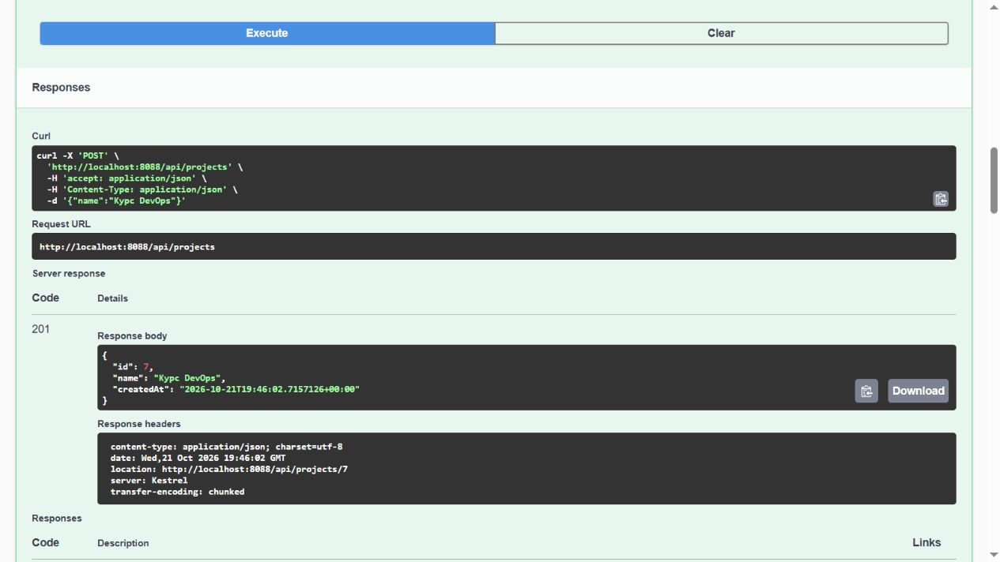
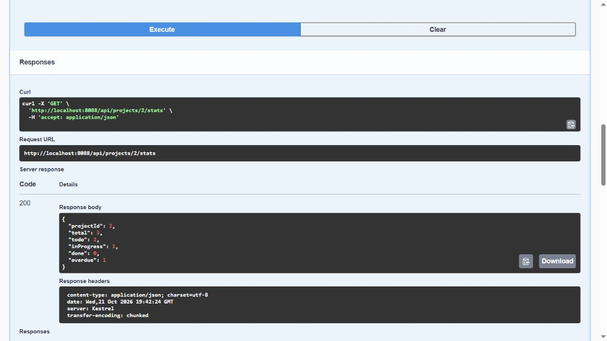

# API, сұрауды талдау және жоба статистикасы

Есімханова Аружан Түсіпханқызы · 25-ИСТК-2о · Д. Серікбаев атындағы ШҚТУ.

## 1.1 — Тапсырмалар сервисінің API интерфейсі

### Мақсаты

DemoApi сервисін іске қосып, HTTP сұрауларын, валидация қателерін және InMemory деректерінің өмірлік циклін тексеру.

### Тапсырмалар сервисінің API интерфейсі

1-апта. 1-бақылау нүктесі. Дайындық және практикалық жұмыстың 1-4-бөлімдері.

| Мәлімет | Мәні |
|---|---|
| Орындаған | Есімханова Аружан Түсіпханқызы |
| Тобы | 25-ИСТК-2о |
| Есеп күні | 22.10.2026 |
| Жоба | DemoApi - жобалар мен тапсырмалар сервисі |
| Деректерді сақтау режимі | InMemory |

[Жобаның ашық репозиторийі](https://github.com/Aruzhaaan-06/devops-labs)

Тексерулердің күні мен уақыты UTC+05:00 уақыт белдеуімен берілген. Тапсырманың орындалу мерзімі мен мерзімінен кешігу шегі UTC бойынша анықталады.

### Жұмыстың мақсаты, ортасы және жоба құрылымы

Мақсаты: DemoApi оқу серверін іске қосу, REST API-ге сұрау жіберу, сәтті жауаптар мен қателерді талдау және процесс жадындағы деректердің сақталу ұзақтығын тексеру.

| Параметр | Әдістемелік нұсқаулықтағы талап / нақты тексеру |
|---|---|
| Платформа | ASP.NET Core / .NET 10, Windows; Kestrel сервері |
| Деректер қоймасы | InMemory; бұл жұмыста PostgreSQL және Docker қажет емес |
| Оқу портының өзгертілуі | Нұсқаулықта 8080 көрсетілген; бұл ортада оны Oracle пайдаланады. DemoApi үшін 8088 порты мен http профилі таңдалды |
| Тексерілген API мекенжайы | http://localhost:8088; бөлек жергілікті тексеру іске қосылымы |
| HTTP клиенттері | PowerShell скрипті және Postman CLI; нұсқаулықта браузер / Swagger да қарастырылған |

### Оқу сервисінің архитектурасы

| Қабат | Қызметі |
|---|---|
| Controllers | Маршруттар, операция нәтижесін тексеру және HTTP кодтары |
| Services | Қолданбалы операциялар және журналға жазу |
| Domain | Project, TaskItem, TaskItemStatus және күй ауысу ережелері |
| Data | Репозиторий интерфейстері және PostgreSQL іске асырылымы |
| Data/InMemory | Процесс жадындағы ортақ тізімдер және сол интерфейстердің іске асырылымдары |

Шешім DemoApi.slnx файлы арқылы ашылады. Program.cs ішінде Storage параметріне сәйкес деректерді сақтау іске асырылымы тіркеледі. Ортақ интерфейстердің арқасында HTTP қабаты деректерді сақтау тәсіліне тәуелді емес.

### Коллекция және сәтті сұраулар

Postman v2.1 пішімінде импорттауға болатын **demo-api** коллекциясы жасалды. Осы кезеңдегі нұсқада baseUrl әдепкіде http://localhost:8088 мәніне тең. Оқу нұсқаулығындағы 8080 портын Oracle пайдаланатындықтан, іске қосу профилінде, коллекцияда және сұрау мысалдарында бірдей 8088 порты көрсетілген. projectId және taskId жауаптардан автоматты түрде алынады, ал жоба атаулары бірегей етіп жасалады.

Коллекцияда 24 сұрау бар: негізгі сценарийде 14, статистика сценарийінде 8 және бөлек қосымша бумада 2 сұрау. Міндетті CLI іске қосылымында алғашқы екі бумадағы 22 сұрау орындалды. Коллекцияның Postman графикалық интерфейсіне импортталғанын және құрылымын көрсету үшін бөлек экран суреті қажет.

| Сұрау | Күтілген | Нақты | Нәтиже |
|---|---|---|---|
| GET /api/projects | 200 | 200 | Бос массив [] |
| POST /api/projects | 201 | 201 | projectId=1; Location сақталған |
| POST /api/tasks | 201 | 201 | taskId=1; status=Todo |
| GET /api/tasks?projectId=1 | 200 | 200 | 1-жобаның бір тапсырмасы |
| PATCH /api/tasks/1/status | 200 | 200 | status=InProgress |
| GET /api/projects/1 | 200 | 200 | id=1; атауы сәйкес келеді |

### Ресурс жасау: 201 және Location

```text
POST /api/projects
Content-Type: application/json
{"name": "lab01-20261021T194046965Z-all-7024bbae-part1"}

HTTP 201 Created
Location: http://localhost:8088/api/projects/1
```

id=1 жобасы жасалды. Серверден алынған Location тақырыбы жаңа ресурстың мекенжайын көрсетеді. Сол сияқты, тапсырмаға жіберілген POST сұрауы 201 кодын және Location http://localhost:8088/api/tasks/1 мәнін қайтарды; бастапқы күйі - Todo.

Кесте мен үзінді 22.10.2026 00:40:46 уақытында сақталған HTTP тексеруіне қатысты. Бұлар - нақты жауаптардың мәтіндік көрінісі, Postman экран суреттері емес.

### Көрсету. Swagger арқылы жоба жасау

Коллекциядан бөлек, Swagger арқылы {"name":"Курс DevOps"} денесімен POST /api/projects сұрауы жіберілді. Сервер 201 кодын, id=7 жобасын және Location http://localhost:8088/api/projects/7 мәнін қайтарды. Бұл объект кейінірек жасалған, сондықтан мәтіндік HTTP тексеруіндегі id=1 жобасынан өзгеше.



[Суретті ашу](../reports/assets/21ebfd37e2b10c0f.png)

1-сурет. Swagger UI: жоба жасау кезіндегі Execute әрекетінің нақты нәтижесі, HTTP 201, JSON және тақырыптар. Бұл - Swagger HTTP клиентінің бөлек көрсетілімі; Postman коллекциясының экран суреті әлі қажет.

### Екінші клиенттің нәтижесі

Суретте Swagger арқылы орындалған сұраудың Request URL мекенжайы, Server response коды және Location тақырыбы көрсетілген.

### API қателері: кодтар, errors және detail

| Тексеру | Код | Жауаптың нақты деректері |
|---|---|---|
| POST /api/projects, name мәні бос | 400 | errors.Name: &quot;The Name field is required.&quot; |
| Жоба атауының қайталануы | 409 | Проект «lab01-20261021T194046965Z-all-7024bbae-part1» уже существует |
| Жаңа Todo тапсырмасын бірден Done күйіне ауыстыру | 409 | Нельзя перевести задачу 2 из Todo в Done |
| GET /api/tasks/2147483647 | 404 | title: &quot;Not Found&quot;; status: 404 |

### JSON-ның дәл үзінділері

```text
{
"status": 400,
"errors": {
"Name": [
"The Name field is required."
]
}
}
```

Жоғарыда 400 жауабының нақты үзіндісі берілген. Жауаптарда type, title және traceId да сақталған; толық денелері HTTP дәлелдерінде орналасқан. Қатені түсіндіру үшін traceId мәнін келтіру міндетті емес.

**errors** сұрау моделінің өрістеріндегі қателерді сипаттайды. **detail** күй қақтығысының себебін түсіндіреді. name валидациясын ASP.NET Core автоматты орындайды, ал 409 жауаптарының мәтінін контроллер береді. Жоқ тапсырманы тексеру үшін int.MaxValue таңдалды: қайта пайдаланылатын стендте ол тұрақты 999 мысалынан сенімдірек.

### 409 кодын тексеру үшін неге жаңа тапсырма қажет?

Негізгі тапсырма Todo күйінен InProgress күйіне ауыстырылған. Тыйым салынған ауысуды тексеру үшін Todo күйіндегі бөлек id=2 тапсырмасы жасалды; Done мәнімен жіберілген PATCH 409 кодын қайтарды. Әйтпесе, InProgress күйінен Done күйіне ауысуға рұқсат етіліп, тексеру шартқа сәйкес келмес еді.

Жоқ тапсырмаға жіберілген сұрау 404 кодын қайтарды. Бұл сұрау пішімінің қатесін немесе сервердің ішкі ақауын емес, ресурстың жоқ екенін білдіреді.

### Жадтағы деректер және қайта іске қосу

Процесс аяқталғанға дейін: HTTP 200, 4 жоба (22.10.2026 00:34:34). Қайта іске қосылғаннан кейін: HTTP 200, жауап денесі [] (22.10.2026 00:40:46). Бұл - процесті қайта іске қосудың нақты тексеруі; Visual Studio ортасында Shift+F5 / F5 пернелерінің басылғанын растамайды.

| Кезең | Сақталған бақылау нәтижесі |
|---|---|
| Тоқтатуға дейін | GET /api/projects: 200; бұрын жасалған төрт жоба |
| Қайта іске қосылғаннан кейін | GET /api/projects: 200; [] |
| Режим | InMemory; тұрақты сақтау орны қосылмаған |

### Жауап: қайта іске қосылғаннан кейін тізім неге бос?

Жобалар мен тапсырмалар жедел жадтағы InMemoryStore тізімдерінде орналасқан. Қойма singleton ретінде тіркелген: ол жұмыс істеп тұрған бір қолданбаның барлық сұрауларына ортақ, бірақ процестен бөлек өмір сүрмейді.

Процесс аяқталғанда оның жады босатылады. Жаңа іске қосылымда тәуелділіктер контейнері бос тізімдері және бастапқы идентификатор санауыштары бар жаңа InMemoryStore жасайды. Бұл режимде файлға немесе дерекқорға жазу орындалмайды. Демек, singleton деректердің сұраулар арасында ортақ болуын қамтамасыз етеді, бірақ іске қосылымдар арасында сақталуын қамтамасыз етпейді.

### Тексеру нәтижелері

| Тексеру | Нақты қорытынды |
|---|---|
| HTTP скрипті, All кезеңі | 23 сұрау; passed=true; нақты жауаптар мен Location сақталған |
| Postman CLI, міндетті бумалар | 22 сұрау, 67 тексеру, 0 қате |
| Postman CLI, толық коллекция | 24 сұрау, 73 тексеру, 0 қате; қосымша бума қамтылған |
| Тестілердің бастапқы жиынтығы | 22 тест орындалды, 22 тест сәтті өтті, 0 қате; InMemory |
| Қайталанып орындалуы | Жоба атаулары бірегей; идентификаторлар API жауаптарынан алынады |

REST API-де жоба мен тапсырма жасау, деректерді оқу және күйді өзгерту операциялары тексерілді. Қате деректер үшін валидация жауабы, ал рұқсат етілмеген күй ауысуы үшін 409 қайтарылды. InMemory қоймасы процесс қайта іске қосылғанда босайтыны анықталды.

### Қосымша. Дереккөздер және тексеруді қайталау

### Материалдар және нұсқалар

Оқу материалдары: «Лаба 1,1.pdf» және «Лаба 1,3.pdf» дәрістері; «Лаба 1,2.pdf» және «Лаба 1,4.pdf» практикалық тапсырмалары.

[Бастапқы код және құжаттама](https://github.com/Aruzhaaan-06/devops-labs)<br>[Міндетті нұсқа: lab01-required-24 тегі, f93b123 коммиті](https://github.com/Aruzhaaan-06/devops-labs/tree/lab01-required-24)

[Репозиторийдегі бастапқы код мұрағаты](https://github.com/Aruzhaaan-06/devops-labs/blob/main/reports/lab01-source.zip)

Есептерге бөлек **lab01-source.zip** мұрағаты қоса беріледі: src және tests бастапқы кодтары, Postman коллекциясы, тексеруді қайталау скрипті және сақталған дәлелдер. Мұрағатқа орнатылған тәуелділіктер мен құрастыру нәтижелері кірмейді.

| Мұрағаттағы / репозиторийдегі дәлел | Мазмұны |
|---|---|
| evidence/lab01/20261021T194046965Z-all-7024bbae/<br>http-evidence.json | API сұраулары мен жауаптары; кодтар, Location тақырыптары, JSON денелері және тексерулер |
| evidence/lab01/postman-required/console.txt | Postman CLI жергілікті іске қосылымы: 22 сұрау, 67 тексеру, 0 қате |
| evidence/lab01/postman-final/console.txt | Postman CLI толық коллекциясы: 24 сұрау, 73 тексеру, 0 қате |
| evidence/lab01/baseline/summary.json | TRX файлынан алынған бастапқы 22 тестінің жиынтық нәтижесі |
| evidence/lab01/required-24/summary.json | TRX файлынан алынған міндетті 24 тестінің жиынтық нәтижесі |
| evidence/lab01/restart/ | Процесс қайта іске қосылғанға дейін төрт жоба; кейін бос тізім |

### Бірінші бөлімнің тексеруін қайталау

```text
pwsh -File scripts/verify-lab01.ps1 -Phase Part1 `
-BaseUrl http://localhost:8088 -KeepData
```

Сервис алдын ала іске қосылуы керек. KeepData жасалған объектілерді қарап шығу үшін сақтайды; бұл параметрсіз скрипт тек өзі жаңадан жасаған жобаларды жояды. Скрипт серверді іске қоспайды және тоқтатпайды. Әр іске қосылым дәлелдер үшін бөлек каталог жасайды.

## Талдау

Сәтті сұраулар 200/201 кодтарын қайтарды. Бос өрістер үшін 400, қайталанатын атау мен тыйым салынған ауысу үшін 409 алынды. Процесс қайта іске қосылғанда деректердің жоғалуы InMemory қоймасының өмірлік цикліне сәйкес келеді.

## Қорытынды

DemoApi іске қосылып, негізгі HTTP операциялары мен қате жауаптары тексерілді. InMemory деректерінің процесс тоқтағанға дейін ғана сақталатыны анықталды.

[PDF есебі](../reports/lab01-part1-report.pdf) · [Бастапқы материалдар](../evidence/lab01/README.md)

## 1.2 — Сұрауды талдау және жоба статистикасы

### Мақсаты

Күй ауысуының шақыру тізбектерін талдап, жоба тапсырмаларының статистикасын іске асыру және міндетті 24 тестімен тексеру.

### Сұрауды талдау және жоба статистикасы

2-апта. Сұрауды өңдеу, жоба статистикасы және тестілеу.

| Мәлімет | Мәні |
|---|---|
| Орындаған | Есімханова Аружан Түсіпханқызы |
| Тобы | 25-ИСТК-2о |
| Есеп күні | 22.10.2026 |
| Жоба | DemoApi - жобалар мен тапсырмалар сервисі |
| Деректерді сақтау режимі | InMemory |

[Жобаның ашық репозиторийі](https://github.com/Aruzhaaan-06/devops-labs)

Тексерулердің күні мен уақыты UTC+05:00 уақыт белдеуімен берілген. Тапсырманың орындалу мерзімі мен мерзімінен кешігу шегі UTC бойынша анықталады.

### Бірінші бөлімді қайта тексеру

Бірінші бөлімдегі HTTP сценарийлері қайта тексерілді. demo-api коллекциясының baseUrl мәні http://localhost:8088 мекенжайына бағытталған. 8080 портын Oracle пайдаланатындықтан, DemoApi үшін 8088 порты таңдалды.

| Сәтті сценарий | Күтілген және нақты жауап |
|---|---|
| GET /api/projects | 200; бастапқы тізім [] |
| POST /api/projects | 201; id=1; Location /api/projects/1 |
| POST /api/tasks | 201; id=1; projectId=1; status=Todo; Location /api/tasks/1 |
| GET /api/tasks?projectId=1 | 200; жасалған бір тапсырма |
| PATCH /api/tasks/1/status | 200; Todo -&gt; InProgress |
| GET /api/projects/1 | 200; жасалған жоба |

| Тексеру | Код | Жауаптың нақты деректері |
|---|---|---|
| POST /api/projects, name мәні бос | 400 | errors.Name: &quot;The Name field is required.&quot; |
| Жоба атауының қайталануы | 409 | Проект «lab01-20261021T194046965Z-all-7024bbae-part1» уже существует |
| Жаңа Todo тапсырмасын бірден Done күйіне ауыстыру | 409 | Нельзя перевести задачу 2 из Todo в Done |
| GET /api/tasks/2147483647 | 404 | title: &quot;Not Found&quot;; status: 404 |

**errors** сұрау моделінің өрістеріндегі қателерді сипаттайды. **detail** күй қақтығысының себебін түсіндіреді. name валидациясын ASP.NET Core автоматты орындайды, ал 409 жауаптарының мәтінін контроллер береді. Жоқ тапсырманы тексеру үшін int.MaxValue таңдалды: қайта пайдаланылатын стендте ол тұрақты 999 мысалынан сенімдірек.

### Жадтағы деректер

Процесс аяқталғанға дейін: HTTP 200, 4 жоба (22.10.2026 00:34:34). Қайта іске қосылғаннан кейін: HTTP 200, жауап денесі [] (22.10.2026 00:40:46). Бұл - процесті қайта іске қосудың нақты тексеруі; Visual Studio ортасында Shift+F5 / F5 пернелерінің басылғанын растамайды.

InMemoryStore бір процестің сұрауларына ортақ. Процесс аяқталғанда тізімдер жойылады, ал жаңа іске қосылым бос қойма жасайды; InMemory режимінде файлға немесе дерекқорға сақтау орындалмайды.

### Сұрауды өңдеудің екі шақыру тізбегі

Төмендегі шақыру тізбектері бастапқы код бойынша талданып, нақты HTTP жауаптарымен салыстырылды.

### Тыйым салынған Todo -> Done ауысуы

```text
TasksController.ChangeStatus
-> TaskService.GetAsync
-> InMemoryTaskRepository.GetAsync
-> табылған Todo тапсырмасын қайтару
-> StatusRules.CanTransition(Todo, Done): false
-> return Problem(..., statusCode: 409)
```

409 коды TasksController.ChangeStatus әдісіндегі !StatusRules.CanTransition(task.Status, status) тармағында таңдалады. {"status":"Done"} денесімен жіберілген нақты PATCH /api/tasks/2/status сұрауы 409 кодын қайтарды; detail: «Нельзя перевести задачу 2 из Todo в Done».

Бұл тармақта TaskService.ChangeStatusAsync және InMemoryTaskRepository.SetStatusAsync шақырылмайды. Бастапқы кодқа сәйкес, күй Todo болып қалады. 409 кодының қайтарылуы тыйым салынған ауысуға арналған интеграциялық тестімен де тексеріледі.

### Рұқсат етілген Todo -> InProgress ауысуы

```text
TasksController.ChangeStatus
-> TaskService.GetAsync
-> InMemoryTaskRepository.GetAsync
-> StatusRules.CanTransition(Todo, InProgress): true
-> TaskService.ChangeStatusAsync
-> InMemoryTaskRepository.SetStatusAsync
-> InMemoryTaskRepository.Replace
-> return updated: HTTP 200
```

Replace lock(store.Sync) ішінде жазбаны Status және UpdatedAt мәндері жаңартылған көшірмемен алмастырады. Қайтарылған тапсырма сервис арқылы контроллерге беріледі; return updated 200 жауабын қалыптастырады. Жаңарту null қайтарса, алдыңғы тармақ 404 қайтарады. 1-тапсырмаға InProgress мәнімен жіберілген нақты PATCH 200 кодын және status=InProgress мәнін қайтарды.

Қолмен тексеру үшін бір жаңа Todo тапсырмасын жасап, алдымен Done, содан кейін InProgress жіберу және екі сұрау үшін де Locals пен Call Stack көріністерін сақтау керек. Сақталған ортақ HTTP тексеруі бұл ауысуларды екі бөлек тапсырмада тексерген, сондықтан бір тапсырманы жөндегіште тексеру талабын алмастырмайды.

### Код бойынша алты сұраққа жауап

### api/tasks/{id}/status маршруты қайда берілген?

Controllers/TasksController.cs файлында: [Route("api/tasks")] класс префиксін береді, ал ChangeStatus үстіндегі [HttpPatch("{id:int}/status")] идентификаторды, /status бөлігін және PATCH әдісін қосады. :int шектеуі бүтін сан түріндегі id мәніне рұқсат береді.

### title бос болғанда 400 кодын кім қайтарады?

[ApiController] қолданылған ASP.NET Core әрекет әдісі шақырылғанға дейін модельді тексереді. CreateTaskRequest.Title және UpdateTaskRequest.Title өрістерінде [Required, StringLength(200)] атрибуттары бар. Бос атау errors өрісінде қателер тізімі бар 400 жауабына әкеледі.

### Күй ауысу ережесі қайда және оны HTTP-сіз қалай тексеруге болады?

Domain/StatusRules.cs файлында: Allowed сөздігі және CanTransition әдісі. Todo &lt;-> InProgress &lt;-> Done көршілес ауысуларына және ағымдағы күйді сақтауға рұқсат етіледі; тікелей Todo &lt;-> Done ауысуына тыйым салынған. Unit/StatusRulesTests.cs ережені HTTP мен дерекқорсыз, жеті деректер жиынтығымен тікелей шақырады.

### 404 коды қайда таңдалады және 409 жауабының detail мәні қайдан алынады?

HTTP кодын контроллер анықтайды: оқу немесе жаңарту нәтижесіндегі null NotFound() жауабына әкеледі. Күй қақтығысында TasksController.ChangeStatus түсіндірмені Problem(..., 409) арқылы береді; жоба атауы қайталанғанда мұны ProjectsController.Create орындайды. detail аргументі JSON-ның аттас өрісіне айналады.

### Деректер қоймасы қайда таңдалады және қайсысы қолданылады?

Program.cs ішінде builder.Configuration["Storage"] мәні Postgres мәнімен салыстырылады. Сәйкес келсе SQL репозиторийлері, әйтпесе InMemoryStore және InMemory іске асырылымдары тіркеледі. Бұл іске қосылымда InMemory қолданылды; оның жұмысы API жауаптарымен және қайта іске қосқаннан кейін деректердің тазаруымен расталған. Орта айнымалылары JSON баптауларын қайта анықтай алады.

### PostgreSQL қолданылғанда TaskService неге өзгермейді?

TaskService ITaskRepository және IProjectRepository интерфейстерін қабылдайды. Екі сақтау тәсілі де бірдей интерфейстерді іске асырады; баптау өзгергенде тәуелділіктер контейнері басқа класты береді. Сервис сол әдістерді шақыруды жалғастырады және оның ішінде SQL жоқ.

### Өзін-өзі тексеру. Дәрістің алты сұрағы

Бұл сұрақтар «Лаба 1,3.pdf» дәрісіне қатысты және алдыңғы бөлімдегі алты практикалық сұрақты толықтырады.

### Frontend, backend және сервис клиенттері

Frontend пайдаланушыға интерфейсті көрсетеді, ал backend логиканы орындайды және деректермен жұмыс істейді. DemoApi жеке пайдаланушы беттерінсіз JSON API ұсынады. Оған веб-сайт, мобильді қолданба, басқа сервистер, Postman, Swagger және командалық жол клиенттері сұрау жібере алады.

### PUT пен PATCH айырмашылығы қандай және жасау операциясы неге 201 қайтарады?

PUT ресурстың өңделетін өрістерін толық алмастырады: тапсырма үшін бұлар - атауы, сипаттамасы және мерзімі. PATCH жеке бөлігін, мысалы күйін өзгертеді. 201 Created жауабы жаңа ресурстың жасалғанын білдіреді, оның мекенжайы Location арқылы беріледі; 200 коды ресурстың жасалғанын арнайы білдірмейді.

### POST неге TaskItem емес, CreateTaskRequest қабылдайды?

Сұрау моделі тек рұқсат етілген projectId, title, description және dueDate өрістерін қамтиды. Идентификаторды, бастапқы Todo күйін және жасалу / жаңартылу уақытын сервер тағайындайды. TaskItem толық қабылданса, клиент бұл мәндерді өзгертіп, ережелерді айналып өтуге әрекеттене алар еді.

### PATCH /status сұрауында status берілмесе не болады?

ChangeStatusRequest.Status nullable түріне және [Required] атрибутына ие. Жоқ мән әдепкі Todo күйіне айналмайды: [ApiController] контроллер әрекеті орындалғанға дейін модель қатесі бар 400 жауабын автоматты қайтарады.

### TaskService кодын өзгертпей деректер қоймасы қалай таңдалады?

Program.cs Storage мәнін оқып, DI контейнерінде ITaskRepository және IProjectRepository интерфейстерінің InMemory немесе SQL іске асырылымдарын тіркейді. TaskService интерфейстерді шақыратындықтан, конфигурацияны ауыстыру оның кодын өзгертуді қажет етпейді.

### UseHttpMetrics неге UseExceptionHandler алдында орналасқан?

Метрикалар middleware-і қателер өңдегішін сыртынан қамтып, жауаптың соңғы HTTP кодын көреді. Өңдегіш ерекшелікті 500 жауабына айналдырса, қолданбаның HTTP метрикаларына дәл сол код тіркеледі.

### Жоба статистикасын іске асыру

**GET /api/projects/{id}/stats** операциясы қосылды. Ол көрсетілген жоба тапсырмаларының санын күйлері мен мерзімдеріне қарай қайтарады. Санауға дейін контроллер жобаның бар-жоғын тексереді: белгісіз id үшін 404, ал бар, бірақ бос жоба үшін санауыштары нөлге тең 200 жауабы беріледі.

| Компонент | Өзгеріс |
|---|---|
| Domain/Project.cs | ProjectStats: ProjectId, Total, Todo, InProgress, Done, Overdue; өрістердің XML сипаттамалары |
| Data/ProjectRepository.cs | Интерфейстегі және SQL іске асырылымындағы GetStatsAsync; параметрленген COUNT FILTER |
| Data/InMemory/InMemoryProjectRepository.cs | lock(store.Sync) ішінде тек өз жобасын қамтитын LINQ есептеулері |
| Services/ProjectService.cs | GetStatsAsync шақыруды репозиторийге береді |
| Controllers/ProjectsController.cs | /{id:int}/stats маршруты; жобаның бар-жоғы; 200/404; XML құжаттамасы |
| DemoApi.http және ProjectsApiTests.cs | HTTP сұрау мысалы және екі жаңа интеграциялық тест |

### Мерзімінен кешігу ережесі және уақыт белдеуі

```text
dueDate < DateOnly.FromDateTime(DateTime.UtcNow)
&& status != TaskItemStatus.Done
```

Бүгінгі күн мерзімінен кешіккен болып саналмайды; мерзімнің көрсетілмеуі және аяқталған тапсырма overdue санын арттырмайды. Екі іске асырылымда да күн шегі UTC бойынша алынады. SQL-де сессия баптауына тәуелді current_date орнына UTC күні параметр ретінде беріледі. Осылайша, InMemory және PostgreSQL үшін нәтиженің мағынасы бірдей сақталады.

SQL-де projectId және күн сұрау мәтініне біріктірілмей, параметрлер арқылы беріледі. COUNT bigint қайтарады; оқу GetInt64 арқылы, int түріне checked түрлендіруімен орындалады. Жаңа тәуелділіктер мен архитектуралық қабаттар қосылған жоқ.

### Статистиканың нақты жауабы

Бөлек id=2 жобасы үшін үш тапсырма жасалды: мерзімсіз Todo, InProgress және UTC бойынша алдыңғы күннен бір күн бұрынғы мерзімі бар Todo. Соңғысының мерзімі әдеттегі жасау операциясынан кейін PUT арқылы қойылды. Осылайша, overdue көрсетілімі тек POST кезінде өткен күнге тыйым салатын қосымша ережемен үйлеседі.

| Тапсырма | Күйі | Мерзімі / overdue санына қосатын үлесі |
|---|---|---|
| Todo without a due date | Todo | null / 0 |
| Task in progress | InProgress | null / 0 |
| Overdue Todo task | Todo | 2026-10-19 / 1; сұраудың UTC күні 2026-10-21 |

### Серверден алынған мән

```text
GET /api/projects/2/stats
HTTP 200 OK
{
"projectId": 2,
"total": 3,
"todo": 2,
"inProgress": 1,
"done": 0,
"overdue": 1
}
```

| Өріс | Мағынасы | Күтілген | Нақты |
|---|---|---|---|
| projectId | Жоба идентификаторы | 2 | 2 |
| total | Жобаның барлық тапсырмасы | 3 | 3 |
| todo | Todo тапсырмалары | 2 | 2 |
| inProgress | InProgress тапсырмалары | 1 | 1 |
| done | Аяқталған тапсырмалар | 0 | 0 |
| overdue | Мерзімінен кешіккен аяқталмаған тапсырмалар | 1 | 1 |

Алты мәннің барлығы сәйкес келді. GET /api/projects/2147483647/stats 404 кодын қайтарды. HTTP тексеруінің уақыты: 22.10.2026 00:40:46 (UTC+05:00). Толық сұраулар, жауаптар және тексерулер қоса берілген дәлелдерде сақталған.

### Көрсету. Swagger-дегі нақты сұрау

Браузердегі Swagger арқылы GET /api/projects/2/stats орындалды: алдымен Try it out, содан кейін Execute таңдалды. Нақты суретте Request URL, Server response 200 және 3 / 2 / 1 / 0 / 1 мәндері бар JSON көрінеді.



[Суретті ашу](../reports/assets/3ab7056a7c102015.png)

1-сурет. Swagger UI: 2-жобаның статистика сұрауына сервердің нақты жауабы. Date тақырыбы: 21.10.2026 19:42:24 GMT, яғни 22.10.2026 00:42:24 UTC+05:00.

Суретте localhost:8088 мекенжайындағы GET /api/projects/2/stats сұрауы, HTTP 200 жауабы және 3 / 2 / 1 / 0 / 1 статистикасы көрсетілген.

### API құжаттамасы

Статистика операциясы контроллер маршруты және XML түсіндірмелері арқылы OpenAPI/Swagger құжаттамасына енгізілген. ProjectStats өрістері бастапқы кодта құжатталған. Swagger және /openapi/v1.json Development ортасында қосылады; бұл - сервистің жеке frontend бөлігі емес, техникалық HTTP клиенті.

### Тестілер және қайталанатын тексерулер

Тестілеу dotnet test арқылы орындалды. Интеграциялық тесттер WebApplicationFactory көмегімен InMemory қоймасы бар қолданбаның HTTP өңдеу тізбегін тексереді. Нәтижелер TRX файлдарына сақталды.

| Кезең | Барлығы / сәтті / қате | UTC+05:00 бойынша уақыт |
|---|---|---|
| Бастапқы шешім | 22 / 22 / 0 | 22.10.2026 00:15:12 |
| Міндетті статистика | 24 / 24 / 0 | 22.10.2026 00:37:54 |
| Postman CLI: міндетті бумалар | 22 сұрау; 67 тексеру; 0 қате | 22.10.2026, бөлек сақталған іске қосылым |
| Postman CLI: толық коллекция | 24 сұрау; 73 тексеру; 0 қате | 22.10.2026, бөлек сақталған іске қосылым |
| HTTP скрипті: All | 23 сұрау; passed=true | 22.10.2026 00:40:46 |

### Екі жаңа міндетті тест

```text
ProjectsApiTests.Stats_ReturnsProjectCountsAndOverdueTasks
ProjectsApiTests.Stats_UnknownProject_ReturnsNotFound
```

Сәтті сценарий тестісі санауыштар мен мерзімінен кешігуді, сондай-ақ бос жобаны, бүгінгі мерзімді, мерзімнің жоқтығын, басқа жоба тапсырмаларының оқшаулануын және аяқталған кешіккен тапсырманың есепке алынбауын тексереді. Екінші тест белгісіз жоба үшін 404 кодын тексереді.

Міндетті 24 жағдай күй ережелерінің юнит-тестісіндегі 7 нұсқадан және 17 интеграциялық тексеруден тұрады. Бұрыннан бар TasksApiTests.ChangeStatus_TodoToDone_ReturnsConflict тікелей Todo -> Done ауысуына тыйымды тексереді.

### Міндетті нәтиженің нұсқасы

[lab01-required-24 тегі / f93b123 коммиті](https://github.com/Aruzhaaan-06/devops-labs/tree/lab01-required-24) қосымша ережеге дейінгі міндетті 24 тесті бар күйді бекітеді. Бастапқы код мұрағаты бұл нәтижені кеңейтілген нұсқадан бөлек тексеруге мүмкіндік береді.

### Мерзімге қатысты қосымша ереже

Қосымша тапсырма нұсқаулықта жұлдызшамен белгіленген: тапсырманы жасағанда өткен күн көрсетілсе, 400 қайтарылуы керек. Кеңейтілген жиынтық сақталған міндетті 24 тестінің нәтижесінен бөлек тексерілді.

Ереже TasksController.Create ішінде анық іске асырылған. DueDate ағымдағы UTC күнінен ерте болса, контроллер ModelState ішіне DueDate қатесін қосып, тапсырманы жасамай ValidationProblem(ModelState) қайтарады. Уақытқа тәуелді бір шартты осылай жергілікті тексеру жаңа атрибутты қажет етпейді және рұқсат етілген PUT әрекетін өзгертпейді.

| Тексеру | Күтілетін жұмыс тәртібі |
|---|---|
| POST сұрауындағы өткен күн | 400; жаңа тапсырма жасалмайды |
| Мерзімі бүгін | Рұқсат етіледі |
| Болашақ күн | Рұқсат етіледі |
| Мерзім көрсетілмеген | Рұқсат етіледі |

### Кеңейтілген тексерудің нақты нәтижесі

```text
Барлығы: 28
Сәтті орындалғаны: 28
Қателер: 0
Режимі: InMemory
```

Сақталған жиынтық бойынша аяқталу уақыты: 22.10.2026 00:39:59 (UTC+05:00). Бұл - бөлек нәтиже; ол бұрын бекітілген міндетті 24 тестінің нәтижесін алмастырмайды.

Қорытынды HTTP тексеруінде dueDate=2026-10-19 мәнімен жіберілген POST 400 қайтарды. Нақты errors.DueDate: «Срок новой задачи не может быть в прошлом (дата UTC).». Қабылдамау тестісі жазбаның жасалмағанын да тексереді; қосымша үш жағдай null, бүгін және ертең мәндерінің жарамдылығын тексереді.

### Мерзімінен кешіккен тапсырмалар статистикасы неге қажет?

Жасалу кезінде күні жарамды болған тапсырманың өзі уақыт өте келе мерзімінен кешігуі мүмкін. Қайталанатын тест үшін бар тапсырманың мерзімі PUT арқылы өткен күнге ауыстырылады. Сондықтан POST валидациясы мен overdue санау ережесі әртүрлі міндет атқарады және бір-біріне кедергі жасамауы керек.

### Қорытынды

Жоба статистикасы іске асырылды: тапсырмалар күйлері және мерзімінен кешіккен аяқталмаған тапсырмалар саналады. InMemory жұмысы HTTP тексерулерімен және міндетті 24 тестімен расталған; коллекция, сұрау нәтижелері және бастапқы код сақталған. SQL іске асырылымы жобаға енгізілген, бірақ оны PostgreSQL-де орындау кейінгі тексеруге жатады.

Зертханалық жұмыстың толық тапсырылғаны әзірге мәлімделмейді: Postman коллекциясының нақты экран суреті, жөндегіште екі сұрауды қолмен қадамдап орындау және Test Explorer-де міндетті 24 тестінің экран суреті қажет. Бұл әрекеттер орындалғаннан кейін нақты интерфейс дәлелдерін есепке қосу керек.

### Қосымша. Бастапқы код және тексеруді қайталау

### Материалдар және нұсқалар

Оқу материалдары: «Лаба 1,1.pdf» және «Лаба 1,3.pdf» дәрістері; «Лаба 1,2.pdf» және «Лаба 1,4.pdf» практикалық тапсырмалары.

[Бастапқы код және құжаттама](https://github.com/Aruzhaaan-06/devops-labs)<br>[Міндетті нұсқа: lab01-required-24 тегі, f93b123 коммиті](https://github.com/Aruzhaaan-06/devops-labs/tree/lab01-required-24)

[Репозиторийдегі бастапқы код мұрағаты](https://github.com/Aruzhaaan-06/devops-labs/blob/main/reports/lab01-source.zip)

Есептерге бөлек **lab01-source.zip** мұрағаты қоса беріледі: src және tests бастапқы кодтары, Postman коллекциясы, тексеруді қайталау скрипті және сақталған дәлелдер. Мұрағатқа орнатылған тәуелділіктер мен құрастыру нәтижелері кірмейді.

| Мұрағаттағы / репозиторийдегі дәлел | Мазмұны |
|---|---|
| evidence/lab01/20261021T194046965Z-all-7024bbae/<br>http-evidence.json | API сұраулары мен жауаптары; кодтар, Location тақырыптары, JSON денелері және тексерулер |
| evidence/lab01/postman-required/console.txt | Postman CLI жергілікті іске қосылымы: 22 сұрау, 67 тексеру, 0 қате |
| evidence/lab01/postman-final/console.txt | Postman CLI толық коллекциясы: 24 сұрау, 73 тексеру, 0 қате |
| evidence/lab01/baseline/summary.json | TRX файлынан алынған бастапқы 22 тестінің жиынтық нәтижесі |
| evidence/lab01/required-24/summary.json | TRX файлынан алынған міндетті 24 тестінің жиынтық нәтижесі |
| evidence/lab01/restart/ | Процесс қайта іске қосылғанға дейін төрт жоба; кейін бос тізім |

### Міндетті тексеруді қайталау

```text
git checkout lab01-required-24
dotnet test DemoApi.slnx

# Сервис алдын ала іске қосылған жағдайда:
pwsh -File scripts/verify-lab01.ps1 -Phase Part2 `
-BaseUrl http://localhost:8088 -KeepData
```

Postman-да /stats іске асырылғаннан кейін «Часть 2 - статистика проекта» бумасы іске қосылады. Қосымша бума тиісті ереже қосылғаннан кейін ғана бөлек орындалады. Компьютердің жергілікті жолдары мен тіркелгі деректері есепке енгізілмейді.

## Талдау

Todo → Done сұрауы контроллердегі ережемен тоқтатылып, қоймаға жаңарту жіберілмейді. Todo → InProgress ауысуында сервис пен репозиторий орындалады. Статистика тек таңдалған жобаның тапсырмаларын есептейді; мерзім шекарасы UTC күнімен анықталады.

## Қорытынды

Жоба статистикасы іске асырылып, шақыру тізбектері талданды. Міндетті 24 тест және қосымша ережелермен 28 тест сәтті өтті.

[PDF есебі](../reports/lab01-part2-report.pdf) · [Бастапқы материалдар](../evidence/lab01/README.md)

## Қайта орындау командалары

Командалар тиісті жұмыс нұсқасына арналған. Ақау сценарийлері жеке оқу стендінде орындалады. Бар `.env` файлын сақтап, негізгі дерекқорды тестке қолданбау керек.

```text
TasksController.ChangeStatus
  → TaskService.GetAsync
  → InMemoryTaskRepository.GetAsync
  → возврат найденной Todo-задачи в контроллер
  → StatusRules.CanTransition(Todo, Done): false
  → return Problem(..., statusCode: StatusCodes.Status409Conflict)
```

```text
TasksController.ChangeStatus
  → TaskService.GetAsync
  → InMemoryTaskRepository.GetAsync
  → StatusRules.CanTransition(Todo, InProgress): true
  → TaskService.ChangeStatusAsync
  → InMemoryTaskRepository.SetStatusAsync
  → InMemoryTaskRepository.Replace
  → возврат обновлённой задачи в сервис, затем контроллер
  → return updated: HTTP 200
```

```json
{"projectId":1,"total":3,"todo":2,"inProgress":1,"done":0,"overdue":1}
```

<a id="лабораторная-1-api-отладка-и-статистика-проекта"></a>
<a id="часть-1-запросы-и-ошибки"></a>
<a id="часть-2-две-цепочки-вызовов"></a>
<a id="todo--done-409"></a>
<a id="todo--inprogress-200"></a>
<a id="шесть-ответов-по-коду"></a>
<a id="шесть-вопросов-для-самопроверки-из-лекции-1-часть2"></a>
<a id="статистика-проекта"></a>
<a id="что-проверено"></a>
<a id="что-приложить-к-двум-отчётам"></a>
<a id="дополнительное-правило-и-оставшаяся-проверка"></a>
