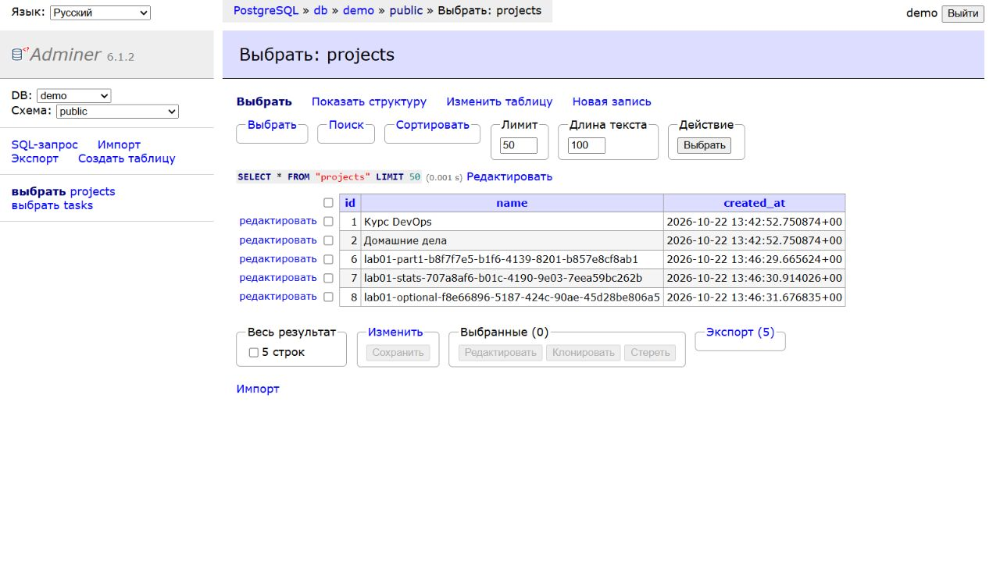
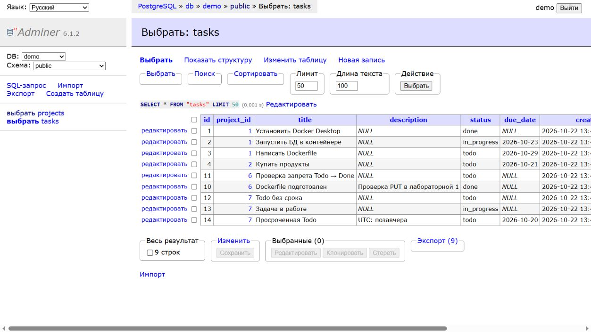

# Docker Compose және деректердің өмірлік циклі

Есімханова Аружан Түсіпханқызы · 25-ИСТК-2о · Д. Серікбаев атындағы ШҚТУ.

## 3.3 — Docker Compose және деректердің өмірлік циклі

### Мақсаты

API, PostgreSQL және Adminer ортасын Compose арқылы сипаттап, сақтау, тәуелділік және дайындық сценарийлерін тексеру.

DEVOPS · 6-АПТА · 06-МАТЕРИАЛ

### 3-бөлім: 6-11-тармақтар және Adminer қосымша тапсырмасы.

**Орындаған:** Есімханова Аружан Түсіпханқызы<br>**Тобы:** 25-ИСТК-2о<br>**Күні:** 2026 жылғы 22 қазан

### Мақсаты және орындалған тексерулер

Сервис пен PostgreSQL-ді бір Compose файлы арқылы сипаттау, деректердің өмірлік циклін, дерекқор істен шыққанда live/ready айырмашылығын, әзірлеу режимін және Adminer арқылы кестелерді қарауды тексеру.

| Тармақ | Нақты нәтиже |
|---|---|
| Compose up --build --wait | API және дерекқор healthy; Docker Compose 5.5.1 |
| Деректердің сақталуы: үш сан | 3 → 3 → 2; Compose-тың бөлек оқу томы |
| Дерекқор тоқтатылған | live 200; ready 503; /api/tasks 500; API healthy |
| Дерекқорды қайта іске қосу | API қайта іске қосылмай-ақ сұраулар қайтадан 200 қайтарады |
| API тексерулері | 24/24 міндетті, 28/28 толық тест; Postman-да 73 тексеру |
| Қосымша тапсырма | Adminer 6.1.2: db серверіне кіру, projects және tasks кестелерін қарау |
| Құпия деректер | Git .env файлын елемейді; config құпиясөзі алынып тасталып жарияланған |

Compose конфигурациясы бойынша 14 техникалық тексеру өтті. API, PostgreSQL және Adminer іске қосылып, деректердің сақталуы мен дайындық тексерулері салыстырылды.

[GitHub-тағы жұмыс нұсқасы](https://github.com/Aruzhaaan-06/devops-labs/tree/lab03-compose)

### Compose: API сервисі

1-листингтің 1-бөлігі (барлығы 2 бөлік). Файл репозиторий түбірінде орналасқан. Бекітілген devops-labs атауы ресурстар атауларын бумаға тәуелсіз етеді және оқу ортасын басқа жобалардан ажыратады.

```text
name: devops-labs

services:
  api:
    image: ${API_IMAGE:-devops-labs-demo-api}:${API_TAG:-local}
    build:
      context: .
      args:
        APP_VERSION: ${API_TAG:-local}
    ports:
      - "127.0.0.1:${API_PORT:-8088}:8080"
    environment:
      Storage: Postgres
      ConnectionStrings__Db: "Host=db;Database=demo;Username=demo;Password=${DB_PASSWORD:?Set
DB_PASSWORD in .env}"
      Chaos__Enabled: "true"
    depends_on:
      db:
        condition: service_healthy
    restart: unless-stopped
    memswap_limit: 256M
    deploy:
      resources:
        limits:
          cpus: "1.0"
          memory: 256M
    logging:
      driver: json-file
      options:
        max-size: "10m"
        max-file: "3"
```

### Күту, ресурстар және журналдар

API PostgreSQL healthcheck тексеруі сәтті өткеннен кейін іске қосылады. Шектеулердің қолданылғаны тексерілді: NanoCpus=1 000 000 000, Memory=268 435 456 және MemorySwap=268 435 456 байт. Memory мен MemorySwap тең болуы қосымша swap жоқ екенін білдіреді. Қайта іске қосу саясаты - unless-stopped, json-file журналдары 10m × 3 шегімен сақталады.

Нұсқаулыққа сәйкес, кейінгі оқу ақаулары үшін Chaos__Enabled=true қосылған. API порты тек localhost-та жарияланған. Құпиясөз DB_PASSWORD арқылы міндетті түрде беріледі; compose.yaml ішіне үлгі құпиясөз жазылмайды.

### Compose: дерекқор, Adminer, том және желі

1-листингтің 2-бөлігі (барлығы 2 бөлік). Adminer tools профилімен қосылады; әдеттегі іске қосу API мен дерекқорды көтереді.

```text
  db:
    image: postgres:18-alpine
    environment:
      POSTGRES_DB: demo
      POSTGRES_USER: demo
      POSTGRES_PASSWORD: ${DB_PASSWORD:?Set DB_PASSWORD in .env}
    ports:
      - "127.0.0.1:${DB_PORT:-15432}:5432"
    volumes:
      - pgdata:/var/lib/postgresql
      - ./db:/docker-entrypoint-initdb.d:ro
    healthcheck:
      test: ["CMD-SHELL", "pg_isready -h 127.0.0.1 -U demo -d demo"]
      interval: 5s
      timeout: 3s
      retries: 10
    restart: unless-stopped

  adminer:
    image: adminer:latest
    profiles: [tools]
    ports:
      - "127.0.0.1:${ADMINER_PORT:-8083}:8080"
    environment:
      ADMINER_DEFAULT_SERVER: db
    depends_on:
      db:
        condition: service_healthy
    restart: unless-stopped

volumes:
  pgdata:

networks:
  default:
    ipam:
      config:
        - subnet: ${COMPOSE_SUBNET:-10.254.54.0/24}
```

### Осы ортаның параметрлері

Бос емес 8080 орнына 8088 қолданылады; PostgreSQL 15432 портында жарияланған. Контейнерлер db атауы арқылы ішкі 5432 портында байланысады. Docker-дің стандартты пулы таусылғандықтан, бос ішкі желі анық көрсетілді. Алдыңғы жұмыстың атаулы томы бөлек сақталған; тәжірибеде devops-labs_pgdata пайдаланылады.

### Деректердің сақталуы: үш сан

Жаңа томда seed.sql екі жоба жасады. API арқылы Compose жобасы қосылды. Содан кейін 9-тармақтың екі команда тізбегі орындалды:

```text
POST /api/projects  {"name":"Compose"}
docker compose down
docker compose up -d --wait
docker compose down -v
docker compose up -d --wait
```

| Өлшеу сәті | Саны және түсіндірмесі |
|---|---|
| down алдында | 3: екі оқу жобасы және жасалған Compose жобасы |
| down және up кейін | 3: контейнерлер мен желі қайта жасалды, атаулы том сақталды |
| down -v және up кейін | 2: ескі оқу томы жойылып, жаңасы seed.sql арқылы бапталды; Compose жобасы енді жоқ |

### Тазартудан кейін неге нөл емес?

PGDATA бос болса, PostgreSQL entrypoint бағдарламасы db/seed.sql скриптін қайта орындайды. Скрипт «Курс DevOps» және «Домашние дела» жобаларын, сондай-ақ төрт тапсырма жасайды. Сондықтан толық тазартудан кейін дәл екі оқу жобасы қайтарылады.

### Резервтік көшірме тексерілді

down -v алдында pg_dump -Fc орындалды. Мұрағат репозиторийден тыс жерге көшіріліп, бөлек demo_restore дерекқорына қалпына келтірілді: Compose-ты қоса, барлық үш жоба табылды. Тазарту алдында негізгі оқу томында бөгде жобалар мен тапсырмалар жоқтығы да тексерілді. 05-материалдың томы жойылған жоқ.

```text
pg_dump -U demo -d demo -Fc -f /tmp/lab06-before-reset.dump
pg_restore -U demo -d demo_restore --no-owner /tmp/lab06-before-reset.dump
```

### Қолмен бапталған ортаны талдау, 6-тармақ

05-материалдағы орналастыруды ғана қайталау үшін 7 команда және параметрлердің 21 қолданысы қажет: том, дерекқор, дайындық тексеруі, API құрастыру, желі, дерекқорды желіге қосу және API іске қосу. Күту қайталаулары, оқу қателері мен тестілер бұл санға кірмейді. Compose сипаттаманы бір файлға, іске қосуды бір командаға біріктіреді.

### Желі, дерекқорды тоқтату және дайындық

db атауы API контейнерінен getent hosts db командасы арқылы анықталды. Кейін docker compose stop db және нақты HTTP сұраулары орындалды:

| Маршрут | Дерекқор тоқтатылғандағы жауап |
|---|---|
| /health/live | 200 · процесс жұмыс істеп тұр |
| /health/ready | 503 · дерекқор қолжетімсіз |
| /api/tasks | 500 · SQL сұрауы орындалмады |

### API неге әлі healthy күйінде?

Dockerfile /health/live маршрутын тексереді: қолданба процесі жауап беруді жалғастырады. /health/ready дайындық тексеруі PostgreSQL-ді бөлек қамтып, 503 қайтарады. Тапсырмалар сұрауы дерекқорға шынымен жүгінетіндіктен, 500 қайтарылады. healthy күйі тәуелді сервистің қолжетімді екенін білдірмейді.

### docker compose start db кейін не болды?

Дайындық және тапсырмалар сұрауы қайтадан 200 қайтара бастады. API іске қосылған уақыт пен қайта іске қосу санауышы өзгерген жоқ. depends_on тәуелділікті үздіксіз бақыламайды, тек up кезіндегі іске қосу ретін анықтайды. Дерекқор қалпына келгеннен кейін Npgsql сұрауларды қайта орындай алды.

### Құпия деректер және .gitignore

Select-String командасымен .gitignore ішіндегі .env ережесі тексерілді. Нәтиже төменде берілген:

```text
.gitignore:7:.env
```

Құпиясөз тек жергілікті .env ішінде сақталады. Git-ке бос .env.example қосылған. Нәтижелік конфигурация docker compose config арқылы тексерілді; жариялау үшін құпиясөз бен абсолютті жолдар алынып тасталды. Өңделмеген config жарияланбауы керек: онда айнымалылардың нақты қойылған мәндері бар.

DB_PASSWORD жоқ болса, Compose сервистерді іске қоспай тоқтайды. Осылайша, нұсқаулықтағы қосалқы demo мәнінің орнына жергілікті құпиясөзді міндетті беру талабы қойылған.

### Әзірлеу және тестілеу

Compose API контейнері тоқтатылып, дерекқор контейнерде қалдырылды. Windows-тағы dotnet процесі сол 8088 портын пайдаланып, PostgreSQL-ге localhost:15432 арқылы қосылды. Жобалар мен тапсырмалар сұраулары 200 қайтарды. Тестілерден кейін Windows процесі аяқталып, толық Compose ортасы healthy күйіне қайтарылды.

| Тексеру | Нақты нәтиже |
|---|---|
| Міндетті іріктеме | PostgreSQL-де 24/24: 7 юнит + 17 интеграциялық тест |
| Толық жиынтық | PostgreSQL-де 28/28: 7 юнит + 21 интеграциялық тест |
| HTTP сценарийлері | 26 сәтті сұрау, оның ішінде үш тестілік жобаны тазарту |
| Postman CLI | 24 сұрау, 73 тексеру, 0 қате |

Тестілер бөлек demo_tests дерекқорын пайдаланды. 24 санын алу үшін DueDate-тің төрт қосымша жағдайы алынып тасталды; толық іске қосу барлық 28 тестіні қамтиды. API коды өзгерген жоқ. Postman нәтижелері бұлтқа жарияланбай, жергілікті сақталды.

### Алдыңғы бөлімнің 1-5-тармақтары

Атаулы томсыз жаңа PostgreSQL контейнері басқа сақтау орнын алады және notes кестесін көрмейді. Атаулы том қайта қосылғанда деректер сақталады, ал seed.sql орындалмайды: PGDATA бұрыннан бапталған. 05-материалда Windows / API контейнері қайта іске қосылғаннан кейін деректердің сақталуы расталған.

### Алдыңғы бөлімнің екі нақты қатесі және себептері:

```text
Unhandled exception. System.InvalidOperationException: Не задана строка подключения
ConnectionStrings:Db
Unhandled exception. Npgsql.NpgsqlException (0x80004005): Failed to connect to 127.0.0.1:5432
```

Бірінші қате: Production ортасында Development конфигурациясындағы қосылу жолы жүктелмеген. Екінші қате: API контейнерінің ішіндегі localhost PostgreSQL контейнерін емес, сол API контейнерін көрсетеді.

### Қосымша тапсырма: Adminer

Adminer 6.1.2 tools профилімен localhost:8083 мекенжайында іске қосылды. Кіру параметрлері: PostgreSQL, db сервері, demo пайдаланушысы, demo дерекқоры; құпиясөз жергілікті .env ішінен алынды. Екі кесте де қаралды.

1-сурет. projects кестесі: оқу жобалары және 3 → 3 → 2 тәжірибесінен кейін Postman коллекциясы қалдырған үш жоба.



[Суретті ашу](../reports/assets/21c23f0b1c9a3ada.jpg)

2-сурет. tasks кестесі: оқу тапсырмалары және Postman коллекциясының деректері. Бұл - веб-интерфейстің нақты суреттері.



[Суретті ашу](../reports/assets/dd1b12233bc4a01e.jpg)

### Қай хостты көрсету керек және неге localhost емес?

db - Compose ортақ желісіндегі PostgreSQL DNS атауы. Adminer ішіндегі localhost Adminer контейнерінің өзін білдірер еді. Көрсетілімнен кейін сеанс аяқталып, сервис ортасы тоқтатылды, атаулы том сақталды.

[Іске қосу командалары және жауаптар](https://github.com/Aruzhaaan-06/devops-labs/blob/main/docs/lab03-compose.md) · [Барлық журналдар мен дәлелдер](https://github.com/Aruzhaaan-06/devops-labs/blob/main/evidence/lab03-compose/README.md)

Дереккөз: Devops (1).zip мұрағатындағы 06-материал, «Неделя 6 - Лаба 3. Данные и Docker Compose», 6-11-тармақтар және қосымша. [Compose іске қосу реті](https://docs.docker.com/compose/how-tos/startup-order/) · [Adminer ресми бейнесі](https://hub.docker.com/_/adminer/)

## Талдау

down командасы атаулы томды сақтады, ал down -v оқу томын жойды. Дерекқор тоқтағанда live 200 болғанымен, ready 503 және дерекке сұрау 500 қайтарды. Бұл процесс күйі мен тәуелділік дайындығының айырмасын көрсетеді.

## Қорытынды

Compose арқылы API, PostgreSQL және Adminer бір ортаға біріктірілді. Деректердің сақталуы, БД ақауы және қалпына келтіру тексерілді.

[PDF есебі](../reports/lab03-compose-report.pdf) · [Бастапқы материалдар](../evidence/lab03-compose/README.md)

## Қайта орындау командалары

Командалар тиісті жұмыс нұсқасына арналған. Ақау сценарийлері жеке оқу стендінде орындалады. Бар `.env` файлын сақтап, негізгі дерекқорды тестке қолданбау керек.

```powershell
Copy-Item .env.example .env
# .env файлын ашып, жеке DB_PASSWORD орнатыңыз.
docker compose config --quiet
docker compose up -d --build --wait
docker compose ps
curl.exe http://localhost:8088/health/ready
curl.exe http://localhost:8088/api/projects
```

```powershell
docker compose exec api getent hosts db
docker compose stop db
curl.exe -i http://localhost:8088/health/live
curl.exe -i http://localhost:8088/health/ready
curl.exe -i http://localhost:8088/api/tasks
docker compose start db
```

```powershell
docker compose stop api
$env:Storage = 'Postgres'
# Жеке құпиясөзіңіз бар жергілікті жолды енгізіңіз; Git ішінде сақтамаңыз.
$env:ConnectionStrings__Db = 'Host=localhost;Port=15432;Database=demo;Username=demo;Password=<локальный пароль>'
$env:Chaos__Enabled = 'false'
dotnet run --project src/DemoApi/DemoApi.csproj --launch-profile http
# dotnet процесін аяқтаңыз (Ctrl+C), содан кейін:
Remove-Item Env:Storage,Env:ConnectionStrings__Db,Env:Chaos__Enabled
docker compose up -d --wait
```

```powershell
docker compose --profile tools up -d --wait
```

<a id="лабораторная-3-часть-3--материал-06--docker-compose"></a>
<a id="требования-и-результат"></a>
<a id="запуск"></a>
<a id="откройте-env-и-задайте-собственный-db_password"></a>
<a id="жизненный-цикл-данных"></a>
<a id="бд-недоступна"></a>
<a id="разработка-и-тесты"></a>
<a id="введите-локальную-строку-с-вашим-паролем-не-сохраняйте-ее-в-git"></a>
<a id="завершите-dotnet-ctrlc-затем"></a>
<a id="adminer"></a>
<a id="сдача-и-ограничения"></a>
