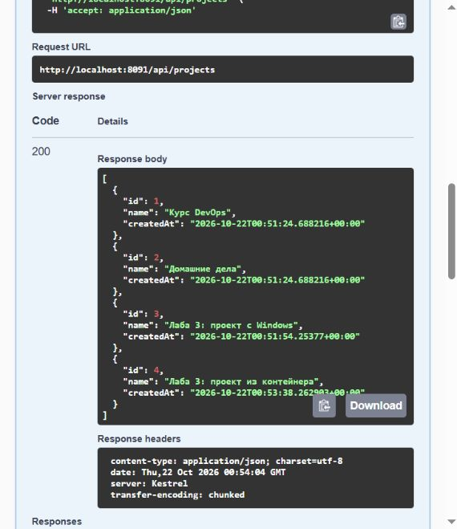

# Сервиске арналған PostgreSQL

Есімханова Аружан Түсіпханқызы · 25-ИСТК-2о · Д. Серікбаев атындағы ШҚТУ.

## 3.1-3.2 — Сервиске арналған PostgreSQL

### Мақсаты

Сервисті PostgreSQL-ге қосып, атаулы том арқылы деректердің сақталуын және SQL репозиторийлерінің жұмысын тексеру.

DEVOPS · 3-БАҚЫЛАУ НҮКТЕСІ · 5-АПТА

### 1 және 2-бөлімдер: 1-5-тармақтар. 05-материал.

**Орындаған:** Есімханова Аружан Түсіпханқызы<br>**Тобы:** 25-ИСТК-2о<br>**Күні:** 2026 жылғы 22 қазан

### Мақсаты

DemoApi-ді контейнердегі нақты PostgreSQL-ге қосу, деректерді атаулы томда сақтау, SQL іске асырылымын тексеру және API мен дерекқорды Docker-дің пайдаланушы желісі арқылы байланыстыру.

| Компонент | Нақты конфигурация |
|---|---|
| Дерекқор | PostgreSQL 18.6, postgres:18-alpine, Linux/amd64 |
| Деректер және бастапқы баптау | Атаулы том + db/seed.sql; bind mount тек оқуға рұқсат береді |
| PostgreSQL 18 деректер жолы | /var/lib/postgresql/18/docker; том /var/lib/postgresql жолына тіркелген |
| Windows-тағы сервис | localhost:8091 → PostgreSQL localhost:15432 |
| Контейнердегі сервис | localhost:8092 → API:8080; дерекқор контейнердің DNS атауы арқылы:5432 |
| Тестілер | 24 міндетті және 28 толық тест; PostgreSQL, бөлек demo_tests дерекқоры |

### Нәтиже

Дерекқор контейнері қайта жасалып, сервис қайта іске қосылғаннан кейін деректер сақталды. Қосылудың екі қате нұсқасы тексеріліп, олардың себептері анықталды. Windows-тағы сервис dotnet арқылы іске қосылды, API нәтижелері Swagger-де қаралды.

[GitHub-тағы зертханалық жұмыс нұсқасы](https://github.com/Aruzhaaan-06/devops-labs/tree/lab03-postgres)

### Атаулы томсыз дерекқор

Бөлек оқу контейнерінде notes кестесі жасалып, check жолы қосылды. Контейнер жойылып, сол бейнеден дәл сол пайдаланушы және дерекқор параметрлерімен қайта жасалды.

```text
CREATE TABLE notes (text text); INSERT INTO notes VALUES ('check'); SELECT * FROM notes;
```

### Бірінші контейнердің нақты шығысы:

```text
CREATE TABLE
INSERT 0 1
check
```

### Екінші контейнердегі сұрау:

```text
SELECT * FROM notes;
```

### Нақты жауап:

```text
ERROR:  relation "notes" does not exist
LINE 1: SELECT * FROM notes;
                      ^
```

### 1-тармақтың жауабы: кесте неге жоқ?

Жаңа контейнер бұрынғы деректер каталогын алмады. PostgreSQL бейнесі VOLUME жариялайтындықтан, -v анық берілмесе де Docker атаусыз том жасайды. Екі контейнердің атаусыз томдары бөлек; ескі том автоматты қосылмайды. Кесте бұрынғы дерекқорда қалған, ал жаңа дерекқор нөлден жасалған. Том атаулары мен контейнерлердің бөлек ID мәндері дәлелде сақталған.

### Маңызды айырмашылық

docker rm командасы -v параметрінсіз атаусыз том файлдарын автоматты түрде жоймайды: том контейнерсіз қалуы мүмкін. Тәжірибедегі мәселе - сол сақтау орнының қайта қосылмауы. Тексеруден кейін тек осы тәжірибе үшін жасалған бір реттік контейнерлер мен олардың атаусыз томдары жойылды.

[Екі контейнердің SQL сұраулары, жауаптары және том мәліметтері](https://github.com/Aruzhaaan-06/devops-labs/blob/main/evidence/lab03/without-named-volume.json)

### Атаулы том және оқу деректері

Негізгі оқу дерекқоры үшін devops-labs-lab03-pgdata томы жасалды. Ол /var/lib/postgresql жолына, ал жобаның db каталогы /docker-entrypoint-initdb.d жолына тек оқу режимінде қосылды. PostgreSQL порты тек 127.0.0.1:15432 мекенжайында жарияланған.

### Алғашқы іске қосу: seed.sql 2 жоба және 4 тапсырма жасады:

```text
Курс DevOps|Установить Docker Desktop|done
Курс DevOps|Запустить БД в контейнере|in_progress
Курс DevOps|Написать Dockerfile|todo
Домашние дела|Купить продукты|todo
```

### Кейін SQL арқылы «Задача из лабы 3» қосылды. Дерекқор контейнері жойылып, сол атаулы томмен қайта жасалды. Қайта жасаудан кейінгі нақты SELECT нәтижесі:

```text
1|Установить Docker Desktop
2|Запустить БД в контейнере
3|Написать Dockerfile
4|Купить продукты
5|Задача из лабы 3
```

### Жаңа контейнер журналы:

```text
PostgreSQL Database directory appears to contain a database; Skipping initialization
```

### 3-тармақтың жауабы: seed.sql неге қайталанбады?

Атаулы том кестелер мен қосылған тапсырманы қоса, PostgreSQL кластерін сақтады. docker-entrypoint-initdb.d скрипттері бос деректер каталогын алғашқы рет баптағанда ғана орындалады. PGDATA бар болса, бейне бастапқы баптауды өткізіп жібереді; сондықтан бастапқы 4 жол қайталанбайды, ал бесінші жол сақталады.

### Құпиясөз және деректер жолы

Құпиясөз жергілікті жасалған және жарияланбайды. Бос емес томда POSTGRES_PASSWORD айнымалысын өзгерту бұрын жасалған пайдаланушының құпиясөзін өзгертпейді. PostgreSQL 18 үшін /var/lib/postgresql жаңа том жолы қолданылады; бұл PostgreSQL 17 ескі мысалдарынан ерекшеленеді.

[Қайта жасау және тапсырманың сақталу дәлелі](https://github.com/Aruzhaaan-06/devops-labs/blob/main/evidence/lab03/volume-after-recreate.json) · [PostgreSQL ресми бейнесі](https://hub.docker.com/_/postgres)

### Windows сервисі және деректердің сақталуы

Windows сервисі Storage=Postgres мәнімен және орта айнымалылары арқылы берілген қосылу жолымен іске қосылды. HTTP API арқылы жоба жасалды; процесс аяқталып, қайта іске қосылғаннан кейін оның ID мәні мен атауы сақталды. Swagger және сервис контейнері сол жобаны көрсетеді.

```text
Хранилище: PostgreSQL
Now listening on: http://127.0.0.1:8091
Hosting environment: Development
```

1-сурет. Қайта іске қосқаннан кейінгі нақты Swagger UI: HTTP 200, оқу жобалары, Windows жобасы (id=3) және контейнер жобасы (id=4).



[Суретті ашу](../reports/assets/c40c23dded54e5b7.jpg)

Сурет API жауабын растайды. Ол Visual Studio консолінің суретін немесе F5 арқылы іске қосуды алмастырмайды; процестің нақты журнал мәтіні жоғарыда берілген.

### Тестілер және SQL статистикасы

Бар тестілер Storage=Postgres және сол PostgreSQL ішіндегі бөлек demo_tests дерекқорын көрсететін ConnectionStrings__Db арқылы орындалды. Контроллерлердің, сервистердің және SQL репозиторийлерінің коды өзгермеді.

| Іске қосу | Нақты нәтиже |
|---|---|
| Міндетті жиынтық | 24/24: 7 юнит және 17 интеграциялық тест; 0 қате, 0 өткізіп жіберілген |
| Ағымдағы нұсқаның толық жиынтығы | 28/28: 7 юнит және 21 интеграциялық тест; 0 қате, 0 өткізіп жіберілген |
| Сақталған HTTP сценарийлері | 26 сәтті сұрау: 23 сценарий және тестілік жобаларды жоюға арналған 3 сұрау |
| Postman CLI | 24 сұрау, 73 тексеру, 0 қате; аяқталу коды 0 |

### Дәл 24 жағдай қалай алынды?

Осы кезеңдегі нұсқада тапсырма мерзімін тексеретін төрт қосымша жағдай бар. Бірінші іске қосу оларды сүзгімен алып тастайды; екіншісі барлық 28 тестіні орындайды. Бұл - ағымдағы кодтың міндетті іріктемесі, қорытынды тест санын өзгертіп көрсету емес.

```text
FullyQualifiedName!~Create_PastDueDate&FullyQualifiedName!~Create_ValidDueDate
```

### Статистиканың SQL нұсқасы

Статистикаға арналған екі интеграциялық тест PostgreSQL-де сәтті өтті: тапсырмалар мен кешігулерді санау, бос жоба, бүгін / null мерзімі, жобаларды оқшаулау, аяқталған тапсырмалар және белгісіз жоба тексерілді. ProjectRepository.GetStatsAsync әдісін түзету қажет болмады.

### Қосымша: бесінші тапсырма қосылған оқу деректеріндегі GET /api/projects/1/stats:

```text
{
  "projectId": 1,
  "total": 4,
  "todo": 2,
  "inProgress": 1,
  "done": 1,
  "overdue": 0
}
```

Нәтижелер TRX файлдарына сақталды. Міндетті жиынтықта 24 тест, толық жиынтықта 28 тест өтті. API контейнері Postman CLI арқылы тексерілді.

### Контейнерді қосудың үш әрекеті

### 1-әрекет: тек Storage=Postgres берілген

```text
Unhandled exception. System.InvalidOperationException: Не задана строка подключения
ConnectionStrings:Db
```

Себебі: контейнер әдепкіде Production ортасында іске қосылады. Бұл ортада appsettings.Development.json ішіндегі қосылу жолы жүктелмейді. ConnectionStrings__Db болмаса, қолданба деректер көзін жасай алмай, жұмысын аяқтайды.

### 2-әрекет: Host=localhost қосылу жолы

```text
Unhandled exception. Npgsql.NpgsqlException (0x80004005): Failed to connect to 127.0.0.1:5432
 ---> System.Net.Sockets.SocketException (111): Connection refused
```

Себебі: API контейнерінің ішіндегі localhost сол API контейнерін көрсетеді. PostgreSQL басқа контейнерде жұмыс істейді, сондықтан 127.0.0.1:5432 мекенжайында тыңдаушы жоқ. Екі әрекет те шынымен нөлден өзгеше кодпен аяқталды; журналдар сақталған.

### 3-әрекет: ортақ желі және дерекқордың DNS атауы

```text
Storage=Postgres
ConnectionStrings__Db=Host=devops-labs-lab03-db;Database=demo;
    Username=demo;Password=<жергілікті құпиясөз>
```

| Тексеру | Нәтиже |
|---|---|
| Желі | devops-labs-lab03-net, 10.254.53.0/24 |
| DNS атауын анықтау | Дерекқор атауы API контейнерінің ішінде анықталды |
| Іске қосылу және дайындық | Контейнер healthy, /health/ready → 200 |
| Ортақ деректер | Windows жобасы id=3 көрінеді |
| docker stop/start API | Контейнер жобасы id=4 сақталды |

### Жұмыс ортасының ерекшелігі

Бұл компьютерде Docker-дің стандартты ішкі желілер пулы таусылған. Бөлек оқу желісінің ішкі желісі Docker желілері және Windows маршруттарымен қиылыспайтыны тексерілгеннен кейін анық таңдалды. Басқа жобалар өзгертілмеді. 15432 порты тек Windows клиенттеріне арналған; контейнерлер тікелей 5432 арқылы байланысады.

### Бақылау сұрақтарына жауап

### Том деректерді неге сақтайды?

Том контейнерден бөлек өмір сүреді. Сол томды пайдаланатын жаңа контейнер бұрынғы PostgreSQL кластерін алады. Бұл контейнерді қайта жасау және бесінші тапсырманың сақталуы арқылы тексерілген.

### Томның bind mount-тан айырмашылығы қандай?

Атаулы томды Docker басқарады; бұл жұмыста онда дерекқор деректері сақталады. Bind mount нақты Windows каталогын қосады; мұнда ол seed.sql скрипті бар db каталогын тек оқу режимінде тіркейді.

### seed.sql неге қайта орындалмайды?

Ресми бейненің entrypoint бағдарламасы бастапқы баптау скрипттерін PGDATA бос болғанда ғана орындайды. Атаулы томда дерекқор бар, сондықтан журналда Skipping initialization көрсетіледі.

### Дерекқор мекенжайы API іске қосылған орынға неге тәуелді?

Windows жарияланған localhost:15432 портын пайдаланады. API контейнері ортақ желідегі дерекқордың DNS атауын және ішкі 5432 портын пайдаланады. Оның localhost мекенжайы Windows-тың немесе көрші контейнердің мекенжайы емес.

### Compose down және down -v орындалғанда не сақталады?

Compose down контейнерлер мен желіні жояды, бірақ атаулы томдарды сақтайды; down -v басқарылатын дерек томдарын да жояды. 05-материалда Compose командалары орындалмаған: олар келесі 06-тапсырмаға жатады.

### Қорытынды

3-зертханалық жұмыстың 1 және 2-бөлімдері орындалды: PostgreSQL, оқу деректері, том, Windows сервисі, тестілер, қосылудың екі қатесі және ортақ желіде контейнерді сәтті іске қосу. Қолданба бұрынғы жұмыс тәртібін сақтады; SQL іске асырылымы алғаш рет нақты іске қосу нәтижелерімен расталды.

PostgreSQL режимінің іске қосылуы консоль журналындағы «Хранилище: PostgreSQL» жолымен расталды. Міндетті 24 тест пен толық 28 тест нәтижелері сақталды.

Тексерулерден кейін API мен дерекқор тоқтатылды. Деректері бар атаулы том сақталды; жергілікті .env Git-ке қосылмайды.

### Дереккөздер және материалдар

05-материал: жүктелген Devops (1).zip мұрағатындағы «Неделя 5 - Контрольная точка 3», 3-зертханалық жұмыстың 1-2-бөлімдері және 3-дәріс; kit.zip жергілікті ашылған.

[Нұсқаулар мен жауаптар](https://github.com/Aruzhaaan-06/devops-labs/blob/main/docs/lab03-postgres.md) · [Журналдар мен дәлелдер](https://github.com/Aruzhaaan-06/devops-labs/blob/main/evidence/lab03/README.md) · [Npgsql параметрлері](https://www.npgsql.org/doc/connection-string-parameters)

## Талдау

Атаулы том контейнерден тәуелсіз сақталады. localhost API контейнерінің өзін көрсететіндіктен, басқа контейнердегі PostgreSQL-ге қосылу үшін ортақ желі мен дерекқордың DNS атауы қолданылды.

## Қорытынды

DemoApi PostgreSQL-ге қосылды. Атаулы том деректерді сақтады; SQL қоймасында міндетті 24 және толық 28 тест өтті.

[PDF есебі](../reports/lab03-postgres-report.pdf) · [Бастапқы материалдар](../evidence/lab03/README.md)

## Қайта орындау командалары

Командалар тиісті жұмыс нұсқасына арналған. Ақау сценарийлері жеке оқу стендінде орындалады. Бар `.env` файлын сақтап, негізгі дерекқорды тестке қолданбау керек.

```powershell
if (-not (Test-Path .env)) {
    "DB_PASSWORD=$([Guid]::NewGuid().ToString('N'))" | Set-Content -Encoding utf8 .env
}
$passwordEntry = Get-Content .env | Where-Object { $_ -match '^DB_PASSWORD=.+$' } | Select-Object -First 1
if (-not $passwordEntry) { throw 'Задайте DB_PASSWORD в локальном .env.' }
$env:POSTGRES_PASSWORD = $passwordEntry.Substring('DB_PASSWORD='.Length)
```

```sql
CREATE TABLE notes (text text);
INSERT INTO notes VALUES ('check');
SELECT * FROM notes;
```

```powershell
docker volume create devops-labs-lab03-pgdata
docker run -d --name devops-labs-lab03-db `
    -e POSTGRES_DB=demo -e POSTGRES_USER=demo -e POSTGRES_PASSWORD `
    -v devops-labs-lab03-pgdata:/var/lib/postgresql `
    --mount "type=bind,source=${PWD}\db,target=/docker-entrypoint-initdb.d,readonly" `
    -p 127.0.0.1:15432:5432 postgres:18-alpine
docker exec devops-labs-lab03-db pg_isready -h 127.0.0.1 -U demo -d demo
```

```powershell
$env:Storage = 'Postgres'
$env:ConnectionStrings__Db = "Host=127.0.0.1;Port=15432;Database=demo;Username=demo;Password=$env:POSTGRES_PASSWORD"
$env:Chaos__Enabled = 'false'
dotnet run --project src/DemoApi/DemoApi.csproj --launch-profile http -- --urls http://127.0.0.1:8091
```

```powershell
docker exec devops-labs-lab03-db psql -U demo -d demo -c 'CREATE DATABASE demo_tests OWNER demo;'
$env:Storage = 'Postgres'
$env:ConnectionStrings__Db = "Host=127.0.0.1;Port=15432;Database=demo_tests;Username=demo;Password=$env:POSTGRES_PASSWORD"
dotnet test DemoApi.slnx -c Release --filter 'FullyQualifiedName!~Create_PastDueDate&FullyQualifiedName!~Create_ValidDueDate'
dotnet test DemoApi.slnx -c Release
Remove-Item Env:Storage, Env:ConnectionStrings__Db, Env:Chaos__Enabled
```

```powershell
docker network create --subnet 10.254.53.0/24 devops-labs-lab03-net
docker network connect devops-labs-lab03-net devops-labs-lab03-db
$env:ConnectionStrings__Db = "Host=devops-labs-lab03-db;Database=demo;Username=demo;Password=$env:POSTGRES_PASSWORD"
docker run -d --name devops-labs-lab03-api --network devops-labs-lab03-net `
    -p 127.0.0.1:8092:8080 -e Storage=Postgres -e ConnectionStrings__Db `
    devops-labs-demo-api:lab03-postgres
Remove-Item Env:ConnectionStrings__Db
```

```powershell
docker start devops-labs-lab03-db
docker exec devops-labs-lab03-db pg_isready -h 127.0.0.1 -U demo -d demo
# Дерекқор дайын болған соң:
docker start devops-labs-lab03-api
Invoke-RestMethod http://localhost:8092/api/projects
```

<a id="лабораторная-3--postgresql--материал-05"></a>
<a id="что-требуется-для-сдачи"></a>
<a id="подготовка-и-конфигурация"></a>
<a id="часть-1-база-и-данные"></a>
<a id="часть-2-сервис-windows-и-тесты"></a>
<a id="три-запуска-api-контейнера"></a>
<a id="возврат-к-сохраненному-стенду"></a>
<a id="после-готовности-бд"></a>
