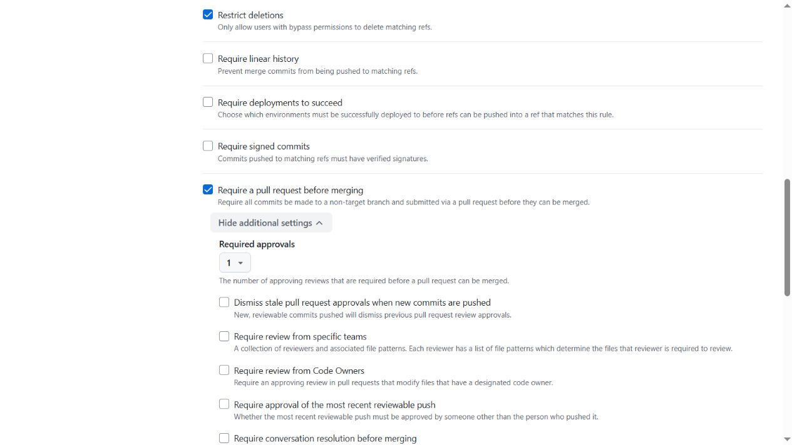
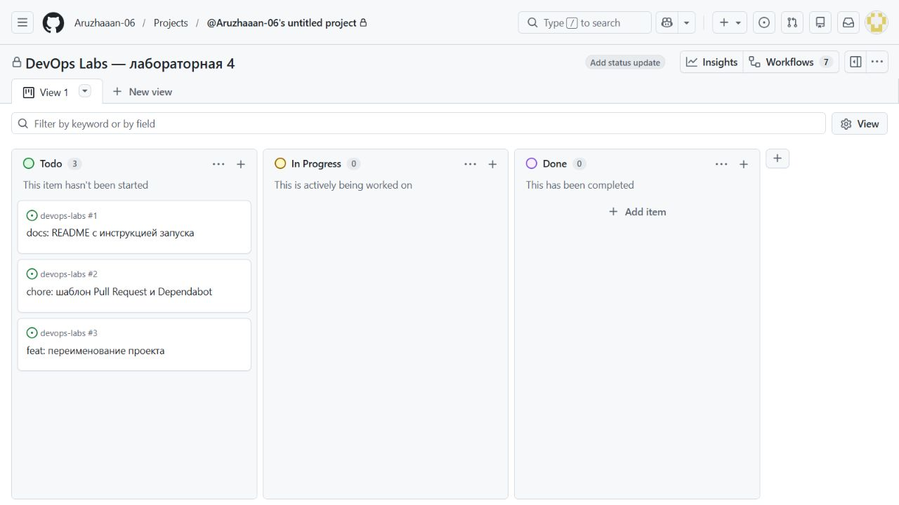
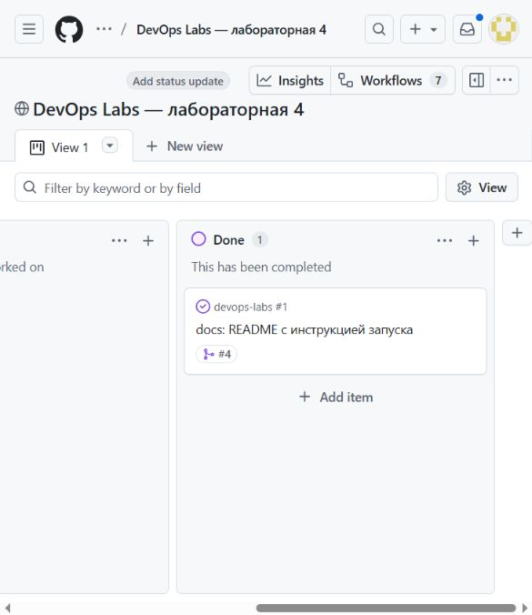
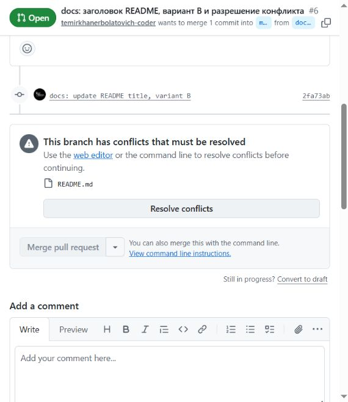

# Git және GitHub-та бірлескен жұмыс

Д. Серікбаев атындағы Шығыс Қазақстан техникалық университеті · Есімханова Аружан Түсіпханқызы · 25-ИСТК-2о.

Бұл нұсқаулық қазақша редакцияланған есептердің толық мазмұнын және қайталауға арналған бастапқы командаларды біріктіреді. Төмендегі өлшемдер мен тексерулер тиісті тарихи кезеңге жатады; аударма оларды қайта орындау болып саналмайды. Код, нақты HTTP жауаптары мен журнал үзінділері бастапқы тілінде сақталған. Қазіргі толықтық пен орындалмаған UI тармақтары [жеке тізімде](REPORT_COMPLETENESS.md) берілген.

## 4.1 — Git және GitHub-та бірлескен жұмыс

### Жұмыстың мақсаты

Қорғалған main тармағы, Pull Request, пікір, қақтығысты шешу және тапсырмалар тақтасы арқылы Git жұмыс үдерісін тексеру.

### Теориялық мәліметтер

Тармақ өзгерістерді негізгі нұсқадан бөлек дайындауға мүмкіндік береді. Pull Request талқылау мен тексеруді біріктіреді. main ережелері тікелей жіберуді шектейді, ал қақтығысты шешкен біріктіру коммиті екі тармақтың тарихын сақтайды.

DEVOPS · 7-АПТА · 07-МАТЕРИАЛ

## 1-бөлім: дайындық және 1-6-тармақтар. A репозиторийі.

**Орындаған:** Есімханова Аружан Түсіпханқызы<br>**Тобы:** 25-ИСТК-2о<br>**Күні:** 2026 жылғы 22 қазан

## Нәтиже және орындалу шектері

Бар ашық репозиторийде техникалық цикл орындалды: қорғалған main, тақтадағы тапсырмалар, код жолына пікір қалдырылған PR, түзету, Approve, squash-merge және екі тармақтың нақты қақтығысы. Команда шығыстары мен GitHub-тың шынайы экран суреттері сақталған.

| Тармақ | Нақты нәтиже |
|---|---|
| main тармағын қорғау | Active; әдепкі тармақ; 1 мақұлдау; жою мен force-push тыйым салынған; bypass жоқ |
| Тікелей push | Қабылданбады: GH013; main және жұмыс тармағы өзгерген жоқ |
| Тапсырмалар тақтасы | 3 issue; README тапсырмасы жабылып, workflow тексеруінде Done күйіне ауысты |
| README PR #4 | Екінші тіркелгінің пікірі → бөлек түзету → Approve → squash |
| #5 / #6 қақтығысы | README қақтығысы болды; оны шешкен 02d593b main тарихында сақталған |
| Тексерулер | 13 техникалық тармақ; құрастыруда 0 ескерту / 0 қате |

**Ресми тапсыру талаптары толық орындалмаған.** Иесінің шешімімен оның екі тіркелгісі пайдаланылды; топтас студентпен жұмыс және бөлек B репозиторийі расталмаған. Оқытушы шақырылмаған: GitHub атауы әлі белгісіз. Қабылданбаған push бөлек терминал суретінің орнына дәл мәтіндік шығыспен берілген.

[GitHub-та бекітілген нұсқа](https://github.com/Aruzhaaan-06/devops-labs/tree/lab04-git) · [Пікірмен қаралған README PR](https://github.com/Aruzhaaan-06/devops-labs/pull/4)

## Дайындық және main тармағын қорғау

Репозиторий: [Aruzhaaan-06/devops-labs](https://github.com/Aruzhaaan-06/devops-labs/). Онда сервис, Dockerfile, Compose және бұрынғы есептер бар. Жаңа репозиторий жасау және git init қайталау қажет болмады. Git, PowerShell 7 және .NET 10 қолжетімді; kit ішіндегі .github каталогы табылды.

temirkhanerbolatovich-coder тіркелгісі шақырылып, write құқығын алды. Екінші рөл үшін бөлек жергілікті көшірме жасалды. Екінші тіркелгі коммиттерінің авторы мен email мәні жергілікті бапталды. Екі тіркелгі де бір адамға тиесілі.

| Баптау | Бекітілген мән |
|---|---|
| Ruleset | main, active, Include default branch |
| Ережелер | Restrict deletions; Pull Request + 1 approval; Block force pushes |
| Ережені айналып өту | Bypass list бос; current_user_can_bypass=never |
| Сыртқы Actions | all_external_contributors: әр сыртқы workflow мақұлдауды талап етеді |
| Еленбейтін файлдар | .env, bin, obj және .vs; қадағаланатын файлдар арасында жоқ |

1-сурет. Баптаудың шынайы суреті: міндетті PR және бір Approve. Барлық параметр main-ruleset.json ішінде де сақталған.



[Түпнұсқаны толық ажыратымдылықта ашу](../reports/assets/c8ed1b08cd2d15a3.jpg)

[Ашық ережелер жиынтығы](https://github.com/Aruzhaaan-06/devops-labs/rules/25644144) · [Сақталған параметрлер](https://github.com/Aruzhaaan-06/devops-labs/blob/main/evidence/lab04-git/main-ruleset.json)

## Тікелей push: күтілген қабылдамау

Тексеру үшін файлдар ағашы ағымдағы main-мен бірдей бос коммит жасалды. Жұмыс тармағын жылжытпау және reset --hard орындамау үшін git commit-tree қолданылды. Тексеру SHA мәнін тікелей main-ге жіберу нөлден өзгеше кодпен аяқталды:

```text
# Empty commit created by git commit-tree HEAD^{tree} -p HEAD with message test: direct push.
$ git push origin bd42e87dae0872ddbc9596af9b8885bde6f369c6:refs/heads/main
remote: error: GH013: Repository rule violations found for refs/heads/main.
remote: Review all repository rules at
https://github.com/Aruzhaaan-06/devops-labs/rules?ref=refs%2Fheads%2Fmain
remote:
remote: - Changes must be made through a pull request.
remote:
To https://github.com/Aruzhaaan-06/devops-labs.git
 ! [remote rejected] bd42e87dae0872ddbc9596af9b8885bde6f369c6 -> main (push declined due to
repository rule violations)
error: failed to push some refs to 'https://github.com/Aruzhaaan-06/devops-labs.git'
```

## Нәтиже нені дәлелдейді?

GitHub дәл refs/heads/main жаңартуын қабылдамады: өзгерістер Pull Request арқылы өтуі керек. Әрекеттен кейін GitHub-тағы main SHA мәні мен жергілікті HEAD қосымша салыстырылды - екеуі де бұрынғыдай қалды. Бос коммит негізгі тарихқа енген жоқ.

## Құпия деректер және Git-тен алып тасталатын файлдар

```text
$ git check-ignore .env src/DemoApi/bin/Debug/net10.0/DemoApi.dll
src/DemoApi/obj/project.assets.json .vs/settings.json
.env
src/DemoApi/bin/Debug/net10.0/DemoApi.dll
src/DemoApi/obj/project.assets.json
.vs/settings.json
```

Қадағаланатын файлдарда .env, bin, obj және .vs жоқ. Құпиясөздер мен токендер жарияланбайды. GitHub CLI әр тіркелгі үшін иесі растаған авторизацияны пайдаланады.

Ережелер жиынтығының суреті алдыңғы бетте берілген. Мұнда терминал жауабының дәл мәтіні сақталған; терминал терезесінің бөлек суреті жоқ. Мұндай сурет нақты талап етілсе, бұл тармақ әлі толықтырылуы керек.

## README-ді PR арқылы тексеру

[PR #4](https://github.com/Aruzhaaan-06/devops-labs/pull/4) · docs/1-readme тармағы · автор Aruzhaaan-06 · тексеруші temirkhanerbolatovich-coder.

README сервис пен маршруттарды, .env және docker compose up -d --build --wait командаларын, Compose дерекқорымен және F5 арқылы әзірлеуді, тест командаларын сипаттайды. Visual Studio конфигурациясы үшін csproj ішіне UserSecretsId қосылды: жергілікті құпиясөз Git-тен тыс сақталады. Бұл идентификатор құпия дерек емес.

## README жолына қалдырылған пікірдің қазақша мазмұны

Төменде бар .env файлын сақтау туралы ескерту берілген, бірақ командалар блогын көшіріп орындағанда бұл команда файлды қайта жазады. Нұсқауды қайталағанда дерекқордың ағымдағы құпиясөзі сақталуы үшін Copy-Item алдында Test-Path тексеруін қосу қажет.

[Код жолына қалдырылған бастапқы пікірді ашу](https://github.com/Aruzhaaan-06/devops-labs/pull/4#discussion_r4349438594)

```text
Тексеруге дейін:
Copy-Item .env.example .env

Бөлек түзетуден кейін:
if (-not (Test-Path .env)) { Copy-Item .env.example .env }
```

| Қадам | Расталған нәтиже |
|---|---|
| e1742a0 | README және UserSecretsId қосылды |
| 53-жолға қалдырылған пікір | Екінші тіркелгі .env қайта жазылу қаупін көрсетті |
| c1e3b46 | Автор Test-Path тексеруін бөлек коммитпен қосты |
| Команданы тексеру | Бар .env өзгеріссіз сақталды |
| Approve және Squash and merge | Түзетілген SHA мақұлданды; main нәтижесі b80b32f |
| Closes #1 | Issue біріктіруден кейін автоматты жабылды |

Шешім сәтті құрастырылды: 0 ескерту және 0 қате. User Secrets әзірлеуге арналған және мәндерді шифрламайды; құпиясөз репозиторийде сақталмайды. Бұл жұмыста Visual Studio-дағы F5 іске қосылмаған. Маршруттар коды мен бизнес ережелері өзгерген жоқ.

Барлық пікірлер мен мақұлдаулар бір иесінің екі тіркелгісін пайдаланатын техникалық сценарийде орындалды; топтас студенттің тәуелсіз тексеруі жүргізілді деп көрсетілмейді.

## Үш issue және тапсырмалар тақтасы

[#1 README](https://github.com/Aruzhaaan-06/devops-labs/issues/1), [#2 PR үлгісі / Dependabot](https://github.com/Aruzhaaan-06/devops-labs/issues/2) және [#3 жобаның атын өзгерту](https://github.com/Aruzhaaan-06/devops-labs/issues/3) жасалды. Барлығы «DevOps Labs - лабораторная 4» ашық Board тақтасына қосылды.

2-сурет. Бастапқы тақта: барлық үш тапсырма Todo күйінде.



[Түпнұсқаны толық ажыратымдылықта ашу](../reports/assets/dbc2a38a11706f9f.jpg)

PR #4 Closes #1 арқылы #1 тапсырмасымен байланысқан. squash орындалғаннан кейін issue автоматты жабылды, бірақ жаңартудан кейін Status In Progress болып қалды. Қосылған Item closed ережесін тексеру үшін сол тапсырма қайта ашылып, қайта жабылды. Status қолмен өзгертілмей, тапсырма автоматты түрде Done күйіне өтті. Алғашқы күйдің себебі анықталмаған.

3-сурет. Қайта тексеруден кейін: жабылған issue #1 Done күйінде. Қалған екі тапсырма Todo күйінде.



[Түпнұсқаны толық ажыратымдылықта ашу](../reports/assets/66fd20d6d8358ce6.jpg)

[Ашық тақтаны қарау](https://github.com/users/Aruzhaaan-06/projects/1). Қосылған workflow және әрекеттер реті бөлек сақталған.

## Екі тармақтың нақты қақтығысы

Бір main b80b32f күйінен негізгі көшірмеде docs/title-a, екінші тіркелгі көшірмесінде docs/title-b жасалды. Екеуінде де README-дің бірінші жолы әртүрлі өзгертілді. [PR #5 (A)](https://github.com/Aruzhaaan-06/devops-labs/pull/5) екінші тіркелгі арқылы мақұлданып, squash арқылы біріктірілді. Осыдан кейін [PR #6 (B)](https://github.com/Aruzhaaan-06/devops-labs/pull/6) үшін mergeable=false, mergeable_state=dirty алынды.

4-сурет. GitHub: This branch has conflicts that must be resolved, README.md файлы.



[Түпнұсқаны толық ажыратымдылықта ашу](../reports/assets/4c5df9269b1e654f.jpg)

```text
$ git fetch origin
$ git merge origin/main
Auto-merging README.md
CONFLICT (content): Merge conflict in README.md
Automatic merge failed; fix conflicts and then commit the result.
```

## B жергілікті көшірмесіндегі нақты қақтығыс белгілері:

```text
# Captured README.md lines, numbered as historical evidence.
1 | <<<<<<< HEAD
2 | # DevOps Labs — проекты и задачи
3 | =======
4 | # DevOps Labs — DemoApi: сервис задач
5 | >>>>>>> origin/main
```

«DevOps Labs - DemoApi: проекты и задачи» ортақ тақырыбы қалдырылды. Қақтығыс белгілері жойылып, git add README.md және git commit -m "docs: resolve title conflict" арқылы екі ата-аналық коммиті бар 02d593b біріктіру коммиті жасалды. push кейін иесі PR #6 өзгерістерін мақұлдап, merge commit арқылы біріктірді.

## Тарих, тексерулер және толықтырылатын тармақтар

Екі нұсқа біріктірілгеннен кейін main тармағынан алынған команда шығысы. Қақтығысты шешкен коммит сақталған және екінші PR-ды squash арқылы біріктіру кезінде жасырылмаған:

```text
$ git log --oneline --graph -16
*   0715252 Merge pull request #6: resolve README title conflict
|\
| *   02d593b docs: resolve title conflict
| |\
| |/
|/|
* | a35874e docs: update README title, variant A (#5)
| * 2fa73ab docs: update README title, variant B
|/
* b80b32f docs: инструкции Compose и разработки в Visual Studio (#4)
* c057d5d feat: add verified Docker Compose laboratory and report
* ee2ac68 docs: publish verified PostgreSQL laboratory 3 and report
* ac16542 feat: containerize DemoApi and document laboratory 2 verification
* 0a79d5d docs: organize lab reports, evidence and repository navigation
* 5235623 feat: validate task deadlines and publish laboratory 1 reports
* f93b123 feat: complete required laboratory 1 API statistics and checks
* 8ad6b5d chore: import DevOps course starter
```

git merge-base --is-ancestor 02d593b HEAD сәтті аяқталды. 02d593b коммитінің бірінші ата-анасы - B нұсқасының коммиті, екіншісі - A нұсқасы бар өзекті main. main-ге қорытынды біріктіру: 0715252. Тармақты қорғау және міндетті мақұлдау талабы өшірілген жоқ.

## Осы жұмыста тексерілгені

checks.json ішіндегі 13 техникалық тармақ: құқықтар, ережелер, push қабылдамауы, issue және Board, тексеру тізбегі, нақты қақтығыс және тарих. dotnet build DemoApi.slnx --no-restore --nologo: 0 ескерту / 0 қате. Бар .env файлының сақталуы тексерілді. API тестілері қайта іске қосылған жоқ; олардың нәтижелері 06-материалға жатады.

## Толық тапсыру үшін не қажет?

1. Оқытушыны қосу: GitHub атауы әзірге берілмеген.<br>2. Топтас студенттің орнына бір иесінің екі тіркелгісін қолдануды оқытушымен келісу. Бөлек B репозиторийіндегі кезең орындалмаған.<br>3. Қабылданбаған push суреті нақты талап етілсе, терминал терезесінің суретін қосу; дәл мәтіндік шығыс сақталған.<br>4. Бұл жұмыста Visual Studio-дағы F5 расталмаған.

Үлгілер, Dependabot, API өзгерісі және шығарылым 08-материалға жатады және бұл есепте орындалды деп көрсетілмейді. main тармағына енгізілетін барлық кейінгі өзгерістер PR арқылы өтуі керек.

Шарттардың дереккөзі: Задание_07.pdf; Неделя_07_Лаба_4_ч 1.pdf, дайындық және 1-6-тармақтар, Devops (1).zip мұрағаты.

[GitHub ережелері](https://docs.github.com/en/repositories/configuring-branches-and-merges-in-your-repository/managing-rulesets/available-rules-for-rulesets) · [ASP.NET Core ішіндегі User Secrets](https://learn.microsoft.com/en-us/aspnet/core/security/app-secrets?view=aspnetcore-10.0) · [Барлық дәлелдер](https://github.com/Aruzhaaan-06/devops-labs/blob/main/evidence/lab04-git/README.md)

## Нәтижелер және шектеулер

13 техникалық тексеру, GH013 қабылдамауы, inline пікір мен түзету, нақты қақтығыс және Git тарихы сақталған.

Оқытушы шақырылмаған; екі аккаунт бір иеге тиесілі; жеке B репозиторийіндегі кезең мен қабылданбаған push терезесінің суреті жоқ.

[PDF есебі](../reports/lab04-git-report.pdf) · [Өңделетін бастапқы файл](../reports/source/lab04-git-report.json) · [Нақты дәлелдер](../evidence/lab04-git/README.md)

## Қайта орындауға арналған командалар

Бұл блоктар бастапқы нұсқаулықтан сақталған. Олар автоматты түрде орындалмайды. Томды жою, контейнерді тоқтату немесе ақау туғызу командалары тек тиісті оқшауланған оқу тәжірибесіне арналған. Бар `.env` файлын қайта жазбаңыз; нақты құпиясөзді Git-ке қоспаңыз. Бұрынғы тег/нұсқа атаулары тарихи кезеңді білдіреді.

```powershell
git fetch origin
git merge origin/main
# CONFLICT (content): Merge conflict in README.md
# Оставлен общий заголовок: DevOps Labs — DemoApi: проекты и задачи
git add README.md
git commit -m "docs: resolve title conflict"
git push
```

## Бастапқы нұсқаулықтағы сілтемелер

- [Дереккөз 1](https://github.com/Aruzhaaan-06/devops-labs)
- [Дереккөз 2](https://github.com/users/Aruzhaaan-06/projects/1)
- [Дереккөз 3](../reports/lab04-git-report.pdf)
- [Дереккөз 4](../evidence/lab04-git/README.md)
- [Дереккөз 5](https://github.com/Aruzhaaan-06/devops-labs/rules/25644144)
- [Дереккөз 6](../evidence/lab04-git/direct-push-rejected.txt)
- [Дереккөз 7](https://github.com/Aruzhaaan-06/devops-labs/issues/1)
- [Дереккөз 8](https://github.com/Aruzhaaan-06/devops-labs/issues/2)
- [Дереккөз 9](https://github.com/Aruzhaaan-06/devops-labs/issues/3)
- [Дереккөз 10](https://github.com/Aruzhaaan-06/devops-labs/pull/4)
- [Дереккөз 11](https://github.com/Aruzhaaan-06/devops-labs/pull/4#discussion_r4349438594)
- [Дереккөз 12](https://github.com/Aruzhaaan-06/devops-labs/pull/5)
- [Дереккөз 13](https://github.com/Aruzhaaan-06/devops-labs/pull/6)
- [Дереккөз 14](../evidence/lab04-git/git-log-graph.txt)
- [Дереккөз 15](lab04-release.md)
- [Дереккөз 16](https://docs.github.com/en/repositories/configuring-branches-and-merges-in-your-repository/managing-rulesets/available-rules-for-rulesets)
- [Дереккөз 17](https://learn.microsoft.com/en-us/aspnet/core/security/app-secrets?view=aspnetcore-10.0)

<!-- Бұрын жарияланған бөлім сілтемелерінің тұрақты идентификаторлары. -->
<a id="лабораторная-4-часть-1--материал-07--git-и-github"></a>
<a id="подготовка-и-защита"></a>
<a id="три-issue-и-board"></a>
<a id="readme-через-ревью"></a>
<a id="настоящий-конфликт-первой-строки"></a>
<a id="conflict-content-merge-conflict-in-readmemd"></a>
<a id="оставлен-общий-заголовок-devops-labs--demoapi-проекты-и-задачи"></a>
<a id="что-остается-для-формальной-сдачи"></a>
