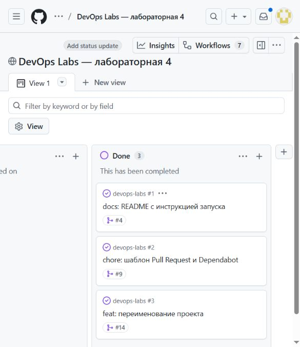
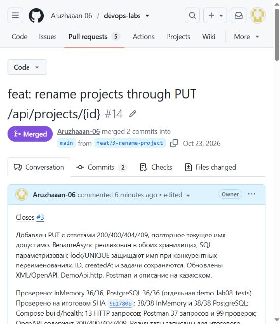
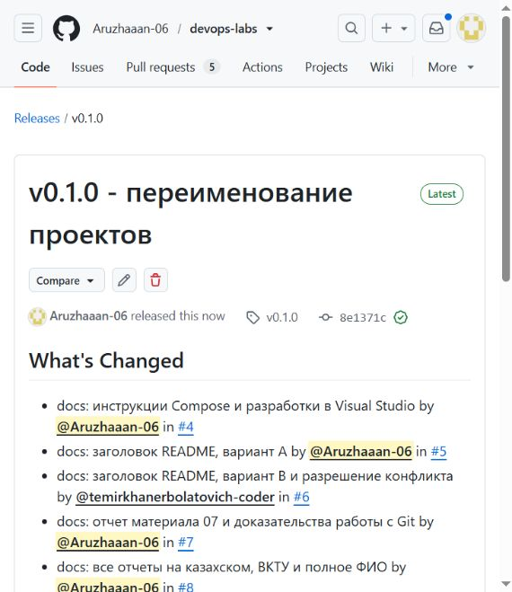

# GitHub ережелері және шығарылым

Есімханова Аружан Түсіпханқызы · 25-ИСТК-2о · Д. Серікбаев атындағы ШҚТУ.

## 4.2 — GitHub ережелері және шығарылым

### Мақсаты

Репозиторий үлгілерін, тәуелділік жаңартуларын, код иелігін және API өзгерісін PR арқылы рәсімдеп, шығарылым дайындау.

ВКТУ · DEVOPS · 08-МАТЕРИАЛ

### 2-бөлім: PR арқылы кодты өзгерту және алғашқы шығарылым

| Мәлімет | Мәні |
|---|---|
| Орындаған | Есімханова Аружан Түсіпханқызы |
| Тобы | 25-ИСТК-2о |
| Университет | ВКТУ |
| Күні | 2026 жылғы 23 қазан |
| Тапсырма | 08-материал, 7-9-бөлімдер және CODEOWNERS |

### Мақсаты

main тармағы қорғалған репозиторийде өзгерістерді жеке тармақ пен PR арқылы өткізу, пікірді ескеріп түзету, жоба атауын екі сақтау режимінде өзгерту және v0.1.0 шығарылымын жариялау.

### Нәтижелер

19 техникалық тексеру сәтті өтті. InMemory: 38/38, PostgreSQL: 38/38. Postman: 37 сұрау, 99 тексеру. Үш issue жабылып, Done бағанына өтті. Шығарылым жарияланды.

[Репозиторий](https://github.com/Aruzhaaan-06/devops-labs/) · [API өзгерісінің PR-ы](https://github.com/Aruzhaaan-06/devops-labs/pull/14) · [v0.1.0 шығарылымы](https://github.com/Aruzhaaan-06/devops-labs/releases/tag/v0.1.0)

Түсіндірмелер қазақ тілінде жазылды. Код, командалар, API жауаптары және нақты экран суреттері дәлел ретінде бастапқы тілінде сақталды.

### Репозиторийді баптау

Алдыңғы жұмыстың жалғасы ретінде бар репозиторий қолданылды. Жұмыс басында main таза болды; Git, PowerShell 7, .NET 10 SDK, Docker Desktop, Compose, GitHub CLI, Postman CLI және браузер пайдаланылды.

### PR үлгісі және Dependabot

Оқу kit жинағындағы екі файл оқылып, .github каталогына қосылды. PR үлгісіндегі Compose командасыне --wait қосылды: дайындықты күту тексеруге енгізілді. Үлгі авторға тестілерді, құжаттаманы және құпия деректердің жоқтығын тексеруді еске салады.

| Файл | Міндеті |
|---|---|
| pull_request_template.md | Өзгеріс сипаттамасы, Closes #, іске қосу және тексеру чек-парағы |
| dependabot.yml | NuGet, Docker және GitHub Actions тәуелділіктерін апта сайын тексеру |
| CODEOWNERS | Барлық файлдар үшін екінші аккаунтты код иесі ретінде белгілеу |

[PR #9](https://github.com/Aruzhaaan-06/devops-labs/pull/9) Closes #2 арқылы issue #2-ні жапты. Өзгеріс мақұлдаудан кейін squash тәсілімен main тармағына біріктірілді.

### CODEOWNERS және main қорғанысы

```text
* @temirkhanerbolatovich-coder
```

Қолданыстағы ruleset сақталып, Require review from Code Owners қосылды. Бір мақұлдау міндетті; bypass тізімі бос. Тікелей push, force-push және main тармағын жоюға қойылған шектеулер сақталды.

Дайын PR #14 ашылғаннан кейін GitHub екінші аккаунтты code owner ретінде автоматты түрде тағайындады. Ревьюер қолмен сұратылған жоқ. CODEOWNERS қатесін тексеретін GitHub API бос қателер тізімін қайтарды.

Dependabot нақты жұмыс істеді: бес NuGet жаңарту PR-ын жасады. Олар осы жұмыста біріктірілген жоқ; тәуелділіктердің қауіпсіздігі толық дәлелденді деген қорытынды жасалмайды. GitHub Actions CI 09-материалда қосылады.

### Жоба атауын өзгерту

```text
PUT /api/projects/{id}
Content-Type: application/json

{ "name": "Жаңа атау" }
```

| HTTP жауабы | Шарты |
|---|---|
| 200 | Жоба атауы өзгертілді; id, name, createdAt қайтарылады |
| 400 | name жоқ, null, бос, тек бос орындардан тұрады немесе 100 таңбадан ұзын |
| 404 | Жоба табылмады; атаудың басқа жобада болуы бұл нәтижені өзгертпейді |
| 409 | Атауды басқа жоба қолданып отыр |

### Қабаттар бойынша орындалуы

**Controller:** RenameProjectRequest үшін Required және StringLength(100) тексеруі. Жоба жоқ болса 404; атау басқа жобада болса 409. XML түсіндірмелері мен жауап түрлері OpenAPI құжаттамасына енгізілді.

**Service:** ProjectService.RenameAsync репозиторийді шақырады; жоба табылып өзгертілсе ғана құрылымды журнал жазбасын шығарады.

**InMemory:** lock (store.Sync) ішінде FindIndex арқылы жоба табылады. Жоқ болса null; атау басқа жобада болса қақтығыс. Бар жазба with { Name = name } көшірмесімен ауыстырылады.

**PostgreSQL:** пайдаланушы деректері SQL мәтініне тікелей қосылмайды; id мен name бөлек параметрлер ретінде беріледі.

```text
UPDATE projects SET name = $2 WHERE id = $1
RETURNING id, name, created_at
```

### Маңызды қасиеттер

Сол атаумен қайталанған PUT 200 қайтарады. Идентификатор, createdAt және тапсырмалар сақталады. Бір атауға қатар келген өзгерістерде бірегейлік InMemory lock және PostgreSQL UNIQUE арқылы қорғалады. SQL бірегейлік қақтығысы клиентке ішкі SQL деректерін ашпай HTTP 409 түрінде беріледі.

Атаулар регистрге тәуелді; бос орындар автоматты түрде қысқартылмайды. Бұрынғы POST әрекетінің бәсекелес сұраулардағы мінез-құлқы осы жұмыста өзгертілмеді.

### Нақты тексеру нәтижелері

| Тексеру | Нәтиже |
|---|---|
| InMemory тестілері | 38/38: 7 модульдік және 31 интеграциялық |
| PostgreSQL тестілері | 38/38; бөлек demo_lab08_tests дерекқорында |
| Postman толық жинағы | 37 HTTP сұрауы, 99 тексеру, 0 қате, шығу коды 0 |
| Тікелей HTTP тексерулері | 13 сұрау; күтілетін жауаптар алынды |
| Compose | Образ құрастырылды; API және БД healthy |
| OpenAPI | PUT әрекетінің 200/400/404/409 жауаптары бар |

### Қосылған 10 тест нұсқасы

Сәтті өзгеріс кезінде id, createdAt және тапсырманың сақталуы; бос емес бірегей атаудың қақтығысы; бос жол, тек бос орындар, null және 101 таңбалы атау; жоқ жоба; сол атаумен қайталанатын PUT; қатар келген екі өзгеріс; апострофы бар SQL-ге ұқсас мәтіннің жай дерек ретінде сақталуы тексерілді.

### Нақты жауап үлгісі

```text
{
  "id": 11,
  "name": "Жаңа атау 6b18a7f135ac4b5b83e6f56ddf13b51b",
  "createdAt": "2026-10-23T07:42:25.540192+00:00"
}
```

200 жауабында атау өзгерді. Кейінгі 400 және 409 сұрауларынан соң GET бұрынғы сәтті нәтижені қайтарды. Тікелей тексеру тек өзі жасаған екі жобаны жойды. Postman-ның жаңа қалтасы да тәуелсіз екі жоба жасап, соңында оларды тазалады.

### Нұсқаны тексеру

Контейнердің GET / жауабындағы version өрісі тексерілген тармақтың SHA мәніне тең: 9b1780b286c4098684285284ae632ebf1e708531. /health/live және /health/ready екеуі де 200 қайтарды.

Postman нәтижесі жергілікті мәтіндік журналда сақталды. --output арқылы экспорт бұл орнатылымда аккаунтқа кіруді талап етті; бұл мүмкіндік қолданылмады. Кәдімгі жергілікті іске қосу сәтті аяқталды. Бұлтқа есеп жарияланды деген тұжырым жоқ.

### Үш issue және Done тақтасы

| Issue | Жабылған PR |
|---|---|
| #1 - README нұсқаулығы | #4, алдыңғы бөлімде орындалған |
| #2 - PR үлгісі және Dependabot | #9, осы бөлімде орындалған |
| #3 - жоба атауын өзгерту | #14, осы бөлімде орындалған |



[Суретті ашу](../reports/assets/6967bc1f5f251d42.jpg)

1-сурет. GitHub Projects тақтасының нақты көрінісі: Done бағанында #1, #2 және #3. Карточкаларда оларды жапқан #4, #9 және #14 PR сілтемелері көрсетілген.

[Тақтаны GitHub-та ашу](https://github.com/users/Aruzhaaan-06/projects/1). Жаңартылған интерфейсте Todo = 0, In Progress = 0, Done = 3 екені тексерілді. Карточкалар қолмен көшірілген жоқ; issue жабылу оқиғалары арқылы ауысты.

Есептегі сурет браузерден тікелей алынды. Done бағанын көрсету үшін тақта көлденең жылжытылды; суреттегі деректер өзгертілген жоқ.

### Кодты пікір арқылы тексеру

[PR #14](https://github.com/Aruzhaaan-06/devops-labs/pull/14) feat/3-rename-project тармағынан main тармағына біріктірілді. Бастапқы код коммиті: 24d5292. Ревьюер қабаттарды, екі сақтау режимін, SQL параметрлерін және құпия деректердің жоқтығын қарады.

### Пікірдің қазақша мазмұны

Екі жобаны бір мезетте бір атауға өзгерту тесті жетіспейді: бірі 200, екіншісі 409 алуы, ал жаңа атау тек бір жобада қалуы керек. SQL параметрлеуін тексеру үшін апострофы бар атауға да нақты сұрау қосу ұсынылды.

[Жолға қалдырылған бастапқы пікір](https://github.com/Aruzhaaan-06/devops-labs/pull/14#discussion_r4357236131) · [Жеке түзету коммиті 9b1780b](https://github.com/Aruzhaaan-06/devops-labs/commit/9b1780b286c4098684285284ae632ebf1e708531)

Автор екі тест қосып, пікірге коммит сілтемесімен жауап берді. Тест саны 36-дан 38-ге өсті. Содан кейін екінші аккаунт дәл осы соңғы SHA үшін Approve қойды. Қайта тексеру InMemory мен PostgreSQL режимдерінің екеуінде де өтті.



[Суретті ашу](../reports/assets/bb621aaa7b956108.jpg)

2-сурет. API өзгерісінің PR #14 беті: Merged күйі және Closes #3 байланысы. Бастапқы 36 тест пен кейінгі 38 тест туралы мәліметтер орындалу кезеңдерін көрсетеді.

GitHub-тағы lab08/manual-verification жасыл мәртебесі нақты жергілікті нәтижелер негізінде қолмен жарияланды. Бұл автоматты CI емес. Ревью аккаунттарының екеуі де бір адамға тиесілі екені PR-да және осы есепте ашық көрсетілді.

### v0.1.0 шығарылымы

Код мақұлданып, main тармағына біріктірілгеннен кейін аннотациясы бар v0.1.0 тегі жіберілді. GitHub шығарылымының сипаттамасы --generate-notes арқылы автоматты жасалды.

```text
git tag -a v0.1.0 -m "First course release"
git push origin v0.1.0
gh release create v0.1.0 --verify-tag --generate-notes
```



[Суретті ашу](../reports/assets/2424b682e1b66fac.jpg)

3-сурет. Жарияланған v0.1.0 шығарылымы, оның тегі және автоматты What's Changed бөлімі.

[Жарияланған шығарылымды ашу](https://github.com/Aruzhaaan-06/devops-labs/releases/tag/v0.1.0) · [Тегтегі бастапқы код](https://github.com/Aruzhaaan-06/devops-labs/tree/v0.1.0)

Тегтің нақты коммиті: 8e1371c67bbc0267947525e25d6cec88a569c8b9. Ол PR #14 біріктіру коммитіне тең. Шығарылым ағашы тестілер орындалған 9b1780b коммитінің файл ағашымен бірдей. Автоматты жазбаларда PR #9 және PR #14 бар; шығарылым draft немесе prerelease емес.

Бастапқы жариялау кезінде осы жұмыс ішінде тег ертерек коммитке қойылғаны анықталды. Жаңа ғана жасалған қате шығарылым мен тег жойылып, код біріктірілгеннен кейін қайта жасалды. Жоғарыдағы SHA мен сілтемелер түпкілікті дұрыс нұсқаны көрсетеді.

### Өзін-өзі тексеру сұрақтары

### Git тармағы деген не?

Тармақ - коммитке сілтеме. Оны жасау файлдарды толық көшіруді қажет етпейді: жаңа сілтеме ғана қосылады.

### Индекс не үшін керек?

Индекс келесі коммитке енетін өзгерістерді таңдайды. Бір файлдағы барлық өзгерісті міндетті түрде бір коммитке біріктіру қажет емес.

### Ескі коммит өзгерсе, кейінгі хэштер неге өзгереді?

Коммит құрамына ата-ана коммитінің хэші кіреді. Ата-ана өзгерсе, одан тарайтын коммиттердің мазмұны мен хэштері де өзгереді.

### Fast-forward, merge commit және squash айырмасы қандай?

Fast-forward кезінде нысана тармақтың ұшы алға жылжиды, себебі ол біріктірілетін тармақтың атасы. Тарих екіге бөлінсе, кәдімгі merge ортақ коммит жасайды. Squash өзгерістерді бір жаңа коммитке жинайды, бастапқы тармақтың ата-аналық байланысын сақтамайды.

### Әртүрлі және бірдей жолдар өзгерсе не болады?

Git әртүрлі аймақтардағы өзгерістерді көбіне өзі біріктіреді. Бір аймаққа үйлеспейтін өзгерістер түссе, қолмен шешілетін конфликт пайда болады. Бірдей жолдағы өзгерістер толық бірдей болса, конфликт болмауы мүмкін.

### main үшін revert неге қолайлы?

revert бұрынғы коммитті жоймай, оның әсерін кері қайтаратын жаңа коммит жасайды. Ортақ тарих сақталады; reset және force-push әріптестердің тарихын бұзуы мүмкін.

### main тармағын қалай қорғаймыз?

Тікелей push пен force-push-ты, тармақты жоюды шектейміз; PR және code owner мақұлдауын талап етеміз. CI қосылғаннан кейін оның сәтті тексеруі де міндетті болуы тиіс.

### JSON өрісін жою және жаңа endpoint қосу нұсқаға қалай әсер етеді?

Тұрақты 1.x API-де үйлесімділікті бұзатын өрісті жою - major, кері үйлесімді endpoint қосу - minor өзгеріс. 0.x кезеңінде API тұрақсыз болуы мүмкін, сондықтан өзгеріс саясаты мен breaking change release notes ішінде анық жазылуы керек. Бұл жұмыста талап етілген алғашқы тег - v0.1.0.

### Құпия токен жарияланып кетсе не істеу керек?

Алдымен токенді дереу кері қайтарып, жаңасын қауіпсіз жерде орнату керек. Кейін қолжетімділік пен журналдар тексеріледі, қолданылған жерлер жаңартылады, қажет болса тарих тазаланады. Коммиттен жай өшіру жарияланған токенді жарамсыз етпейді.

### Қорытынды

Репозиторийге PR үлгісі, Dependabot және CODEOWNERS қосылды. Жоба атауын өзгерту екі қоймада іске асырылып, бәсекелес сұраулар мен SQL параметрлері тексерілді. v0.1.0 шығарылымы жарияланды.

## Талдау

Бәсекелес атау өзгерту сұрауларының біреуі 200, екіншісі 409 алды. UNIQUE шектеуі мен параметрленген SQL деректердің бірізділігін сақтады. Атауы өзгерген жобаның ID және тапсырмалары өзгермеді.

## Қорытынды

Жобаның атауын өзгерту функциясы екі қоймада тексерілді. InMemory және PostgreSQL режимдерінде 38/38 тест өтті, v0.1.0 шығарылды.

[PDF есебі](../reports/lab04-release-report.pdf) · [Бастапқы материалдар](../evidence/lab04-release/README.md)

## Қайта орындау командалары

Командалар тиісті жұмыс нұсқасына арналған. Ақау сценарийлері жеке оқу стендінде орындалады. Бар `.env` файлын сақтап, негізгі дерекқорды тестке қолданбау керек.

```powershell
docker compose up -d --wait db
dotnet test DemoApi.slnx
docker compose up -d --build --wait
curl.exe http://localhost:8088/health/ready
```

<a id="зертханалық-жұмыс-4-2-бөлім---материал-08"></a>
<a id="мақсаты-және-api-келісімшарты"></a>
<a id="іске-асыру"></a>
<a id="тексеру"></a>
<a id="репозиторийді-баптау"></a>
<a id="ресми-тапсыру-шектеулері"></a>
<a id="2026-жылғы-23-қазандағы-нақты-нәтиже"></a>
