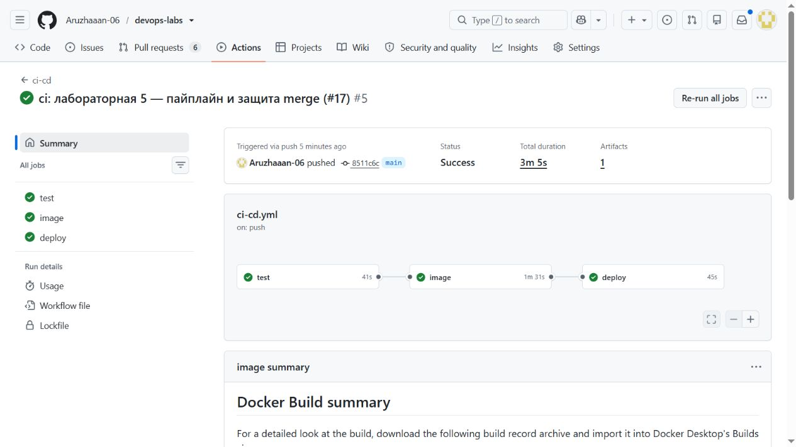
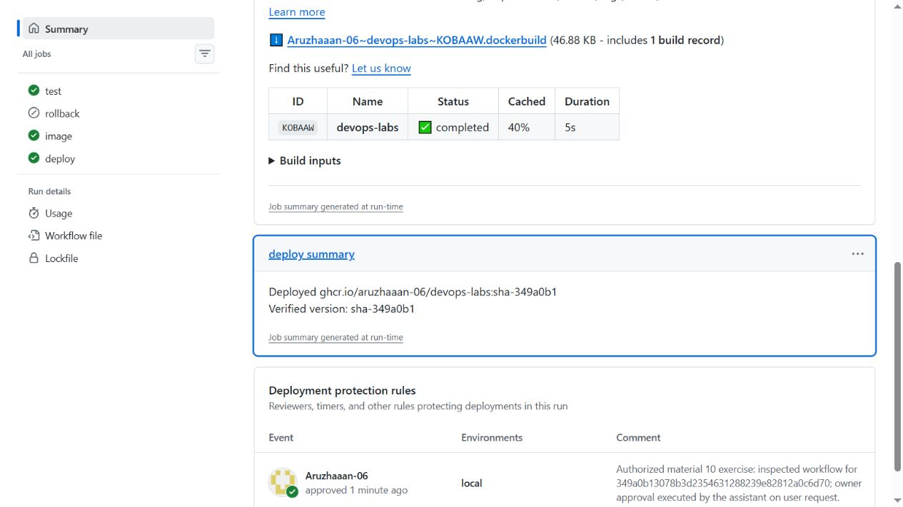
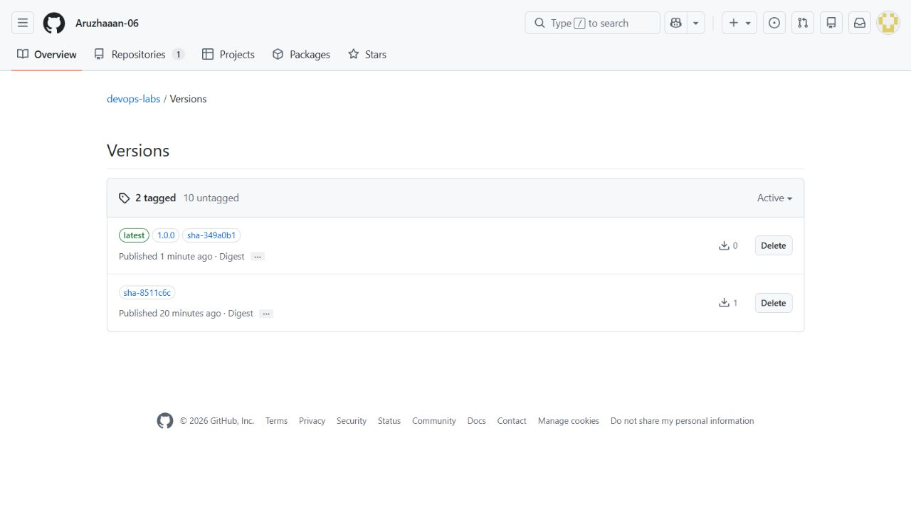

# Үздіксіз жеткізу және кері қайтару

Д. Серікбаев атындағы Шығыс Қазақстан техникалық университеті · Есімханова Аружан Түсіпханқызы · 25-ИСТК-2о.

Бұл нұсқаулық қазақша редакцияланған есептердің толық мазмұнын және қайталауға арналған бастапқы командаларды біріктіреді. Төмендегі өлшемдер мен тексерулер тиісті тарихи кезеңге жатады; аударма оларды қайта орындау болып саналмайды. Код, нақты HTTP жауаптары мен журнал үзінділері бастапқы тілінде сақталған. Қазіргі толықтық пен орындалмаған UI тармақтары [жеке тізімде](REPORT_COMPLETENESS.md) берілген.

## 5.2 — Үздіксіз жеткізу және кері қайтару

### Жұмыстың мақсаты

GHCR бейнесін жариялау, жергілікті ортаға орналастыру, дайындық тексеруі және бұрынғы нұсқаға кері қайтару тізбегін тексеру.

### Теориялық мәліметтер

Бейне тегі орналастырылатын нұсқаны анықтайды. Дайындық тексеруі процестің іске қосылғанын ғана емес, сұрау қабылдай алатынын бағалайды. Кері қайтаруда бұрынғы белгілі бейне таңдалады; деректер томы бөлек сақталады.

ВКТУ · DEVOPS · 10-МАТЕРИАЛ

## 2-бөлім: 6-9-тармақтар және үш қосымша тапсырма

| Мәлімет | Мәні |
|---|---|
| Орындаған | Есімханова Аружан Түсіпханқызы |
| Тобы | 25-ИСТК-2о |
| Университет | ВКТУ |
| Күні | 2026 жылғы 23 қазан |
| Репозиторий | Aruzhaaan-06/devops-labs, public |

## Мақсаты

Тексерілген кодты GHCR контейнер бейнесіна айналдырып, жергілікті Docker Desktop-та іске қосу; жаңа нұсқаны, дайындықты және деректердің сақталуын дәлелдеу; бұрынғы нұсқаға қайта құрастырмай оралу және v1.0.0 релизін шығару.

## Нақты нәтиже

main үшін test → image → deploy тізбегі орындалды. Жаңа GET / жауабында hello from CI/CD хабарламасы бар. InMemory тестілері 39/39, PostgreSQL CI тестілері 39/39; тірі API-де Postman 38 сұрау мен 103 тексеруді қатесіз орындады. Қолмен және Actions батырмасы арқылы кері қайтару тексерілді.

[Код пен workflow өзгерісі: PR #18](https://github.com/Aruzhaaan-06/devops-labs/pull/18) · [Релиз v1.0.0](https://github.com/Aruzhaaan-06/devops-labs/releases/tag/v1.0.0)

Код, командалар, шынайы API жауаптары және GitHub суреттері дәлел ретінде бастапқы тілінде сақталған. Түсіндірмелер мен қорытындылар қазақ тілінде жазылды.

## Алғашқы толық пайплайн

09-материалдың PR #17-і міндетті test пен code owner мақұлдауынан кейін squash merge арқылы біріктірілді. main коммиті 8511c6c болды. test GitHub-hosted Ubuntu-да PostgreSQL қызметімен орындалды; image бейнені GHCR-ға жіберді; deploy self-hosted Windows runner-де дайын бейнені іске қосты.



[Түпнұсқаны толық ажыратымдылықта ашу](../reports/assets/d50db26a63e45581.jpg)

1-сурет. Бірінші толық run: test, image және deploy - Success. Сурет нақты GitHub Actions бетінен алынған.

| Тексеру | Нәтиже |
|---|---|
| main және API нұсқасы | 8511c6c → sha-8511c6c |
| Образ | ghcr.io/aruzhaaan-06/devops-labs:sha-8511c6c |
| Дайындық | /health/live = 200, /health/ready = 200 |
| Деректер | Жоба мен тапсырма жасалып, екі кері қайтаруға дейін сақталды |

[Толық бастапқы run 39926367307](https://github.com/Aruzhaaan-06/devops-labs/actions/runs/39926367307)

Осы компьютерде 8080 портын бұрыннан басқа қызмет қолданады. Сондықтан хосттағы API_PORT=8088, ал контейнер ішіндегі порт 8080 күйінде қалды. DB_PORT=15432 және COMPOSE_SUBNET=10.254.54.0/24 бұрынғы жұмыстармен үйлестірілді.

## Жаңа хабарлама және тексерулер

feat/info-message тармағында InfoResponse моделіне string Message қосылды. GET / бұрынғы service, version, host өрістерін сақтап, hello from CI/CD хабарламасын қайтарады. PR #18 жасыл test пен мақұлдаудан кейін біріктірілді; жаңа main - 349a0b1.

```text
{
  "service": "DemoApi",
  "version": "sha-349a0b1",
  "host": "caeec38802cb",
  "message": "hello from CI/CD"
}
```

| Тексеру | Нәтиже |
|---|---|
| Жергілікті InMemory | 39/39: 7 unit және 32 integration тест |
| PR және main PostgreSQL CI | 39/39, failure жоқ |
| Postman, нақты Docker API | 38 сұрау, 103 assertion, қате 0 |
| Жаңа интеграциялық тест | Service, Message, APP_VERSION және бос емес Host тексеріледі |
| Коллекцияға қосылған сұрау | GET /: HTTP 200, Service, Message, Version - 4 тексеру |

Postman localhost:8088 мекенжайындағы нақты PostgreSQL қолданатын контейнерге жіберілді; expectedVersion=sha-349a0b1 мәні берілді. Exit code - 0. Postman бұлтқа жариялау орындалған жоқ; CLI-дің тіркелгі сұраған ескертуі жергілікті тексерулерді тоқтатпады.

[PR тексеруі](https://github.com/Aruzhaaan-06/devops-labs/actions/runs/39926948580) · [Жаңа main: бірінші іске қосу](https://github.com/Aruzhaaan-06/devops-labs/actions/runs/39927177292/attempts/1)

## Қайта deploy жасаудың әсері

Сол main run-ының deploy job-ы қайта орындалды. image тегі мен Compose конфигурациясы бірдей болғанда API контейнерінің ID-і және StartedAt өзгермеді. Осы бақылау бірдей нұсқаны қайта орналастыру контейнерді қажетсіз қайта жасамағанын көрсетеді.

```text
API_IMAGE=ghcr.io/aruzhaaan-06/devops-labs
API_TAG=sha-349a0b1
docker compose up -d --no-build --wait --wait-timeout 90
```

SHA тегі код нұсқасын анықтайды, бірақ registry тегі техникалық тұрғыдан қайта тағайындалуы мүмкін. Нақты артефакт үшін image ID және registry manifest digest бөлек сақталды.

## Қолмен кері қайтару

Алдыңғы қысқа SHA тегі docker image ls арқылы табылып, жергілікті кэште бар sha-8511c6c бейнесі таңдалды. Код қайта құрастырылған жоқ. Тек осы Compose жобасының қызметтері жаңартылды; PostgreSQL-дің атаулы томы жойылған жоқ.

```text
$env:API_IMAGE = "ghcr.io/aruzhaaan-06/devops-labs"
$env:API_TAG = "sha-8511c6c"
docker compose up -d --no-build --wait --wait-timeout 90
Invoke-RestMethod http://localhost:8088/
Remove-Item Env:API_IMAGE, Env:API_TAG
```

| Өлшем | Нақты нәтиже |
|---|---|
| Уақыт | 12,823 секунд |
| Басталуы | Бірінші Compose командасының алдындағы сәт |
| Аяқталуы | GET / ескі version мәнін бірінші растаған сәт |
| Ескі нұсқа | sha-8511c6c; message өрісі жоқ |
| Деректер | Бақылау жобасы мен тапсырмасы бастапқы JSON мәндерімен бірдей |
| Том | devops-labs_pgdata сақталды |

```text
{
  "service": "DemoApi",
  "version": "sha-8511c6c",
  "host": "2ee94556fa64"
}
```

## Дұрыс нұсқаға қайта оралу

GitHub Actions-та жаңа main run үшін Re-run all jobs орындалды. test, image және deploy қайтадан сәтті аяқталды; GET / қайтадан sha-349a0b1 және hello from CI/CD көрсетті. Бақылау жобасы мен тапсырмасы сақталды.

[Re-run all jobs: үшінші әрекет](https://github.com/Aruzhaaan-06/devops-labs/actions/runs/39927177292/attempts/3)

Өлшеу PowerShell терезесіндегі шамалау арқылы емес, monotonic таймермен жасалды; UTC басталу/аяқталу сәттері manual-rollback-timing.json файлында сақталған.

## Батырмамен кері қайтару және approval

workflow_dispatch оқиғасына міндетті tag енгізуі және бөлек rollback job қосылды. Бұл жолда test, image және deploy өткізіледі; бұрын жарияланған бейне тартылады. sha-xxxxxxx немесе x.y.z пішімі тексеріледі, latest қабылданбайды. Енгізу shell мәтініне тікелей қойылмай, environment арқылы беріледі.

| Өлшем | Нақты нәтиже |
|---|---|
| Run | 39927957374, workflow_dispatch, success |
| Таңдалған тег | sha-8511c6c |
| Уақыт | 57,696 секунд |
| Өлшеу шекарасы | Dispatch сұрауы → approval/кезек → ескі GET / жауабын растау |
| Нәтиже | Ескі version, message жоқ, жоба мен тапсырма сақталды |

Бұл 57,696 секундқа approval, runner кезегі және бақылау аралығы кіреді; оны 12,823 секундтық тікелей Compose өлшемімен бірдей деп салыстыруға болмайды. Содан кейін deploy қайта орындалып, sha-349a0b1 қалпына келтірілді.



[Түпнұсқаны толық ажыратымдылықта ашу](../reports/assets/afd8b3d4619e0cf9.jpg)

2-сурет. Job summary тексерілген бейне бен version мәнін көрсетеді; астында local ортасының approval жазбасы бар.

local Environment: required reviewer - Aruzhaaan-06, protected branches ғана рұқсат етілген, әкімші айналып өте алмайды. Күту нақты API күйімен тіркелді. Мақұлдау осы оқу сценарийі үшін иенің тапсырмасымен ассистент арқылы орындалды; тәуелсіз адамның тексеруі ретінде көрсетілмейді.

[Батырмалық кері қайтару run-ы](https://github.com/Aruzhaaan-06/devops-labs/actions/runs/39927957374)

## v1.0.0 релизі және Packages

Тексерілген 349a0b1 коммитіне v1.0.0 аннотацияланған Git тегі қойылып, origin-ге жіберілді. GitHub Release автоматты release notes арқылы жасалды. Тегтің test және image жұмыстары сәтті өтті; deploy және rollback skipped болды.



[Түпнұсқаны толық ажыратымдылықта ашу](../reports/assets/380b5b8cb6523b07.jpg)

3-сурет. Packages бетінде latest, sha-349a0b1, 1.0.0 және алдыңғы sha-8511c6c тегтері бар. Сурет тег пайплайны аяқталғаннан кейін алынды.

| Тексеру | Нәтиже |
|---|---|
| Тег run-ы | 39928705609 - success |
| test / image | success / success |
| deploy / rollback | skipped / skipped |
| API контейнері | Тег run-ының алдында және соңында ID мен StartedAt өзгермеді |
| API нұсқасы | sha-349a0b1 және hello from CI/CD сақталды |

[Тег пайплайны](https://github.com/Aruzhaaan-06/devops-labs/actions/runs/39928705609) · [Жария релиз](https://github.com/Aruzhaaan-06/devops-labs/releases/tag/v1.0.0)

Registry-дегі 1.0.0 тегі мен қолданбаның APP_VERSION мәні екі бөлек ұғым: осы релиздегі API нұсқасы sha-349a0b1 болып қалады. Тег оқиғасы жұмыс істеп тұрған контейнерге орналастыру жүргізбеді.

## Дәріс сұрақтарына жауап

## PR кезінде бейне неге жарияланбайды?

PR коды әлі main тармағына қабылданбаған. Бұл workflow PR үшін test job-ын ғана іске қосады; GHCR write құқығы тек image job-ына беріледі. Қабылданбаған код жергілікті runner-де орналастырылмайды.

## CI PostgreSQL-ді қайдан алады?

services.postgres уақытша postgres:18-alpine контейнерін іске қосады, pg_isready health check дайындықты күтеді. Storage=Postgres пен ConnectionStrings__Db тестілерді сол қызметке бағыттайды.

## Неге latest орнына sha тегі қолданылады?

sha тегі кодтың коммитін көрсетіп, алдыңғы нұсқаны таңдауға мүмкіндік береді; latest жылжиды. Registry тегін қайта тағайындауға болатындықтан, дәл артефактты тану үшін digest те сақталады.

## NAT артындағы self-hosted runner қалай байланысады?

Runner GitHub-қа өзі шығыс HTTPS қосылымын орнатып, тапсырма күтеді. Осы компьютерге сырттан ашық кіріс портын беру қажет емес.

## Қайта құрастырмай қалай тез ораламыз?

Бұрын жарияланған бейнені таңдап, API_IMAGE пен API_TAG орнатамыз. Compose up --no-build --wait орындаймыз, кейін GET / нұсқасын және readiness күйін тексереміз. Бұл жұмыста қолмен қайтару 12,823 секунд алды.

## image-ден deploy-ға мәндер қалай беріледі?

Step outputs → job outputs → needs.image.outputs тізбегі API_IMAGE пен API_TAG береді. Жай файл жеткіліксіз: jobs әртүрлі runner-лерде, ортақ емес дискілерде орындалады.

## Delivery мен Deployment айырмасы қандай?

Delivery тексерілген артефактты дайындайды; оны іске қосуға бөлек шешім қажет. Deployment сервисті де жаңартады. main push test → image → deploy жолын өтеді, бірақ осы қосымша нұсқада жергілікті мақұлдау күтеді. Тег тек бейне жариялайды.

## Бір тегке deploy қайталанса не болады?

Образ бен Compose конфигурациясы өзгермесе, жұмыс істеп тұрған контейнер қайта жасалмайды. Бұл болжам контейнер ID және StartedAt мәндерін салыстыру арқылы нақты тексерілді.

## Тапсыруға арналған қорытынды

| Талап | Орындалуы |
|---|---|
| 6: алғашқы main deploy | PR #17 біріктірілді; test → image → deploy жасыл |
| 7: Message өзгерісі | PR #18, 39/39 тест, sha-349a0b1 және жаңа хабарлама |
| 8: кері қайтару | 12,823 с; ескі жауап; Re-run all jobs арқылы қалпына келтіру |
| 9: v1.0.0 | 1.0.0 Packages тегі; тег deploy жасамады |
| Қосымша 1 | workflow_dispatch + tag + бөлек rollback; нақты run сәтті |
| Қосымша 2 | Job summary тексерілген Deployed image және version көрсетеді |
| Қосымша 3 | local, required reviewer, күту және approval дәлелі |
| Жинақталған тексеру | 34 шарт сәтті, қате 0 |

## Тапсырылатын материалдар

Қазақша PDF, бастапқы код пен workflow, Postman коллекциясы, толық пайплайн және Packages суреттері, GET / жауаптары, тест нәтижелері, уақыт өлшемдері мен деректердің сақталуын дәлелдейтін JSON файлдары репозиторийде беріледі. 09-материалдағы қызыл test пен blocked merge дәлелдері өз тарихи каталогында сақталды.

[Осы бөлімнің дәлелдері](https://github.com/Aruzhaaan-06/devops-labs/tree/main/evidence/lab05-cd) · [Орындау тәртібі](https://github.com/Aruzhaaan-06/devops-labs/tree/main/docs/lab05-cd.md) · [Барлық қазақша есеп](https://github.com/Aruzhaaan-06/devops-labs/tree/main/reports)

## Жариялаудан кейінгі соңғы нұсқа

Бұл есеп функционалдық 349a0b1 кезеңінің өлшемдерін тіркейді. Есепті жариялайтын құжат коммиті main SHA-ын өзгертеді және CI/CD қайта орындайды. Соңғы main SHA, тірі API нұсқасы, health және файл хештері v1.0.0 релизіне lab10-final-verification.json ретінде тіркеледі. Бұл PDF ішіне өзінің болашақ коммит SHA-ын жазу қажеттілігін жояды.

## Шектеулер

Екі GitHub аккаунты бір адамға тиесілі; олармен жасалған техникалық ревью тәуелсіз топтас студенттің жұмысын дәлелдемейді. Оқытушының логині берілмеген. Бұрынғы жұмыстардағы қолмен жөндеу мен Visual Studio/Postman суреттерінің ашық тармақтары өз чек-парағында қалады. API осы компьютер мен runner жұмыс істеп тұрған кезде қолжетімді.

Құпия дерек DB_PASSWORD secret-і арқылы беріледі; пароль мен runner credential файлдары есепке қосылған жоқ. Python скрипті тек сақталған дәлелдерден PDF жасайды, CI немесе deploy іске қоспайды.

## Нәтижелер және шектеулер

39/39 тест, Postman 38 сұрау/103 тексеру, test → image → deploy тізбегі және екі rollback сақталған. Қолмен rollback 12,823 с, workflow rollback 57,696 с; v1.0.0 жарияланған.

Өлшемдер сол кездегі ортаға жатады. Оқытушының қолжетімділігі, бұрынғы UI дәлелдері және жұптық жұмысты келісу ашық.

[PDF есебі](../reports/lab05-cd-report.pdf) · [Өңделетін бастапқы файл](../reports/source/lab05-cd-report.json) · [Нақты дәлелдер](../evidence/lab05-cd/README.md)

## Қайта орындауға арналған командалар

Бұл блоктар бастапқы нұсқаулықтан сақталған. Олар автоматты түрде орындалмайды. Томды жою, контейнерді тоқтату немесе ақау туғызу командалары тек тиісті оқшауланған оқу тәжірибесіне арналған. Бар `.env` файлын қайта жазбаңыз; нақты құпиясөзді Git-ке қоспаңыз. Бұрынғы тег/нұсқа атаулары тарихи кезеңді білдіреді.

## Бастапқы нұсқаулықтағы сілтемелер

- [Дереккөз 1](https://github.com/Aruzhaaan-06/devops-labs/pull/18)
- [Дереккөз 2](https://github.com/Aruzhaaan-06/devops-labs/actions/runs/39926367307)
- [Дереккөз 3](https://github.com/Aruzhaaan-06/devops-labs/actions/runs/39927177292)
- [Дереккөз 4](https://github.com/Aruzhaaan-06/devops-labs/actions/runs/39927957374)
- [Дереккөз 5](https://github.com/Aruzhaaan-06/devops-labs/actions/runs/39928705609)
- [Дереккөз 6](../evidence/lab05-cd/checks.json)
- [Дереккөз 7](../reports/lab05-cd-report.pdf)
- [Дереккөз 8](../evidence/lab05-cd/README.md)

<!-- Бұрын жарияланған бөлім сілтемелерінің тұрақты идентификаторлары. -->
<a id="5-зертханалық-жұмыс-2-бөлім---материал-10"></a>
<a id="міндетті-сценарий"></a>
<a id="артефакт-және-орналастыру"></a>
<a id="қайта-орындау-және-екі-кері-қайтару"></a>
<a id="environment-local-және-құпия-дерек"></a>
<a id="релиз"></a>
<a id="дәріс-сұрақтарына-жауап"></a>
<a id="өлшенген-нәтиже-және-қайта-орындау"></a>
