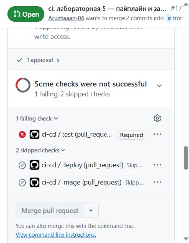
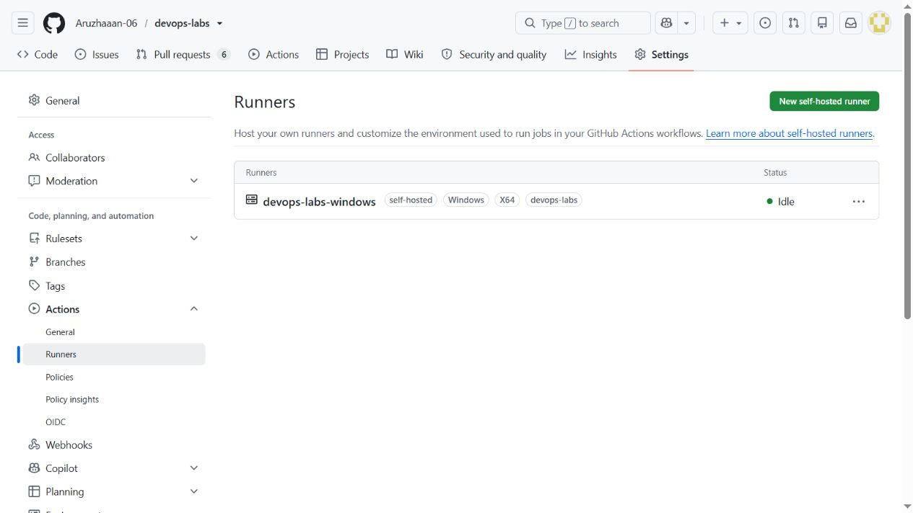
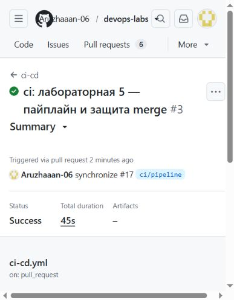

# GitHub Actions арқылы үздіксіз интеграция

Есімханова Аружан Түсіпханқызы · 25-ИСТК-2о · Д. Серікбаев атындағы ШҚТУ.

## 5.1 — GitHub Actions арқылы үздіксіз интеграция

### Мақсаты

Құрастыру мен PostgreSQL тестілерін GitHub Actions ішінде автоматтандырып, сәтсіз тест кезінде біріктірудің бұғатталуын тексеру.

ВКТУ · DEVOPS · 09-МАТЕРИАЛ

### 1-бөлім: пайплайн, міндетті тест және жергілікті runner

| Мәлімет | Мәні |
|---|---|
| Орындаған | Есімханова Аружан Түсіпханқызы |
| Тобы | 25-ИСТК-2о |
| Университет | ВКТУ |
| Күні | 2026 жылғы 23 қазан |
| Тапсырма | 09-материал, 1-5-тармақтар |

### Мақсаты

Әр PR үшін PostgreSQL қатысатын автоматты тестілерді іске қосу, қызыл test бар кезде main тармағына біріктіруге тыйым салу және келесі бөлімге жергілікті Windows runner мен құпия деректі дайындау.

### Нақты нәтиже

Жергілікті Release құрастыруы сәтті: 0 ескерту, 0 қате; PostgreSQL тестілері 38/38. GitHub-та үш нақты кезең орындалды: жасыл 38/38, әдейі бұзылған бір тестпен қызыл 37/38 және тест қалпына келтірілгеннен кейін жасыл 38/38. 24 техникалық тексеру сәтті өтті.

[Workflow және бес жауап берілген PR #17](https://github.com/Aruzhaaan-06/devops-labs/pull/17) · [Жұмыс тармағы ci/pipeline](https://github.com/Aruzhaaan-06/devops-labs/tree/ci/pipeline)

Әдістемелік нұсқаулық бойынша PR осы бөлімде ашық қалдырылды. Біріктіру, GHCR-ға бейне жіберу, жергілікті deploy және rollback 10-материалға жатады. Олардың орындалғаны осы есепте мәлімделмейді.

Екі GitHub аккаунты бір адамға тиесілі. Ревью - GitHub механизмінің техникалық тексеруі; ол тәуелсіз студенттің тексеруі ретінде көрсетілмейді. Код, командалар, лог жолдары және нақты суреттер бастапқы тілінде сақталды.

### Workflow және бес сұраққа жауап

### PR, main push және v1.0.0 тегі

| Оқиға | Орындалатын жұмыстар |
|---|---|
| main тармағына PR | test; image және deploy skipped |
| main push | test → image → deploy; келесі job алдыңғысына тәуелді |
| v1.0.0 тегі | test → image; deploy skipped, себебі ref main емес |

Бұл кесте workflow шарттарын түсіндіреді. Осы бөлімде нақты PR жолы тексерілді; push және тег арқылы жариялау келесі бөлімде тексеріледі.

### PostgreSQL қайдан алынады?

test job GitHub-hosted Ubuntu runner-де орындалады. services.postgres postgres:18-alpine контейнерін іске қосып, pg_isready арқылы оның дайындығын күтеді. Storage=Postgres және ConnectionStrings__Db тестілерді localhost:5432 мекенжайындағы уақытша demo дерекқорына бағыттайды. CI-дегі demo паролі жергілікті томның құпиясөзі емес.

### image ішіндегі GITHUB_TOKEN құқықтары

contents: read бастапқы кодты алуға, packages: write бейнені GHCR-ға жіберуге қажет. Қосымша write құқығы тек image job үшін берілген; негізгі workflow contents: read пайдаланады. Жеке PAT workflow файлына енгізілмейді.

### deploy қайда орындалады және неге?

self-hosted, Windows, X64, devops-labs белгілері бар жергілікті орындаушы агентте орындалады. Ол осы компьютердің Docker Desktop қызметіне қол жеткізеді; GitHub-hosted runner жергілікті Docker-ді көрмейді. deploy тек осы репозиторийдің main push оқиғасына арналған.

### Жаңа контейнер healthy болмаса не болады?

docker compose up командасындегі --wait --wait-timeout 90 сәтсіз аяқталып, job қызыл болады. Кейінгі readiness smoke test орындалмайды. Smoke test орындалған кезде HTTP қатесі де job-ты сәтсіз етеді. Workflow автоматты rollback жасамайды; кері қайтару келесі материалда тексеріледі.

Осы бес жауап PR #17 сипаттамасына да енгізілген. Жасыл CI тек тексерілген кодқа қатысты; ол жариялау немесе deploy автоматты түрде орындалды дегенді білдірмейді.

### Жергілікті тексеру және бейімдеу

Алдымен Docker Compose дерекқоры іске қосылды. Жергілікті .env құпиясөзін өзгертпей, тек тестілерге арналған demo_lab09_tests дерекқоры дайындалды. Дерекқор құпиясөзі тек процесс ортасы арқылы берілді, журналға жазылған жоқ.

```text
docker compose up -d --wait db
dotnet restore DemoApi.slnx
dotnet build DemoApi.slnx --no-restore -c Release
dotnet test DemoApi.slnx --no-build -c Release
```

SQL тестілерін орындағанда Storage=Postgres және ConnectionStrings__Db айнымалылары бөлек тест дерекқорын көрсетті. Нәтиже: барлық 38 тест өтті, оның 7-еуі модульдік, 31-і интеграциялық.

### Оқу kit файлы қалай өзгертілді?

| Бейімдеу | Себебі |
|---|---|
| DemoApi.slnx нақты көрсетілді | Runner дұрыс шешімді restore/build/test етуі үшін |
| 6 action нақты SHA-ға бекітілді | Әр іске қосуда сол ресми action коды пайдаланылуы үшін |
| persist-credentials: false | Checkout-тан кейін Git тіркелгі деректерін сақтамау үшін |
| Windows/X64/devops-labs белгілері | Deploy дұрыс жергілікті runner-ге түсуі үшін |
| 15432, 8088 және 10.254.54.0/24 | Қолданыстағы Compose порттары мен желісіне сәйкестендіру үшін |

### Тесті merge шартына айналдыру

Бірінші GitHub Actions run сәтті өткен соң, қолданыстағы main ruleset-ке required_status_checks ережесі қосылды. Контекст - test, дереккөзі - GitHub Actions қолданбасы. Соңғы main кодымен тексеруді талап ету қосылды. Бұрынғы PR, code owner мақұлдауы, force-push пен жоюға тыйым сақталды; bypass тізімі бос қалды.

Ревьюердің Approve-ы тест әдейі бұзылмай тұрып алынды. Қызыл кезеңде мақұлдау сақталғанымен, міндетті test сәтсіз болғандықтан merge қолжетімсіз болды. Осылайша блоктау тек ревьюдің жоқтығынан емес, нақты тесттен болғаны расталды.

Жергілікті тексеру, CI және GitHub ruleset нәтижелері бөлек JSON және мәтіндік журналдарда сақталған.

### Қызыл test merge-ті бұғаттады

Create_DuplicateName_ReturnsConflict тестіндегі күтілетін Conflict уақытша OK мәніне ауыстырылды. API дұрыс 409 қайтарды; әдейі қате күту тестті құлатты. Қате коммит: bfd8617.



[Суретті ашу](../reports/assets/81bfc6bd7bd6fd8f.jpg)

1-сурет. PR #17: 1 approval бар; ci-cd / test қызыл және Required деп белгіленген; Merge pull request түймесі қолжетімсіз. Сурет браузерден тікелей алынды.

```text
Create_DuplicateName_ReturnsConflict [FAIL]
Expected: OK
Actual:   Conflict
Failed: 1, Passed: 37, Total: 38
Process completed with exit code 1.
```

Жоғарыдағы жолдар GitHub Actions журналынан алынған; уақыт белгілері мен қадам атауы ықшамдалған. Толық журнал evidence/lab05-ci/failure-ci-log.txt ішінде сақталған. Күтілген HTTP 200 мен нақты HTTP 409 айырмасы анық көрінеді.

[Қызыл GitHub Actions run](https://github.com/Aruzhaaan-06/devops-labs/actions/runs/39922922366) · [Әдейі қате тест коммиті](https://github.com/Aruzhaaan-06/devops-labs/pull/17/commits/bfd861774f93526fcddf7e1f0c987413ff24146f)

GitHub REST күйі де mergeable_state=blocked болды. Серверге қате кодты біріктіру сұрауы жіберілген жоқ: интерфейс пен API блоктауды нақты көрсетті.

### Runner және DB_PASSWORD

Ресми actions-runner-win-x64-2.338.0.zip архиві жүктеліп, оның SHA-256 сомасы GitHub берген мәнмен салыстырылды. Runner C:\actions-runner каталогына, репозиторийден тыс орнатылды. Тіркеу токені журналға не Git-ке жазылған жоқ.



[Суретті ашу](../reports/assets/35c86b131b2f432a.jpg)

2-сурет. Settings → Actions → Runners: devops-labs-windows, Windows/X64/devops-labs белгілері және Idle күйі. API тексеруі status=online және busy=false мәндерін көрсетті.

| Параметр | Нақты күйі |
|---|---|
| Іске қосу | run.cmd фондық процесте; Windows қызметі ретінде орнатылмаған |
| Репозиторий құпия дерегі | DB_PASSWORD атауымен сақталған; мәні көрсетілмейді |
| Құпиясөздің көзі | Жергілікті .env файлының қолданыстағы томға сәйкес мәні |
| Deploy ортасы | PowerShell 7, API_PORT=8088, DB_PORT=15432 |

Құпия дерек GitHub CLI-ге stdin арқылы берілді. GitHub API тек secret атауы мен уақыт метадеректерін қайтарады; құпиясөз мәнін қайтармайды. Есепте оның мәні көрсетілмейді. Runner тіркелгі файлдары C:\actions-runner ішінде ғана қалады.

### Қауіпсіздік шекарасы

Қоғамдық репозиторийдегі self-hosted runner жергілікті пайдаланушы құқықтарымен код орындайды. Сыртқы қатысушылардың workflow-лары үшін all_external_contributors мақұлдауы сақталды. PR тестілері hosted Ubuntu-да қалады. Бұл толық оқшаулау емес: сыртқы кодты тексермей мақұлдауға болмайды.

Компьютер немесе runner процесі тоқтаса, ол Offline болады. Осы есеп дайындалған кезде агент Online/Idle күйінде келесі зертханалық жұмысқа қалдырылды.

### Қалпына келтіру және қорытынды

Күтілетін код жеке коммитпен Conflict мәніне қайтарылды: 07ef056. Бастапқы және қалпына келтірілген коммиттердің src, tests және workflow файлдары бірдей екені тексерілді. Қате күту түпкілікті нұсқада қалған жоқ.



[Суретті ашу](../reports/assets/6e7d0355286d61e2.jpg)

3-сурет. Тест қалпына келтірілгеннен кейінгі GitHub Actions run: Success. API мен толық логта test=success, image/deploy=skipped және 38 өткен тест көрсетілген.

| Кезең | Коммит және нәтиже |
|---|---|
| Бастапқы CI | 4052ddb - 38/38, success |
| Әдейі қате тест | bfd8617 - 37/38, failure; merge blocked |
| Қалпына келтіру | 07ef056 - 38/38, success |

[Бастапқы жасыл run](https://github.com/Aruzhaaan-06/devops-labs/actions/runs/39922701822) · [Қалпына келген жасыл run](https://github.com/Aruzhaaan-06/devops-labs/actions/runs/39923354322) · [Бес жауабы бар PR #17](https://github.com/Aruzhaaan-06/devops-labs/pull/17)

### 09-материалдың нәтижесі

Workflow жарияланды, 24 тексеру сәтті өтті, міндетті test пен қызыл кезде merge блокталуы дәлелденді, тест қалпына келтірілді, runner және secret дайындалды. Есепте талап етілген сілтемелер, қате жолы және нақты суреттер берілген.

PR әдейі ашық қалдырылды: 10-материалда оны біріктіріп, image → GHCR → жергілікті deploy → readiness smoke test және rollback орындалады. Есеп пен дәлелдер ci/pipeline тармағында жарияланады; олар main тармағына осы кезеңде біріктірілмейді.

Ресми анықтама: [GitHub Actions .NET](https://docs.github.com/en/actions/tutorials/build-and-test-code/net); [runner қауіпсіздігі](https://docs.github.com/en/actions/reference/security/secure-use). Есеп жинақтаушы скрипт арқылы сақталған дәлелдерден қайта құрастырылады; скрипт CI-ді іске қоспайды.

## Талдау

Қате күтілетін мән функционалдық тестті сәтсіз етті және міндетті test тексеруі merge әрекетін бұғаттады. Күтілетін Conflict қалпына келген соң 38 тест қайта өтті.

## Қорытынды

GitHub Actions арқылы құрастыру мен PostgreSQL тесттері автоматтандырылды. Сәтсіз test кезінде main тармағына біріктіру бұғатталатыны тексерілді.

[PDF есебі](../reports/lab05-ci-report.pdf) · [Бастапқы материалдар](../evidence/lab05-ci/README.md)

<a id="5-зертханалық-жұмыс-1-бөлім---материал-09"></a>
<a id="workflow-құрылымы"></a>
<a id="жергілікті-runner-және-secret"></a>
<a id="қате-және-қалпына-келтіру-сценарийі"></a>
<a id="пайплайнның-келесі-бөлігі"></a>
<a id="2026-жылғы-23-қазандағы-нәтиже"></a>
<a id="10-материалдағы-жалғасы"></a>
