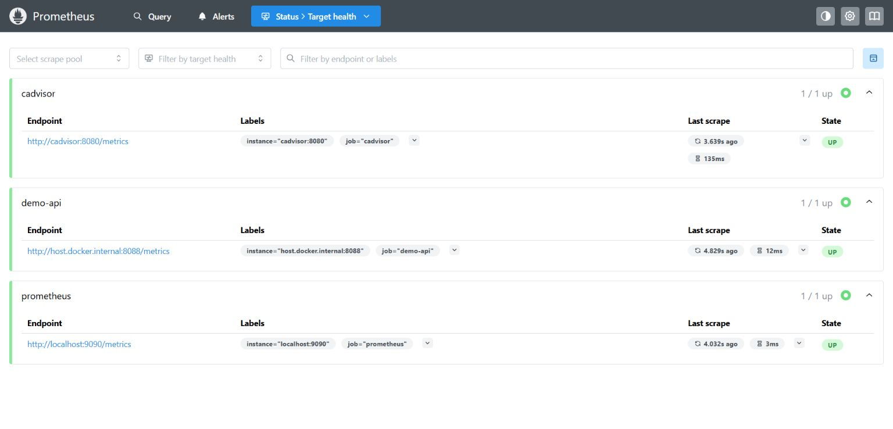
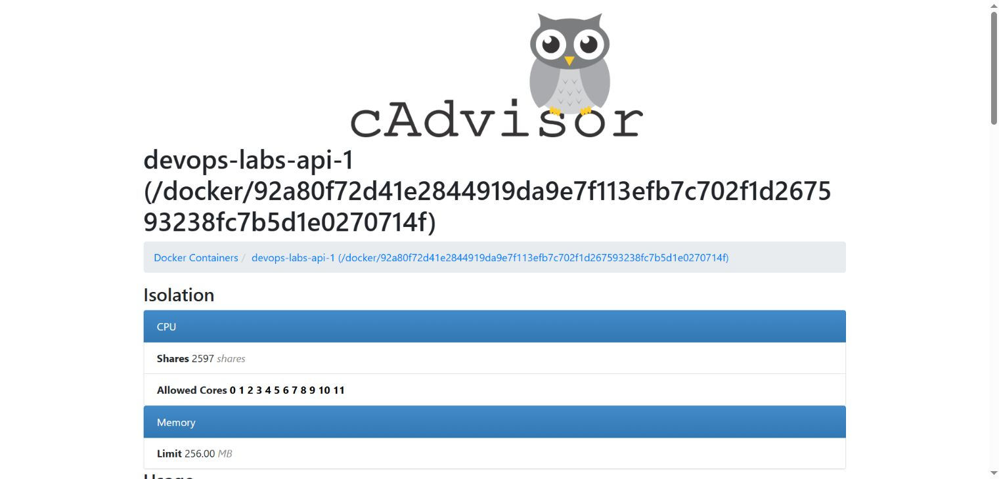
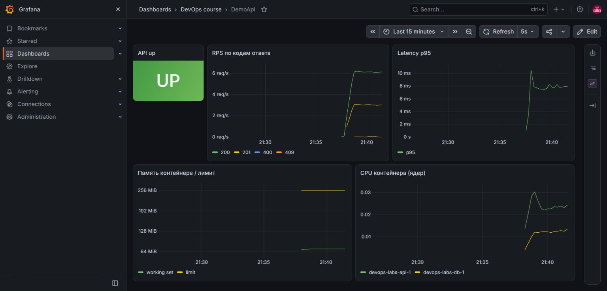
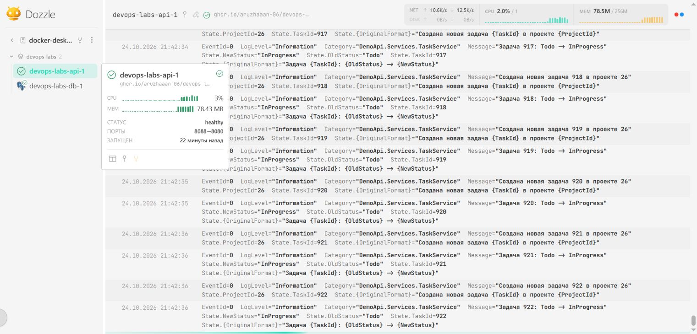
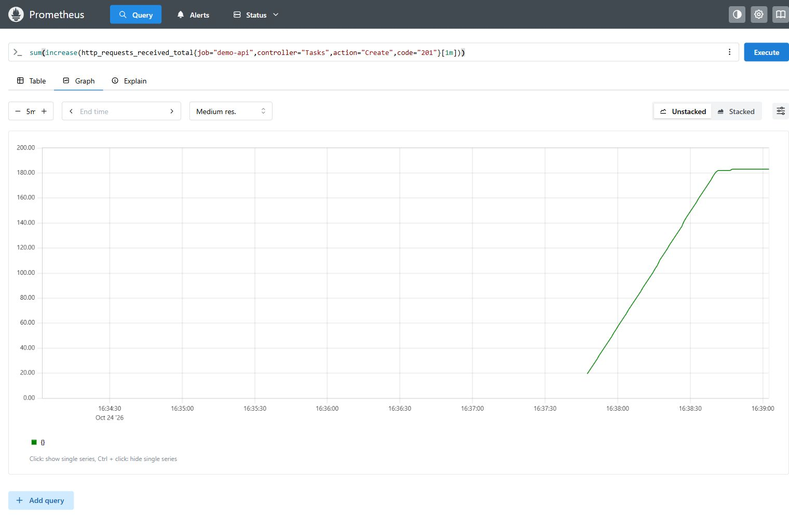
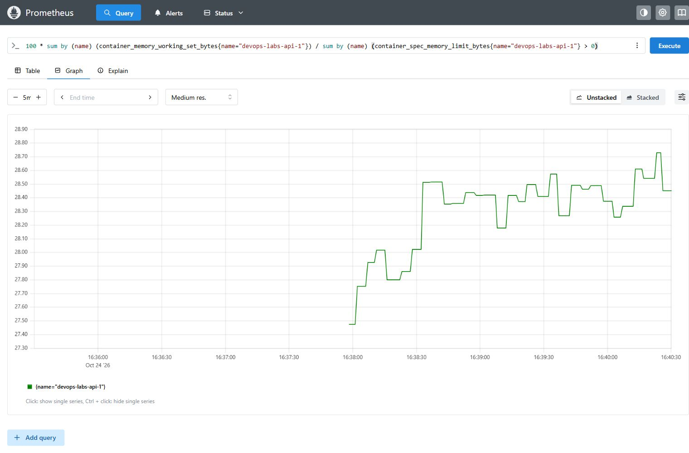
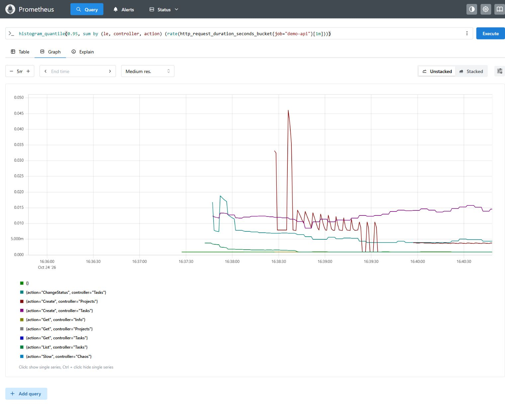
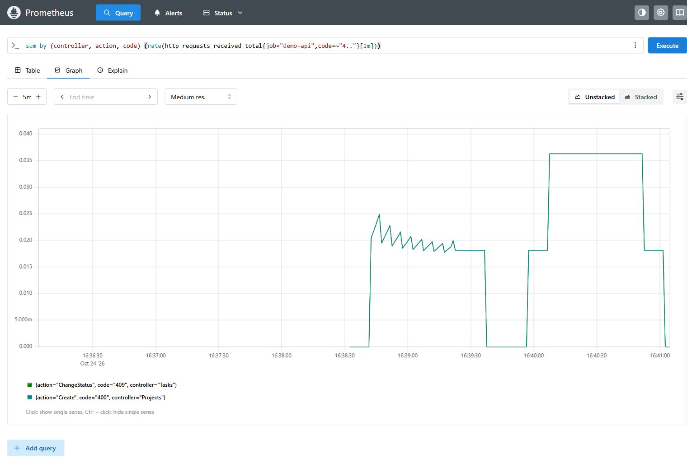

# Метрикалар және PromQL

Д. Серікбаев атындағы Шығыс Қазақстан техникалық университеті · Есімханова Аружан Түсіпханқызы · 25-ИСТК-2о.

Бұл нұсқаулық қазақша редакцияланған есептердің толық мазмұнын және қайталауға арналған бастапқы командаларды біріктіреді. Төмендегі өлшемдер мен тексерулер тиісті тарихи кезеңге жатады; аударма оларды қайта орындау болып саналмайды. Код, нақты HTTP жауаптары мен журнал үзінділері бастапқы тілінде сақталған. Қазіргі толықтық пен орындалмаған UI тармақтары [жеке тізімде](REPORT_COMPLETENESS.md) берілген.

## 7.1 — Метрикалар және PromQL

### Жұмыстың мақсаты

API метрикаларын, контейнер ресурстарын және журналдарын бір стендке біріктіріп, PromQL сұрауларымен жүктемені талдау.

### Теориялық мәліметтер

Counter оқиғалар санын жинайды, ал rate уақыт бірлігіндегі өзгерісті бағалайды. Histogram бойынша p95 bucket аралығында интерполяцияланады; ол жеке сұраудың дәл секундомерлік өлшеміне тең емес.

ВКТУ · DEVOPS · 13-МАТЕРИАЛ

## 1-бөлім: мониторинг стегі, бастапқы метрикалар,жүктеме және сұраулар (1-4-тармақтар)

| Мәлімет | Мәні |
|---|---|
| Орындаған | Есімханова Аружан Түсіпханқызы |
| Тобы | 25-ИСТК-2о |
| Университет | ВКТУ |
| Күні | 2026 жылғы 24 қазан |
| Тапсырма | 13-материал; 7-зертханалық жұмыс, 1-бөлім |

## Мақсаты

DemoApi сервисі мен контейнер ресурстарын Prometheus арқылы бақылау, Grafana дашбордын іске қосу, cAdvisor метрикаларын және Dozzle журналдарын оқу. Жүктеме кезінде сұрау жиілігін, p95 кідірісін, жадты және клиент қателерін PromQL арқылы өлшеу.

## Нақты нәтиже

Үш нысанның бәрі UP. Әдістемедегі бес және жеке құрастырылған төрт PromQL сұрауы орындалды. Нақты HTTP400/409 жауаптары графикте көрінді. Жүктеме 1200 итерацияны қатесіз аяқтады; 1200 тапсырманың бәрі InProgress күйінде сақталды.

Chrome браузерінен 13 шынайы экран суреті алынды; міндетті Target health және төрт жеке сұраудың графиктері осы есепке енгізілді. Postman: 5 сұрау, 15 тексеру, қате 0.

[Мониторинг стегінің PR #22-і](https://github.com/Aruzhaaan-06/devops-labs/pull/22) · [Конфигурация](https://github.com/Aruzhaaan-06/devops-labs/tree/main/monitoring) · [Бастапқы дәлелдер](https://github.com/Aruzhaaan-06/devops-labs/tree/main/evidence/lab07-metrics)

Өлшемдер API-дің sha-e8be38f нұсқасында алынды. Негізгі сандық кесінді: 2026-10-24 16:40:13 UTC, жергілікті уақыт 21:40:13 (UTC+5). Скриншоттар бірнеше минут аралығында түсірілді; олардың сандары кесіндімен дәл бірдей болуы міндетті емес.

## Мониторинг стегі және нысандар

| Құрал және порт | Нұсқа және қызметі |
|---|---|
| Prometheus · 9090 | v3.14.0; метрикаларды жинау, сақтау және ережелерді есептеу |
| Grafana · 3000 | 13.2.1; Prometheus дереккөзі, DevOps course / DemoApi дашборды |
| cAdvisor · 8081 | v0.60.5; контейнердің cgroup CPU/жад метрикалары |
| Dozzle · 8888 | v11.0.1; тек devops-labs жобасының журналдары |

```text
docker compose -f monitoring/compose.yaml up -d
docker compose -f monitoring/compose.yaml exec -T prometheus promtool check config
/etc/prometheus/prometheus.yml
```



[Түпнұсқаны толық ажыратымдылықта ашу](../reports/assets/cf37b61a096976a7.png)

1-сурет. Prometheus → Status → Target health: cadvisor, demo-api және prometheus - барлығы UP.

prometheus.yml: scrape_interval және evaluation_interval - 5 секунд. demo-api → host.docker.internal:8088/metrics; cadvisor → cadvisor:8080/metrics; prometheus → localhost:9090/metrics. API-дің хосттағы порты 8088, контейнер ішіндегі порты 8080. host.docker.internal арқылы нақты жинау сәтті болды.

Мониторинг жеке Compose жобасында іске қосылды. Docker автоматты адрес пулдары толғандықтан, бос 10.254.55.0/24 ішкі желісі берілді; MONITORING_SUBNET арқылы өзгертіледі. Қолданыстағы желілер мен өзге жобалар жойылған жоқ. Promtool конфигурация мен бес ереженің синтаксисін растады.

[Нысандардың JSON күйі](https://github.com/Aruzhaaan-06/devops-labs/blob/main/evidence/lab07-metrics/targets.json) · [Promtool нәтижесі](https://github.com/Aruzhaaan-06/devops-labs/blob/main/evidence/lab07-metrics/promtool.txt)

## Бастапқы метрикалар және жүктеме

API метрикаларындағы controller="Tasks" белгісі TasksController класын, action="Create", "ChangeStatus", "List" белгілері оның аттас әдістерін көрсетеді. Projects/Create - ProjectsController.Create. Қысқартылған нақты кесінді төменде; толық жолдар api-metrics.txt файлында сақталған.

```text
http_requests_received_total{controller="Tasks",action="Create",code="201",...}
http_requests_received_total{controller="Tasks",action="ChangeStatus",code="200",...}
http_requests_received_total{controller="Projects",action="Create",code="400",...}
```

Жолдардағы көп нүкте басқа белгілердің есепте ықшамдалғанын білдіреді; метрика файлы өзгертілген жоқ. Counter жинақталған HTTP жауаптарын санайды; ол бизнес оқиғасының жеке есептегіші емес.

```text
pwsh ./scripts/load.ps1 -BaseUrl http://localhost:8088 -DelayMs 300 -Iterations 1200
...
iterations: 1200
completed: 1200; failed: 0; project: 26
```

Скрипт бір жоба құрады. Әр итерация тапсырма құрады, оны Todo → InProgress күйіне ауыстырады және Todo сүзгісімен тізім сұрайды; соңында 300 мс күтеді. Әр 20 итерацияда санауыш шығады. Iterations=0 болса, әдістемедегідей Ctrl+C-ге дейін жұмыс істейді. Қате болса, соңғы exit code нөлден өзгеше болады.

Нақты іске қосу: жоба №26, 1200 итерация, қате 0. БД-дан 1200 InProgress тапсырмасы қайта оқылып тексерілді. Жүктеме аяқталған; деректер дәлел ретінде сақталды. Бұрынғы 10-12-материалдардың үш бақылау жобасы мен тапсырмасы өзгермеген.



[Түпнұсқаны толық ажыратымдылықта ашу](../reports/assets/e7bc978fff55143f.png)

2-сурет. cAdvisor → Docker Containers → devops-labs-api-1. Жад шегі 256 MiB; нақты метрикада 268435456 байт.

[API метрикалары](https://github.com/Aruzhaaan-06/devops-labs/blob/main/evidence/lab07-metrics/api-metrics.txt) · [cAdvisor метрикалары](https://github.com/Aruzhaaan-06/devops-labs/blob/main/evidence/lab07-metrics/cadvisor-metrics.txt) · [Жүктеме нәтижесі](https://github.com/Aruzhaaan-06/devops-labs/blob/main/evidence/lab07-metrics/load-results.json)

## Дашборд және журналдар



[Түпнұсқаны толық ажыратымдылықта ашу](../reports/assets/ec834a95a7aafb36.png)

3-сурет. DevOps course / DemoApi: UP, кодтар бойынша RPS, жалпы p95, жад/шек және API/БД CPU графиктері.

Grafana дереккөзі provisioning арқылы http://prometheus:9090 адресіне қосылады; UID - prometheus. Дашборд JSON файлы Git ішінде. cAdvisor метрикаларындағы атау нақты devops-labs-api-1 атауына түзетілді. Жад сызығы 256 MiB шегінен төмен, CPU екі контейнер бойынша бөлек көрсетіледі.



[Түпнұсқаны толық ажыратымдылықта ашу](../reports/assets/493cd4558ed4aed7.png)

4-сурет. Dozzle: devops-labs-api-1 журналында тапсырма құру және Todo → InProgress ауысуы көрінеді.

Метрика сұраулардың жиілігі мен кідірісін санмен көрсетеді; журнал нақты taskId/projectId және орындалған әрекетті түсіндіреді. Dozzle сүзгісі өзге жобалардың журналдарын интерфейске қоспайды. Журналдағы тіл дәлел ретінде өзгертілмеген.

## Әдістемедегі бес PromQL сұрауы

## Нысандардың қолжетімділігі

```text
up
```

Үш қатардың әрқайсысы 1: соңғы scrape сәтті. up=1 бизнес логика түгел дұрыс деген кепіл емес; ол /metrics адресінің қолжетімділігін көрсетеді.

## Әрекеттер бойынша RPS

```text
sum by (controller,
   action) (rate(http_requests_received_total{job="demo-api"}[1m]))
```

rate - соңғы минуттағы орташа өсім, өлшемі сұрау/с. Tasks/Create ≈3,0365; ChangeStatus ≈3,0547; List ≈3,0183. Контроллерсіз қатарлар health/metrics сияқты MVC-ден тыс маршруттарды да қамтуы мүмкін.

## Жалпы p95 кідірісі

```text
histogram_quantile(0.95,
   sum by (le) (rate(http_request_duration_seconds_bucket{job="demo-api"}[1m])))
```

Негізгі кесіндіде 0,007796 с, яғни шамамен 7,796 мс. le белгісі гистограмма аралықтарының шекараларын сақтайды; нәтиже аралықтар арасындағы интерполяцияға тәуелді.

## API жады

```text
container_memory_working_set_bytes{name="devops-labs-api-1"} / 1024 / 1024
```

Working set = 73,246 MiB. 1024-ке екі рет бөлу байтты MiB-ке ауыстырады; бұл Docker-дегі бүкіл контейнердің жады.

## Контейнер CPU жүктемесі

```text
sum by (name) (rate(container_cpu_usage_seconds_total{name=~"devops-labs-.*"}[1m]))
```

rate(counter) пайдаланылған ядролар үлесін береді. Кесіндіде API ≈0,02268 ядро, БД ≈0,01203 ядро. API үшін 1,0 ядро - Compose-тағы бір ядролық квотаға жуық жүктеме.

Бес сұрау Prometheus → Query → Graph ішінде де орындалды; олардың жеке экран суреттері screenshots/required-*.png файлдарында. Негізгі бір уақытқа есептелген instant және 3 минуттық range JSON нәтижелері бөлек сақталған. Графиктер 5 минуттық аралықты көрсетеді.

## Жеке сұрау: құрылған тапсырмалар

```text
sum(increase(http_requests_received_total{job="demo-api",
  controller="Tasks",
  action="Create",
  code="201"}[1m]))
```



[Түпнұсқаны толық ажыратымдылықта ашу](../reports/assets/5545dc37fda81147.png)

5-сурет. Соңғы минутта HTTP201 жауабымен құрылған тапсырмалар саны.

## Түсіндіру

Сұрау Tasks/Create/201 қатарын таңдап, increase арқылы соңғы минуттағы өсімді есептейді. sum барлық сәйкес қатарларды біріктіреді. Негізгі кесінді: 182,1918 тапсырма/мин.

Бөлшек сан - қате емес: increase өлшем терезесінің шеттерін экстраполяциялайды. Бұл барлық уақыттағы тапсырма саны да, БД-дағы нақты 1200 жолдың саны да емес. Жүктеме шамамен минутына 182 тапсырма құрды.

[Instant және range нәтижесі](https://github.com/Aruzhaaan-06/devops-labs/blob/main/evidence/lab07-metrics/own-created.json) · [Түпнұсқа экран суреті](https://github.com/Aruzhaaan-06/devops-labs/blob/main/evidence/lab07-metrics/screenshots/own-created.png)

## Жеке сұрау: жадтың шекке қатынасы

```text
100 * sum by (name) (container_memory_working_set_bytes{name="devops-labs-api-1"}) / sum by (name)
(container_spec_memory_limit_bytes{name="devops-labs-api-1"} > 0)
```



[Түпнұсқаны толық ажыратымдылықта ашу](../reports/assets/a9f1d896022625e0.png)

6-сурет. API working set жадының белгіленген шекке пайыздық қатынасы.

## Түсіндіру

Кесінді: 28,6118%. Алым - working set, бөлім - 268435456 байт шек. Екі жақта да name бойынша бірдей топтау қолданылды; басқа белгілер нәтижені қажетсіз ұзартпайды.

Шегі нөлден үлкен контейнер ғана есепке алынады: >0 сүзгісі нөлге бөлуді болдырмайды. Жад 80% ескерту шегінен төмен. Working set - қолданылған жадтан белсенді емес файл кэші шегерілген көрсеткіш; ол процесс жады метрикасымен дәл бірдей болмауы мүмкін.

[Instant және range нәтижесі](https://github.com/Aruzhaaan-06/devops-labs/blob/main/evidence/lab07-metrics/own-memory.json) · [Түпнұсқа экран суреті](https://github.com/Aruzhaaan-06/devops-labs/blob/main/evidence/lab07-metrics/screenshots/own-memory.png)

## Жеке сұрау: әрекеттер бойынша p95

```text
histogram_quantile(0.95,
   sum by (le,
   controller,
   action) (rate(http_request_duration_seconds_bucket{job="demo-api"}[1m])))
```



[Түпнұсқаны толық ажыратымдылықта ашу](../reports/assets/7b85a0101d4eb26e.png)

7-сурет. Әр controller/action тобы үшін p95 кідірісінің графигі.

## Түсіндіру

rate әр гистограмма аралығының минуттық өсімін есептейді. sum by(le,controller,action) аралық шекарасын және әрекетті сақтайды. histogram_quantile(0.95,...) әр әрекетке жеке 95-процентиль береді.

Кесінді: Tasks/Create - 13,680 мс; ChangeStatus - 3,970 мс; List - 1,078 мс. Бұрын орындалған, бірақ соңғы минутта сұрауы болмаған Projects/Get, Tasks/Get және Chaos/Slow үшін NaN сақталды: осы терезеде p95 анықталмайды. Ол нөлге ауыстырылған жоқ.

[Instant және range нәтижесі](https://github.com/Aruzhaaan-06/devops-labs/blob/main/evidence/lab07-metrics/own-p95.json) · [Түпнұсқа экран суреті](https://github.com/Aruzhaaan-06/devops-labs/blob/main/evidence/lab07-metrics/screenshots/own-p95.png)

## Жеке сұрау: клиент қателерінің жиілігі

```text
sum by (controller,
   action,
   code) (rate(http_requests_received_total{job="demo-api",
  code=~"4.."}[1m]))
```



[Түпнұсқаны толық ажыратымдылықта ашу](../reports/assets/4a3132ff0e3e9a87.png)

8-сурет. Projects/Create/400 және Tasks/ChangeStatus/409 қатарларының жиілігі.

## Түсіндіру

Бос жоба атауы HTTP400 берді. Жаңа Todo тапсырмасын бірден Done күйіне ауыстыру HTTP409 берді. Сұраулар бастапқы scrape-тен кейін қайталанды, сондықтан counter өсімі rate арқылы көрінді. Екі кодтың кесіндідегі жиілігі де ≈0,03637 сұрау/с.

controller/action/code бойынша топтау қай әрекеттің және қай кодтың жиілегенін көрсетеді. Бірдей уақытта бірдей санмен жасалған 400/409 сызықтары графикте қабаттасады; екеуі де графиктің шартты белгілерінде және JSON ішінде бар. 4xx клиенттің жарамсыз сұрауы кері қайтарылғанын білдіреді; оны сервердің 5xx қатесімен араластырмау керек.

[Instant және range нәтижесі](https://github.com/Aruzhaaan-06/devops-labs/blob/main/evidence/lab07-metrics/own-4xx.json) · [Түпнұсқа экран суреті](https://github.com/Aruzhaaan-06/devops-labs/blob/main/evidence/lab07-metrics/screenshots/own-4xx.png)

```text
POST /api/projects  {"name":""} -> 400
POST /api/tasks  {"projectId":28,"title":"lab13-Todo-to-Done"} -> 201
PATCH /api/tasks/428/status  {"status":"Done"} -> 409
```

## Ережелер, тексеру және қорытынды

| Ереже | Шарты |
|---|---|
| ApiDown | up=0; 30 с сақталса, critical |
| ApiHighErrorRate | Соңғы минутта 5xx үлесі &gt;5%; 30 с |
| ApiSlowRequests | Жалпы p95 &gt;1 с; 30 с |
| ContainerHighMemory | API working set / шек &gt;80%; 15 с |
| ContainerRestarted | Соңғы 5 минутта max by(name)(start_time) өзгерген |

Бұл бөлімде ережелердің мазмұны оқылып, синтаксисі және жүктелуі тексерілді. Ақау тудырып, барлық алертті іске қосу - келесі 14-материалдың міндеті; ол осы есепте орындалды деп көрсетілмейді.

## Тексеру

Нақты Prometheus API: 3/3 UP; 9 instant және 9 range сұрауы. Белсенді әрекеттердің p95 мәндері анықталған, NaN белсенді емес әрекеттер үшін сақталған. Нақты 400/409 жауаптары, API және cAdvisor бастапқы метрикалары, жүктеме журналы мен 13 шынайы скриншот Git-те сақталған. Postman CLI: 5 сұрау, 15 тексеру, exit0; бұлтқа жіберілген жоқ.

## Қауіпсіздік және қолдану шегі

Төрт UI тек 127.0.0.1 адресіне жарияланған. Grafana admin/admin - әдістемедегі жергілікті бастапқы кіру. cAdvisor privileged және host mount қолданады; Dozzle Docker socket-ін оқиды. Socket-ті :ro тіркеу Docker API-ге толық қауіпсіздік шекарасы бола алмайды. Стендті интернетке ашуға болмайды; Dozzle actions/shell қосылған жоқ. Құпия DB_PASSWORD файлдарға қосылмайды.

## Жариялау және қайталау

[PR #22](https://github.com/Aruzhaaan-06/devops-labs/pull/22) · [Қайта орындау нұсқаулығы](https://github.com/Aruzhaaan-06/devops-labs/blob/main/docs/lab07-metrics.md) · [Postman коллекциясы](https://github.com/Aruzhaaan-06/devops-labs/blob/main/postman/lab07-metrics.postman_collection.json) · [Соңғы deploy-ды тексеру файлы бар релиз](https://github.com/Aruzhaaan-06/devops-labs/releases/tag/v1.0.0)

Кейінгі main CI/CD дәл осы өлшем нұсқасының SHA-сына тең болмайды: есеп пен құжаттаманың өзі де жаңа commit жасайды. Соңғы main/runtime сәйкестігі lab13-final-verification.json релиз файлы арқылы беріледі. Бұрынғы 11 PDF өзгертілмейді. Техникалық Approve үшін бір адамның екі тіркелгісі қолданылады; бұл тәуелсіз жұптық ревью емес. Оқытушының GitHub атауы әлі белгісіз.

## Қорытынды

Метрика, ресурс және журнал бір стендте байланыстырылды. Жүктеменің сұрау жиілігі мен кідірісі өлшенді, API жады шекпен салыстырылды, 400/409 клиент қателері әрекеттер бойынша табылды. 13-материалдың 1-4-тармақтары орындалды; алерт тәжірибелері мен инцидентті талдау келесі жұмыстарға қалды.

[Prometheus: rate, increase, histogram_quantile](https://prometheus.io/docs/prometheus/3.12/querying/functions/) · [cAdvisor ресми репозиторийі](https://github.com/google/cadvisor) · [Dozzle ресми нұсқаулығы](https://dozzle.dev/guide/getting-started)

## Нәтижелер және шектеулер

3/3 UP, тоғыз PromQL сұрауы, 13 шынайы сурет, 1200 итерация және Postman 5 сұрау/15 тексеру сақталған.

Бұл кезеңде барлық алертті әдейі іске қосу орындалмаған; ол 14-материалдың жеке тәжірибесіне жатады.

[PDF есебі](../reports/lab07-metrics-report.pdf) · [Өңделетін бастапқы файл](../reports/source/lab07-metrics-report.json) · [Нақты дәлелдер](../evidence/lab07-metrics/README.md)

## Қайта орындауға арналған командалар

Бұл блоктар бастапқы нұсқаулықтан сақталған. Олар автоматты түрде орындалмайды. Томды жою, контейнерді тоқтату немесе ақау туғызу командалары тек тиісті оқшауланған оқу тәжірибесіне арналған. Бар `.env` файлын қайта жазбаңыз; нақты құпиясөзді Git-ке қоспаңыз. Бұрынғы тег/нұсқа атаулары тарихи кезеңді білдіреді.

```powershell
docker compose -f monitoring/compose.yaml config --quiet
docker compose -f monitoring/compose.yaml up -d
docker compose -f monitoring/compose.yaml exec -T prometheus promtool check config /etc/prometheus/prometheus.yml
pwsh ./scripts/load.ps1 -BaseUrl http://localhost:8088 -DelayMs 300 -Iterations 1200
```

```powershell
python scripts/verify-lab13.py --output ./tmp/lab13-new-run
postman collection run postman/lab07-metrics.postman_collection.json --env-var queryTime=<epoch-из-own-created.json> --no-report-events
```

## Бастапқы нұсқаулықтағы сілтемелер

- [Дереккөз 1](https://github.com/Aruzhaaan-06/devops-labs/pull/22)
- [Дереккөз 2](../reports/lab07-metrics-report.pdf)
- [Дереккөз 3](../evidence/lab07-metrics/README.md)
- [Дереккөз 4](lab05-cd.md)
- [Дереккөз 5](http://localhost:9090/targets)
- [Дереккөз 6](http://localhost:3000)
- [Дереккөз 7](http://localhost:8081/docker/)
- [Дереккөз 8](http://localhost:8888)
- [Дереккөз 9](../evidence/lab07-metrics)
- [Дереккөз 10](https://github.com/Aruzhaaan-06/devops-labs/releases/tag/v1.0.0)
- [Дереккөз 11](https://prometheus.io/docs/prometheus/3.12/querying/functions/)
- [Дереккөз 12](https://github.com/google/cadvisor)
- [Дереккөз 13](https://dozzle.dev/guide/getting-started)

<!-- Бұрын жарияланған бөлім сілтемелерінің тұрақты идентификаторлары. -->
<a id="материал-13-метрики-и-promql"></a>
<a id="запуск-и-повторение"></a>
<a id="что-проверено-в-ui"></a>
<a id="запросы-и-смысл-результатов"></a>
<a id="границы-и-результат"></a>
