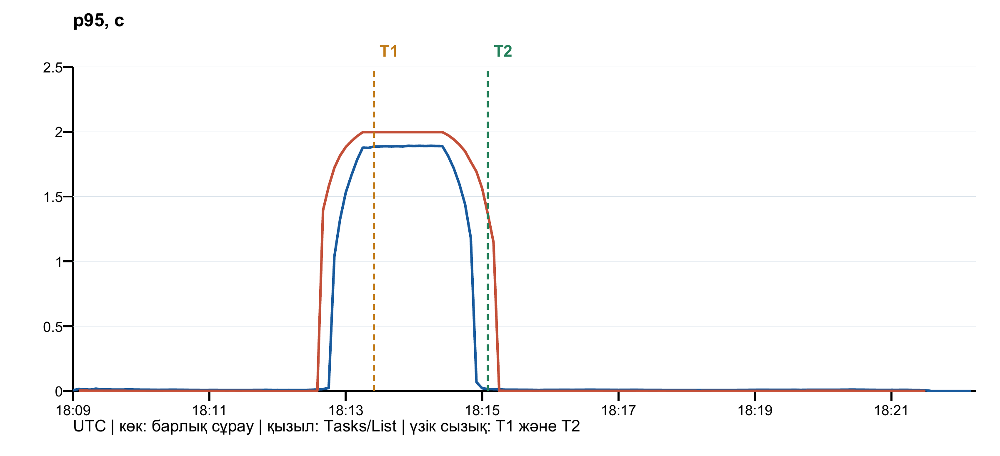

# Инцидентті анықтау және қалпына келтіру

Д. Серікбаев атындағы Шығыс Қазақстан техникалық университеті · Есімханова Аружан Түсіпханқызы · 25-ИСТК-2о.

Бұл нұсқаулық қазақша редакцияланған есептердің толық мазмұнын және қайталауға арналған бастапқы командаларды біріктіреді. Төмендегі өлшемдер мен тексерулер тиісті тарихи кезеңге жатады; аударма оларды қайта орындау болып саналмайды. Код, нақты HTTP жауаптары мен журнал үзінділері бастапқы тілінде сақталған. Қазіргі толықтық пен орындалмаған UI тармақтары [жеке тізімде](REPORT_COMPLETENESS.md) берілген.

## 8 — Инцидентті анықтау және қалпына келтіру

### Жұмыстың мақсаты

Кідіріс регрессиясын мониторинг арқылы анықтап, rollback, GitHub Revert PR және постмортем арқылы қалпына келтіру циклін орындау.

### Теориялық мәліметтер

Функционалдық тестінің сәттілігі жауап беру уақытының қолайлы екенін дәлелдемейді. Инцидент метрикаларының анықтамасы өлшеу шекарасына тәуелді. Орналастырудан кейінгі latency gate мәселені анықтайды, бірақ автоматты rollback жасамайды.

ВКТУ · DEVOPS · 15-МАТЕРИАЛ

## Қорытынды жұмыс: анықтау, кері қайтару және түзету

| Мәлімет | Мәні |
|---|---|
| Орындаған | Есімханова Аружан Түсіпханқызы |
| Тобы | 25-ИСТК-2о |
| Университет | ВКТУ |
| Күні | 2026 жылғы 24 қазан |
| Материал | 15; қорытынды 8-зертханалық жұмыс |

## Мақсаты

Шығарылымды пайплайн арқылы жариялау, деградацияны мониторингтен анықтау, бұрынғы нұсқаға кері қайтару, Revert PR арқылы түзету және қайталанудың алдын алу шараларын тіркеу.

## Нақты нәтиже

Функционалдық тестілерден өткен 1500 мс кідіріс әдейі шығарылды. ApiSlowRequests алерті іске қосылып, себеп Tasks/List әрекетінен табылды. Бұрынғы sha-cf768be нұсқасына rollback жасалды. GitHub жасаған Revert PR №28 түзетілген нұсқаны қайта жариялады. Бақылау деректері сақталды.

## Орындау шекарасы

Тәжірибе localhost оқу стендінде орындалды. Браузерді басқару бұғатталғандықтан UI скриншоттары жасалды деп көрсетілмейді: нақты Prometheus жауаптары, график және журналдар берілді. Оқытушы алдындағы онлайн қорғау бұл есеппен алмастырылмайды.

[Инцидент №27](https://github.com/Aruzhaaan-06/devops-labs/issues/27) · [Нашар шығарылым PR №26](https://github.com/Aruzhaaan-06/devops-labs/pull/26) · [Revert PR №28](https://github.com/Aruzhaaan-06/devops-labs/pull/28) · [v1.1.0 релизі](https://github.com/Aruzhaaan-06/devops-labs/releases/tag/v1.1.0)

Уақыттар UTC бойынша жазылған; жергілікті уақыт UTC+5. Негізгі өлшемдер түзетілген sha-21b953a кезеңіне қатысты. Есеп пен deploy тексеруі қосылған соңғы main сәйкестігі lab15-final-verification.json арқылы бөлек расталады.

## Бастапқы күй және жұмыс реті

| Қадам | Нақты орындау |
|---|---|
| 1. Нашар шығарылым | Issue №25, feat/25-audit, PR №26; CI және merge |
| 2. Анықтау | Қолмен сұрау жібермей ApiSlowRequests firing күту |
| 3. Кері қайтару | Сақталған sha-cf768be тегіне workflow rollback |
| 4. Инцидент | T0/T1/T2, метрикалар және себеп - issue №27 |
| 5. Түзету | GitHub жасаған Revert PR №28 және жаңа deploy |
| 6. Постмортем | Алты бөлім, әр әрекетке жеке issue №29-31 |
| 7. Релиз | Жаңа v1.1.0 тегі, жасалған release notes және постмортемге сілтеме |

## Стенд

ASP.NET Core / .NET 10 API, PostgreSQL, Docker Desktop, PowerShell 7, GitHub Actions және self-hosted Windows runner. Prometheus, Grafana, cAdvisor және Dozzle бұрынғы monitoring жобасында жұмыс істеді. API хостта 8088, контейнер ішінде 8080 портын қолданады; әдістемедегі 8080 хост адресі осы стендте 8088 болып бейімделді.

## Бастапқы тексеру

main=cf768be; GET / нұсқасы sha-cf768be. Readiness 200, үш monitoring нысанасы UP, ApiSlowRequests inactive. Runner online/idle болды. Бұрынғы sha-тег rollback нысанасы ретінде алдын ала сақталды; main қорғауы мен міндетті test өшірілген жоқ.

## Жүктеме

Бастапқы load.ps1 жаңа №37 жобасында тапсырма құрып, InProgress күйіне ауыстырып, тізімді оқыды. Қайталану шегі 20 000, кідірісі 300 мс; басқарушы процесс түзетілген нұсқа расталған соң өзінің жүктемесін ғана тоқтатты.

[Бастапқы күй](https://github.com/Aruzhaaan-06/devops-labs/blob/main/evidence/lab08-incident/baseline.json) · [Нақты алертті бақылаушы](https://github.com/Aruzhaaan-06/devops-labs/blob/main/scripts/observe-lab15.py)

## Функционалдық тест өткен нашар шығарылым

Issue №25 бойынша TaskService.ListAsync әдісі ғана өзгертілді. Сұраудың нәтижесі бұрынғыдай қалады, бірақ әр оқу 1500 мс күтеді. Сондықтан бұл мысал функционалдық дұрыстық пен жауап уақытының бөлек қасиеттер екенін көрсетеді.

```text
public async Task<IReadOnlyList<TaskItem>> ListAsync(
    int? projectId, TaskItemStatus? status, CancellationToken ct)
{
    await Task.Delay(1500, ct); // "аудит"
    return await tasks.ListAsync(projectId, status, ct);
}
```

| Белгі | Нәтиже |
|---|---|
| Ветка | feat/25-audit |
| PR | №26; Closes #25 |
| PR PostgreSQL CI | 40 өтті, 0 қате |
| Merge нәтижесі | 4e49041b629a30791b27654a793722dc8a4c82bf |
| main PostgreSQL CI | 40 өтті, 0 қате |
| Жарияланған нұсқа | sha-4e49041 |
| T0: GitHub merged_at | 18:10:54.000 UTC |

## Неге тестілер жасыл?

Тестілер HTTP күйін, жауап мазмұнын, валидацияны және деректерді тексереді. Сұраудың 1,5 секунд күтуі сол нәтижелерді өзгертпейді. Бұрынғы deploy smoke тек /health/ready-ді оқыды; ол Tasks/List кідірісін тексермеді.

## Ревьюдің шегі

Екі GitHub тіркелгісі бір адамға тиесілі. Сондықтан Approve - қорғалған репозиторийдегі техникалық сценарий, тәуелсіз топтас студенттің ревьюі емес. Әдейі енгізілген кідіріс оқу инциденті екені PR ішінде ашық жазылды.

[PR және diff](https://github.com/Aruzhaaan-06/devops-labs/pull/26) · [Төрт CI іске қосуының нәтижесі](https://github.com/Aruzhaaan-06/devops-labs/blob/main/evidence/lab08-incident/ci-summary.json)

## Алерт арқылы анықтау және себепті табу

Автоматты бақылаушы Prometheus ережелерін шамамен әр секунд сайын оқыды. ApiSlowRequests firing болғанға дейін қолмен API диагностикасы жасалмады. Жүктеме мен пайплайнның штаттық health тексерулері жұмысын жалғастырды.

| Өлшем | Нақты мән |
|---|---|
| T1: бірінші firing бақылауы | 18:14:18.726 UTC |
| Ереже | Жалпы p95 &gt; 1 с, for=30s |
| Себеп болған әрекет | controller=Tasks, action=List |
| Tasks/List p95 | 1,9968 с |
| Алерттен кейінгі бір HTTP жауабы | 200; 1,512 с |
| Нұсқа және код | sha-4e49041; TaskService.cs, 15-жол |

```text
histogram_quantile(0.95,
  sum by (le, controller, action) (
    rate(http_request_duration_seconds_bucket{job="demo-api"}[1m])
  )
)
```

## Диагностика жолы

PromQL әрекетті Tasks/List деп бөлді. Тек содан кейін GET / арқылы version оқылып, оның commit-і GitHub-та ашылды. TasksController.List сұрауды TaskService.ListAsync әдісіне береді; сол әдістің 15-жолындағы Task.Delay(1500, ct) кідірістің себебі болды.

## Екі түрлі уақыт өлшемі

Histogram p95 bucket шекаралары бойынша жуықталады. Сондықтан 1,9968 с мәнін дәл 1500 мс stopwatch өлшемімен теңестіруге болмайды. Екеуі де сұраудың белгіленген 1 секунд шегінен асқанын растайды.

[Бірінші firing](https://github.com/Aruzhaaan-06/devops-labs/blob/main/evidence/lab08-incident/first-firing.json) · [PromQL, version және нақты HTTP өлшемі](https://github.com/Aruzhaaan-06/devops-labs/blob/main/evidence/lab08-incident/diagnosis.json)

## Нақты метрикалар графигі және хронология



[Түпнұсқаны толық ажыратымдылықта ашу](../reports/assets/4145cc5242719c55.png)

1-сурет. Prometheus query_range бастапқы деректерінен құрылған график. Бұл Grafana UI скриншоты емес. Қадам - 5 секунд; NaN аралықтары нөлмен алмастырылмады. T1 - анықтау, T2 - rollback пен алерттің сөнгенін бірге растау.

| Оқиға | UTC | Мағынасы |
|---|---|---|
| T0 | 18:10:54.000 | PR merge; кейін CI, image және deploy бар |
| T1 | 18:14:18.726 | Бақылаушы ApiSlowRequests firing көрді |
| T2 | 18:15:58.875 | Ескі нұсқа расталды; ApiSlowRequests inactive |

Анықтау: T1 - T0 = **204,726 с**. Бұл санға пайплайн мен deploy да кіреді. Оны тек Prometheus scrape/evaluation кідірісі деп атау қате.

Қалпына келу: T2 - T1 = **100,149 с**. Диагностика, workflow dispatch, approval, runner кезегі, контейнерді ауыстыру және қалыпты күйді растау осы аралықта орындалды.

## Бақылау шегі

T0 GitHub серверінің секундтық merged_at уақытына сүйенеді. T1 және T2 - сақталған бақылау уақыттары. Миллисекундтың жазылуы абсолют шекара дәлдігін білдірмейді; бақылаушының шамамен 1 секундтық аралығы және API сұрау уақыты бар.

[Әр әрекеттің бастапқы қатары](https://github.com/Aruzhaaan-06/devops-labs/blob/main/evidence/lab08-incident/p95-actions-range.json) · [Уақыттардың анықтамалары](https://github.com/Aruzhaaan-06/devops-labs/blob/main/evidence/lab08-incident/incident-metrics.json)

## Алдымен сервисті қалпына келтіру

Себеп анықталғаннан кейін түзетуді күтпей, дайын бұрынғы бейнеге rollback жасалды. Нысана - sha-cf768be. Қозғалмалы latest тегі қолданылған жоқ; дерекқор томы жойылған жоқ.

```text
gh workflow run ci-cd.yml --ref main -f tag=sha-cf768be
# Таңдалған run үшін local environment approval
# rollback: pull existing image -> compose up -> readiness -> version
```

| Тексеру | Нәтиже |
|---|---|
| Workflow | workflow_dispatch; rollback job - success |
| Қайтарылған нұсқа | sha-cf768be |
| T2 | 18:15:58.875 UTC |
| ApiSlowRequests | inactive |
| Деректер | PostgreSQL бақылау объектілері сақталды |
| Жүктеме | Rollback кезінде жалғасты; байланыс қателері журналда қалды |

## Алерт неге бірден сөнбеуі мүмкін?

p95 соңғы минуттағы histogram өсіміне сүйенеді. Жаңа процесс, scrape және ережені есептеу уақыттары қатарға әсер етеді; ескі баяу үлгілердің салмағы бірден жоғалмайды. T2 тек нұсқа мен inactive күйі нақты расталғанда тіркелді.

## Шешімнің шегі

Жергілікті мақұлдау пайдаланушының тапсырмасы бойынша ассистентпен орындалды. Қорғау өшірілмеді және bypass қолданылмады. Бұл тәуелсіз адамның approval-ы деп көрсетілмейді. Rollback - жедел қалпына келтіру; main ішіндегі нашар commit келесі Revert PR арқылы ғана түзетіледі.

[Түпкі T2 және нұсқа](https://github.com/Aruzhaaan-06/devops-labs/blob/main/evidence/lab08-incident/T2.json) · [Инциденттегі rollback run сілтемесі](https://github.com/Aruzhaaan-06/devops-labs/issues/27)

## GitHub Revert PR арқылы тұрақты түзету

GitHub серверінің revertPullRequest операциясы PR №26 өзгерісін кері қайтаратын жаңа PR №28 жасады. Бұл - GitHub Revert батырмасының серверлік баламасы; файлды қолмен бұрынғы күйге ұқсатып жазу емес. Браузер қолжетімсіз болғандықтан операция ресми API арқылы орындалды.

| Қадам | Нәтиже |
|---|---|
| Revert PR | №28; сипаттамада Refs #27 |
| PR test | PostgreSQL 40/40 |
| Ревью | CODEOWNER екінші тіркелгімен; бір иесі бар екені көрсетілген |
| Merge және main | 21b953a4b34b5f336aca46f2928ede6966fb47d2 |
| main test -&gt; image -&gt; deploy | Барлығы success |
| Нақты version | sha-21b953a |
| Қалпына келген Tasks/List p95 | 1,759 мс |

## Кодты салыстыру

Revert-тен кейін src және tests каталогтары бастапқы cf768be нұсқасымен дәл салыстырылды: айырма жоқ. Бизнес-санауыш сақталды; HTTP-контракт өзгермеді. Compose, Dockerfile, scrape және alert ережелері де өзгертілген жоқ.

## Қайта қосылу алерті

ContainerRestarted соңғы 5 минуттағы process start өзгерісін көрсетеді. Басқарылатын deploy-дан кейін ол уақытша firing болуы қалыпты. Соңғы тексеруде осы терезе толық өткенше күтіліп, бес ереженің бәрі inactive болғаны расталады; уақыт қысқартылмайды.

[GitHub жасаған Revert PR](https://github.com/Aruzhaaan-06/devops-labs/pull/28) · [Нақты сервер операциясы](https://github.com/Aruzhaaan-06/devops-labs/blob/main/evidence/lab08-incident/revert-operation.json) · [Бастапқы және түзетілген код](https://github.com/Aruzhaaan-06/devops-labs/blob/main/evidence/lab08-incident/source-proof.json)

## Постмортем: не болды және неге болды

## Не болды?

«Аудит» атауымен тізімді оқу жолына 1500 мс жасанды күту енгізілді. Сұрау HTTP 200 қайтарды, функционалдық тестілер өтті. Деградацияны ApiSlowRequests алерті анықтады.

## Әсері

Оқу жүктемесіндегі Tasks/List клиенттері ұзақ күтті; нақты бір жауап 1,512 с алды. Қалпына келтірудің T1-ден есептелген уақыты 100,149 с. Бұл барлық клиентке әсердің дәл ұзақтығы емес: T0 - merge, ал әсер deploy-дан кейін басталған. Қайта қосылу кезіндегі 5 байланыс қатесі сақталды; тапсырмалар жойылған жоқ.

## Түпкі себеп

Әрбір оқу сұрауының тікелей жолындағы await Task.Delay(1500, ct). Аудитті орындау тәсіліне response-time бюджеті қойылмаған. Controller/action метрикалары мен root version себепті нақты commit-пен байланыстырды.

## Неге ертерек табылмады?

Функционалдық тестілер жауаптың дұрыстығын тексерді. Readiness дерекқорға қолжетімділікті тексерді. Екеуінде де Tasks/List жауап уақытының шегі болмады. Сондықтан жасыл пайплайн жеткілікті latency кепілдігі бола алмады.

## Не жақсы жұмыс істеді?

Алерт, controller/action белгілері, нұсқаны commit-пен байланыстыру, сақталған sha-тег, қорғалған PR үрдісі және дайын rollback workflow. Алдымен сервис қалпына келтіріліп, содан кейін main Revert PR арқылы түзетілді.

## Әрі қарайғы әрекеттер

Тез deploy smoke енгізу, жеке performance baseline дайындау және оқиғаға әрекет ету нұсқаулығын сақтау. Әр әрекетке жеке issue ашылды; орындалған және ашық қалған жұмыс ажыратылады.

[Инциденттегі бастапқы постмортем түсініктемесі](https://github.com/Aruzhaaan-06/devops-labs/issues/27#issuecomment-6387899631)

## Қайталанудың алдын алу және әрекеттер

| Issue | Әрекет және күй |
|---|---|
| №29 | Deploy ішінде Tasks/List latency smoke; осы жұмыстың қорытынды PR-ына енгізілді |
| №30 | PostgreSQL бар performance baseline; кеңейтілген follow-up ашық қалады |
| №31 | Диагностика, rollback және қорғау жоспары; нұсқаулыққа енгізілді |

## Жаңа deploy шегі

scripts/smoke-tasks-latency.ps1 үш рет деректерді өзгертпейтін GET жібереді. Әр жауап HTTP 200 болып, 1000 мс-тан аз уақытта аяқталуы тиіс; бір сұраудың timeout мәні 5 секунд. Белгісіз projectId және Todo сүзгісі үлкен жауап көлемінің ықпалын азайтады.

```text
./scripts/smoke-tasks-latency.ps1 `
  -BaseUrl "http://127.0.0.1:$env:API_PORT"
```

| Нұсқа | Өлшем | Қорытынды |
|---|---|---|
| Нашар | 1615,960 мс | exit 1; 1000 мс шегі орындалмады |
| Түзетілген, үлгі 1 | 98,281 мс | HTTP 200; шектен төмен |
| Түзетілген, үлгі 2 | 4,096 мс | HTTP 200; шектен төмен |
| Түзетілген, үлгі 3 | 2,590 мс | HTTP 200; шектен төмен |

## Нені қамтамасыз етеді?

Осы 1500 мс регрессиясы енді deploy job ішінде байқалмай жасыл өте алмайды. Тексеру readiness-тен кейін, Job summary-ден бұрын іске қосылады. Ол статистикалық жүктеме тесті де, автоматты rollback та емес. Шек бұзылса, оператор инцидент нұсқаулығымен кері қайтарады. Кеңейтілген жүктеме жұмысы №30 issue-де бөлек сақталды.

[№29: latency gate](https://github.com/Aruzhaaan-06/devops-labs/issues/29) · [№30: performance baseline](https://github.com/Aruzhaaan-06/devops-labs/issues/30) · [№31: runbook](https://github.com/Aruzhaaan-06/devops-labs/issues/31)

## Деректер, бақылау және тексеру нәтижелері

| Тексеру | Нақты нәтиже |
|---|---|
| Нашар PR және main CI | Екі іске қосуда да PostgreSQL 40/40 |
| Revert PR және main CI | Екі іске қосуда да PostgreSQL 40/40 |
| Read-only Postman | 6 сұрау; 13 тексеру; 0 қате |
| Ережелер | Бес ереже healthy/inactive болғанша күтілді |
| Бұрынғы деректер | 10-12 бақылау объектілері; 13-тегі 1200 InProgress; 14-тегі 2231/531 тапсырма сақталды |
| Инцидент жүктемесі | №37 жоба; 1771 InProgress тапсырма; 5 байланыс қатесі |
| Жүктеме/бақылаушы | Өз процестері тоқтатылды; Prometheus бақылаушысының қатесі жоқ |

## Дәлелдерді тексеру

checks.json уақытының реті, firing фактісі, себеп болған әрекет, version/commit байланысы, rollback, GitHub Revert операциясы, кодтың дәл қалпына келуі, деректердің сақталуы және latency шегінің екі нұсқадағы нәтижесін тексереді. Бұл - сақталған өлшемдердің тексеруі; ақау сценарийі қайта орындалмайды.

## Қайта тексеру

```text
postman collection run postman/lab08-incident.postman_collection.json `
  --env-var expectedVersion=sha-<current-main> --no-report-events
python scripts/check-lab15-evidence.py
```

## Маңызды шектеу

API/CLI жауаптары мен осы есептің графигі нақты деректерден алынды. Бірақ олар интерфейстің шынайы скриншоты деп көрсетілмейді. Браузер бұғаттауы салдарынан әдістемедегі alert/Grafana скриншоттары толықтырылмаған. Бұл тармақтың бағасын оқытушы анықтайды.

[Барлық бастапқы дәлелдер](https://github.com/Aruzhaaan-06/devops-labs/tree/main/evidence/lab08-incident) · [Қайта қолданылатын коллекция](https://github.com/Aruzhaaan-06/devops-labs/blob/main/postman/lab08-incident.postman_collection.json)

## Қорғауға дайындық: алты сұрақ

## PATCH /api/tasks/{id}/status қай жолмен өтеді?

TasksController.ChangeStatus алдымен TaskService.GetAsync арқылы тапсырманы алады. Ол жоқ болса 404 береді. StatusRules.CanTransition жалған болса 409 Problem жауабын контроллер жасайды. Рұқсат етілсе TaskService.ChangeStatusAsync репозиторийдің SetStatusAsync әдісін шақырады; PostgreSQL UPDATE орындалып, нәтиже 200 болып қайтады.

## Контейнер exit 137 арқылы аяқталды. Не істейміз?

Алдымен Docker events, inspect және журналды уақытпен салыстырамыз. Exit 137 жалғыз өзі OOM дәлелі емес: SIGKILL де сол кодты бере алады. oom оқиғасын, сол іске қосудың OOMKilled белгісін, working set/limit және restart уақытын тексереміз. Автоматты restart-тен кейін соңғы State ескі оқиғаны жаппауы мүмкін; сақталған events маңызды.

## Неге sha-тег, ал latest емес?

sha-тег шығарылымды нақты commit-пен байланыстырып, бұрын тексерілген нұсқаны таңдау мүмкіндігін береді. latest жаңа push сайын басқа бейнеге ауыса алады. Образ байттарын дәл бекіту үшін digest қолданылады; бұл жұмыста нұсқа, commit және бейне сәйкестігі бөлек тексеріледі.

## Readiness пен liveness айырмасы қандай?

Liveness процестің жауап беруін, readiness PostgreSQL-мен жұмысқа дайын екенін тексереді. Осы Dockerfile HEALTHCHECK ішінде /health/live шақырылады. Сондықтан БД қолжетімсіз болса контейнер healthy болып қалуы мүмкін, ал /health/ready 503 береді. Deploy smoke readiness-ті қосымша тексереді.

## БД құпиясөзі қайда? Өзгертсек не болады?

GitHub-та DB_PASSWORD Actions secret ретінде, жергілікті машинада Git-ке кірмейтін .env ішінде сақталады. Құпиясөз есепке немесе журналға шығарылмайды. PostgreSQL томы бұрын жасалса, env мәнін ғана ауыстыру БД пайдаланушысының құпиясөзін өзгертпейді; сәйкессіздік қосылу қатесін тудырады. Өзгеріс БД мен конфигурацияда келісілген түрде орындалуы тиіс.

## cAdvisor /metrics-тен нені бөлек көреді?

cAdvisor контейнердің CPU, working set, memory limit және start уақытын көреді. Қолданбаның /metrics адресі HTTP сұрау кодтарын, latency histogram және demo_tasks_created_total бизнес-санауышын береді. Екі қабат бірін-бірі толықтырады; контейнердің тірі болуы қолданушы сұрауының жылдамдығын дәлелдемейді.

## Тапсыру талаптары және он минуттық қорғау

| Критерий | Ұпай | Осы жұмыстың күйі |
|---|---|---|
| Жасыл test -&gt; image -&gt; deploy, main қорғауы | 20 | Қорғаныс сақталды; соңғы release/main бөлек manifest арқылы тексеріледі |
| Алертпен табу, әрекет/жол/deploy | 20 | Нақты firing, Tasks/List, 15-жол және sha-4e49041 |
| Rollback және қалпына келу уақыты | 20 | 100,149 с; нақты version және inactive |
| Revert PR және deploy | 15 | GitHub жасаған PR №28; пайплайнмен жарияланды |
| Инцидент, суреттер, постмортем, әрекеттер | 15 | Хронология/постмортем/issue бар; UI скриншоттары толықтырылмаған |
| Оқытушының екі сұрағына жауап | 10 | Алты дайын жауап берілді; онлайн қорғау өтпеді |

## Өздігінен баға қойылмайды

Әдістемеде өту шегі 70 ұпай деп берілген. Бұл есеп автоматты түрде сол бағаны кепілдемейді: UI дәлелдерін, орындалған тармақтарды және онлайн жауаптарды оқытушы бағалайды.

## Қорғау жоспары

0-2 минут: репозиторий, main қорғауы, жасыл пайплайн және v1.1.0. 2-4 минут: алерт, controller/action, нұсқа және код жолы. 4-6 минут: rollback, T0/T1/T2 және деректердің сақталуы. 6-8 минут: Revert PR, постмортем, latency gate және ашық follow-up. 8-10 минут: оқытушының екі сұрағына жауап.

## Студент орындайтын қадамдар

Курс форумында слотқа жазылу, Teams/Zoom/Meet арқылы экран көрсетіп қорғау және есепті СДО-ға жүктеу. Оқытушының GitHub атауы әлі берілмеген. Бұрынғы жұмыстардағы қолмен жөндеу және экран суреттері жөніндегі тармақтар мен шарттары алынбаған 04-материал жалпы чек-листе сақталады.

[Релиз: есеп, ортақ мұрағат және final verification](https://github.com/Aruzhaaan-06/devops-labs/releases/tag/v1.1.0) · [Қадамдық runbook және шектеулер](https://github.com/Aruzhaaan-06/devops-labs/blob/main/docs/lab08-incident.md)

## Нәтижелер және шектеулер

PostgreSQL CI 40/40, шынайы rollback және Revert PR №28, Postman 6 сұрау/13 тексеру, 34 дәлел тексеруі сақталған. T1-T0 204,726 с; T2-T1 100,149 с. 1771 тапсырма сақталған.

Алерт/Grafana UI суреттері, форум слоты, онлайн қорғау және СДО-ға тапсыру аяқталмаған. Performance baseline №30 бөлек ашық.

[PDF есебі](../reports/lab08-incident-report.pdf) · [Өңделетін бастапқы файл](../reports/source/lab08-incident-report.json) · [Нақты дәлелдер](../evidence/lab08-incident/README.md)

## Қайта орындауға арналған командалар

Бұл блоктар бастапқы нұсқаулықтан сақталған. Олар автоматты түрде орындалмайды. Томды жою, контейнерді тоқтату немесе ақау туғызу командалары тек тиісті оқшауланған оқу тәжірибесіне арналған. Бар `.env` файлын қайта жазбаңыз; нақты құпиясөзді Git-ке қоспаңыз. Бұрынғы тег/нұсқа атаулары тарихи кезеңді білдіреді.

```powershell
   python scripts/observe-lab15.py --repo . --output ../lab15-new-observation --with-load --seconds 3600
```

```promql
histogram_quantile(0.95,
  sum by (le, controller, action) (
    rate(http_request_duration_seconds_bucket{job="demo-api"}[1m])
  )
)
```

```powershell
./scripts/smoke-tasks-latency.ps1
postman collection run postman/lab08-incident.postman_collection.json --env-var expectedVersion=sha-<current-main> --no-report-events
python scripts/check-lab15-evidence.py
```

## Бастапқы нұсқаулықтағы сілтемелер

- [Дереккөз 1](https://github.com/Aruzhaaan-06/devops-labs/issues/27)
- [Дереккөз 2](https://github.com/Aruzhaaan-06/devops-labs/issues/27#issuecomment-6387899631)
- [Дереккөз 3](../reports/lab08-incident-report.pdf)
- [Дереккөз 4](../evidence/lab08-incident/README.md)
- [Дереккөз 5](https://github.com/Aruzhaaan-06/devops-labs/releases/tag/v1.1.0)
- [Дереккөз 6](https://github.com/Aruzhaaan-06/devops-labs/issues/25)
- [Дереккөз 7](https://github.com/Aruzhaaan-06/devops-labs/pull/26)
- [Дереккөз 8](https://github.com/Aruzhaaan-06/devops-labs/pull/28)
- [Дереккөз 9](https://docs.github.com/en/graphql/reference/pulls#revertpullrequest)
- [Дереккөз 10](https://github.com/Aruzhaaan-06/devops-labs/issues/29)
- [Дереккөз 11](https://github.com/Aruzhaaan-06/devops-labs/issues/30)
- [Дереккөз 12](https://github.com/Aruzhaaan-06/devops-labs/issues/31)

<!-- Бұрын жарияланған бөлім сілтемелерінің тұрақты идентификаторлары. -->
<a id="материал-15-инцидент-в-сервисе-задач"></a>
<a id="реальный-цикл-инцидента"></a>
<a id="действия-после-постмортема"></a>
<a id="повторение-только-на-локальном-учебном-стенде"></a>
<a id="данные-и-ограничения"></a>
